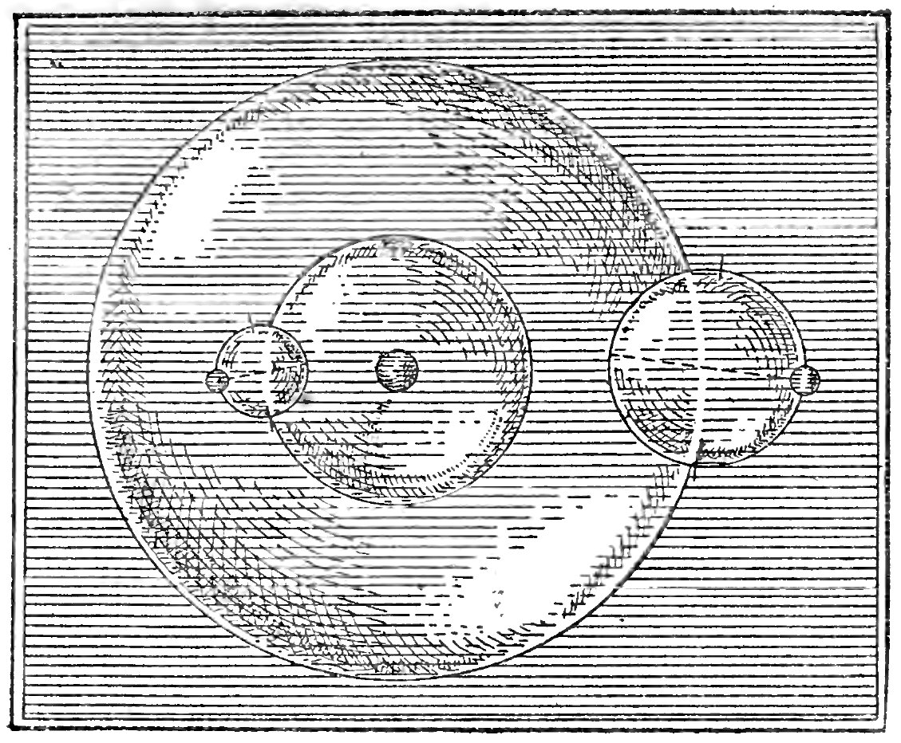

<!-- p. 399 (411) -->

**Fig. I. (on this page).** *Plan of concentric spheres, shewing Earth enclosed in the sphere (bearing the epicycle) of the Moon, and these again enclosed in the sphere (bearing the epicycle) of Mercury. The scale approximately conforms to the estimated magnitudes as given by Alfraganus (fl. early 9th cent.* A.D.; *translated into Latin mid 12th cent.): but for simplicity the magnitudes of the epicycles have been exaggerated by the amounts (notable in the case of the Moon) of the eccentricities, so as to include all the magnitudes which affect the maximum and minimum distances of the heavenly bodies from the earth.*

*The bulks of Earth, Moon, and Mercury are arbitrarily exaggerated, the scale being too small to shew them in proportion to each other or to the spheres. Their diameters should be (very roughly) as* 18 *(Earth),* 6 *(Moon), and* 1 *(Mercury).*
