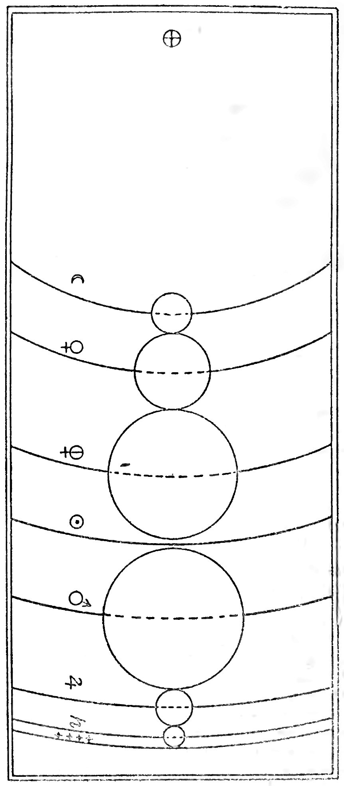

<!-- p. 399 (411) -->

**Fig. II. (over page).** *Section of a portion of the eight revolving heavens that bear the Moon* (☾), *Mercury* (☿), *Venus* (♀), *the Sun* (☉), *Mars* (♂), *Jupiter* (♃), *Saturn* (♄), *and the fixed stars* (* * * *); *all except* ☉ *and* * * * * *carrying epicycles. The diameters of the spheres and the epicycles* (cf. *explanation of Fig. I.) are represented approximately on the scale of the* logarithms *of their dimensions, as estimated by Alfraganus.*

*The centres of all the epicycles are represented in the figure as being in the same longitude as the Sun. This was supposed always to be the case with respect to the epicycles of Mercury and Venus; but the centres of the other epicycles assumed every position from that of opposition to that of conjunction in the course of their periodic movements. Note that the maximum distance of one heavenly body coincides with the minimum distance of the next (the variation in the Sun’s distance being due to eccentricity alone).*

<!-- p. 400 (412) -->

*The sphere of the Primum Mobile, and the Empyrean, are not represented.*

