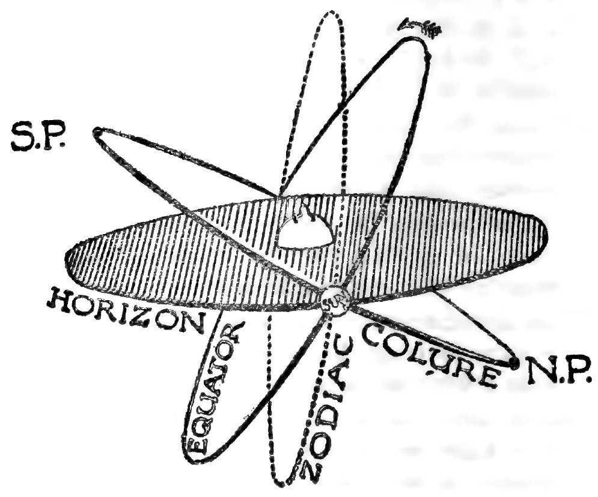

# Canto I

<!-- p. 2 (012) -->

## Argument

SUBJECT matter (1-12) and invocation (13-36). The sun is in the equinoctial point. It is midday at Purgatory and midnight at Jerusalem, when Dante sees Beatrice gazing at the sun and instinctively imitates her gesture, looking away from her and straight at the sun (37-54). The light glows as though God had made a second sun, and Dante now turns once more to Beatrice who is gazing heavenward. As he looks his human nature is transmuted to the quality of heaven and he knows not whether he is still in the flesh or no (55-75). They pass through the sphere of fire and hear the harmonies of heaven, but Dante is

<!-- p. 3 (013) -->

bewildered because he knows not that they have left the earth, and when enlightened by Beatrice he is still perplexed to know how he can rise, counter to gravitation (76-99). Beatrice, pitying the delirium of his earthly mind, explains to him the law of universal (material and spiritual) gravitation. All things seek their true place, and in the orderly movement thereto, and rest therein, consists the likeness of the universe to God. Man’s place is God, and to rise to him is therefore natural to man. It is departing from him that (like fire darting downwards) is the anomaly that needs to be explained (100-142).

<!-- p. 2 (012), text -->

La gloria di colui che tutto move <!-- label: Paradiso Terrestre -->\
&emsp;per l' universo penetra, e risplende\
&emsp;in una parte più, e meno altrove.\
Nel ciel che più della sua luce prende 4\
&emsp;fu' io; e vidi cose che ridire\
&emsp;nè sa nè può qual di lassù discende;\
perchè, appressando sè al suo disire, 7\
&emsp;nostro intelletto si profonda tanto,\
&emsp;che retro la memoria non può ire.\
Veramente quant' io del regno santo 10\
&emsp;nella mia mente potei far tesoro,\
&emsp;sarà ora materia del mio canto.\
O buono Apollo, all' ultimo lavoro 13\
&emsp;fammi del tuo valor sì fatto vaso,\
&emsp;come dimandi a dar l' amato alloro.\
Infino a qui l' un giogo di Parnaso 16\
&emsp;assai mi fu, ma or con ambo e due\
&emsp;m' è uopo entrar nell' aringo rimaso.\
Entra nel petto mio, e spira tue 19\
&emsp;sì come quando Marsia traesti\
&emsp;della vagina delle membra sue.

<!-- p. 3 (013), text -->

The All-mover’s glory penetrates through the universe, and regloweth in one region more, and less in another. <!-- label: The glory of God -->

In that heaven which most receiveth of his light, have I been; and have seen things which whoso descendeth from up there hath nor knowledge nor power to re-tell;

because, as it draweth nigh to its desire, our intellect sinketh so deep, that memory cannot go back upon the track.

Nathless, whatever of the holy realm I had the power to treasure in my memory, shall now be matter of my song.

O good Apollo, for the crowning task, make me a so-fashioned vessel of thy worth, as thou demandest for the grant of thy beloved laurel. <!-- label: The poet’s prayer -->

Up till here one peak of Parnassus hath sufficed me; but now, with both the two, needs must I enter this last wrestling-ground.

Into my bosom enter thou, and so breathe as when thou drewest Marsyas from out what sheathed his limbs.

<!-- p. 4 (014) -->

O divina virtù, se mi ti presti 22 <!-- label: Paradiso Terrestre -->\
&emsp;tanto che l' ombra del beato regno\
&emsp;segnata nel mio capo io manifesti,\
venir vedra' mi al tuo diletto legno, 25\
&emsp;e coronarmi allor di quelle foglie,\
&emsp;che la materia e tu mi farai degno.\
Sì rade volte, padre, se ne coglie, 28\
&emsp;per trionfare o Cesare o poeta,\
&emsp;colpa e vergogna dell' umane voglie,\
che partorir letizia in sulla lieta 31\
&emsp;delfica deità dovria la fronda\
&emsp;Peneia, quando alcun di sè asseta.\
Poca favilla gran fiamma seconda: 34\
&emsp;forse retro da me con miglior voci\
&emsp;si pregherà perchè Cirra risponda.\
Surge ai mortali per diverse foci 37 <!-- label: Salita -->\
&emsp;la lucerna del mondo; ma da quella,\
&emsp;che quattro cerchi giunge con tre croci,\
con miglior corso e con migliore stella 40\
&emsp;esce congiunta, e la mondana cera\
&emsp;più a suo modo tempera e suggella.\
Fatto avea di là mane e di qua sera 43\
&emsp;tal foce quasi, e tutto era là bianco\
&emsp;quello emisperio, e l' altra parte nera,\
quando Beatrice in sul sinistro fianco 46\
&emsp;vidi rivolta, e riguardar nel sole.\
&emsp;Aquila sì non gli s' affisse unquanco.\
E sì come secondo raggio suole 49\
&emsp;uscir del primo, e risalire in suso,\
&emsp;pur come peregrin che tornar vuole;\
così dell' atto suo, per gli occhi infuso 52\
&emsp;nell' imagine mia, il mio si fece,\
&emsp;e fissi gli occhi al sole oltre a nostr' uso.

<!-- p. 5 (015) -->

O divine Virtue, if thou dost so far lend thyself to me, that I make manifest the shadow of the blessed realm imprinted on my brain, <!-- label: Invocation -->

thou shalt see me come to thy chosen tree and crown me, then, with the leaves of which the matter and thou shalt make me worthy.

So few times, Father, is there gathered of it, for triumph or of Caesar or of poet,—fault and shame of human wills,—

that the Peneian frond should bring forth gladness in the joyous Delphic deity, when it sets any athirst for itself.

A mighty flame followeth a tiny spark; perchance, after me, shall prayer with better voices be so offered that Cirrha may respond.

The lantern of the universe riseth unto mortals through divers straits; but from that which joineth four circles in three crosses

he issueth with more propitious course, and united with a more propitious star, and doth temper and stamp the mundane wax more after his own mood.

Almost this strait had made morning on that side and evening on this; and there that hemisphere all was aglow, and the other region darkling; <!-- label: Noonday -->

when I beheld Beatrice turned on her left side and gazing on the sun. Never did eagle so fix himself thereon.

And even as the second ray doth ever issue from the first, and rise back upward, (like as a pilgrim whose will is to return);

so from her gesture, poured through the eyes into my imagination, did mine own take shape; and I fixed mine eyes upon the sun, transcending our wont.

<!-- p. 6 (016) -->

Molto è licito là, che qui non lece 55 <!-- label: Salita -->\
&emsp;alle nostre virtù, mercè del loco\
&emsp;fatto per proprio dell' umana spece.\
Io nol soffersi molto, nè sì poco 58\
&emsp;ch' io nol vedessi sfavillar dintorno,\
&emsp;qual ferro che bogliente esce del foco.\
E di subito parve giorno a giorno 61\
&emsp;essere aggiunto, come quei che puote\
&emsp;avesse il ciel d' un altro sole adorno.\
Beatrice tutta nell' eterne rote 64\
&emsp;fissa con gli occhi stava: ed io in lei\
&emsp;le luci fissi, di lassù remote.\
Nel suo aspetto tal dentro mi fei, 67\
&emsp;qual si fe' Glauco nel gustar dell' erba,\
&emsp;che il fe' consorto in mar degli altri dei.\
Trasumanar significar *per verba* 70\
&emsp;non si poria; però l' esemplo basti\
&emsp;a cui esperienza grazia serba.\
S' io era sol di me quel che creasti 73\
&emsp;novellamente, Amor che il ciel governi,\
&emsp;tu il sai, che col tuo lume mi levasti.\
Quando la rota, che tu sempiterni 76\
&emsp;desiderato, a sè mi fece atteso,\
&emsp;con l' armonia che temperi e discerni,\
parvemi tanto allor del cielo acceso 79\
&emsp;dalla fiamma del sol, che pioggia o fiume\
&emsp;lago non fece mai tanto disteso.\
La novità del suono e il grande lume 82\
&emsp;di lor cagion m' accesero un disio\
&emsp;mai non sentito di cotanto acume.\
Ond' ella, che vedea me, sì com' io, 85\
&emsp;a quietarmi l' animo commosso,\
&emsp;pria ch' io a domandar, la bocca aprio;

<!-- p. 7 (017) -->

Much is granted there which is not granted here to our powers, in virtue of the place made as proper to the human race. <!-- label: Beatrice and Dante -->

I not long endured him, nor yet so little but that I saw him sparkle all around, like iron issuing molten from the furnace.

And, of a sudden, meseemed that day was added unto day, as though he who hath the power, had adorned heaven with a second sun.

Beatrice was standing with her eyes all fixed upon the eternal wheels, and I fixed my sight, removed from there above, on her.

Gazing on her such I became within, as was Glaucus, tasting of the grass that made him the sea-fellow of the other gods. <!-- label: Glaucus -->

To pass beyond humanity may not be told in words, wherefore let the example satisfy him for whom grace reserveth the experience.

If I was only that of me which thou didst new-create, O Love who rulest heaven, thou knowest, who with thy light didst lift me up.

When the wheel which thou, by being longed for, makest eternal, drew unto itself my mind with the harmony which thou dost temper and distinguish, <!-- label: Harmony of the Spheres -->

so much of heaven then seemed to me enkindled with the sun’s flame, that rain nor river ever made a lake so wide distended.

The newness of the sound and the great light kindled in me a longing for their cause, ne’er felt before so keenly.

Whence she who saw me even as I saw myself, to still my agitated mind, opened her lips, e’er I mine to ask;

<!-- p. 8 (018) -->

e cominciò: “Tu stesso ti fai grosso 88 <!-- label: Salita -->\
&emsp;col falso imaginar, sì che non vedi\
&emsp;ciò che vedresti, se l'avessi scosso.\
Tu non se' in terra, sì come tu credi; 91\
&emsp;ma folgore, fuggendo il proprio sito,\
&emsp;non corse, come tu ch' ad esso riedi.”\
S' io fui del primo dubbio disvestito 94\
&emsp;per le sorrise parolette brevi,\
&emsp;dentro ad un novo più fui irretito;\
e dissi: “Già contento requievi 97\
&emsp;di grande ammirazion; ma ora ammiro\
&emsp;com' io trascenda questi corpi lievi.”\
Ond' ella, appresso d'un pio sospiro, 100\
&emsp;gli occhi drizzò ver me con quel sembiante\
&emsp;che madre fa sopra figliuol deliro;\
e cominciò: “Le cose tutte e quante 103\
&emsp;hann' ordine tra loro; e questo è forma\
&emsp;che l'universo a Dio fa simigliante.\
Qui veggion l' alte creature l' orma 106\
&emsp;dell' eterno valore, il quale è fine,\
&emsp;al quale è fatta la toccata norma.\
Nell' ordine ch' io dico sono accline 109\
&emsp;tutte nature, per diverse sorti,\
&emsp;più al principio loro e men vicine;\
onde si movono a diversi porti 112\
&emsp;per lo gran mar dell'essere, e ciascuna\
&emsp;con istinto a lei dato che la porti.\
Questi ne porta il foco in ver la luna, 115\
&emsp;questi nei cor mortali è permotore,\
&emsp;questi la terra in sè stringe ed aduna.\
Nè pur le creature, che son fuore 118\
&emsp;d'intelligenza, quest' arco saetta,\
&emsp;ma quelle ch' hanno intelletto ed amore.

<!-- p. 9 (019) -->

and she began: “Thou thyself makest thyself dense with false imagining, and so thou seest not what thou wouldst see, if thou hadst cast it off. <!-- label: Earthly and heavenly law -->

Thou art not upon earth, as thou believest; but lightning, fleeing its proper site, ne’er darted as dost thou who art returning thither.”

If I was stripped of my first perplexity by the brief smile-enwrapped discourse, I was the more enmeshed within another;

and I said: “Content already and at rest from a great marvelling, now am I in amaze how I transcend these lightsome bodies.”

Whereon she, after a sigh of pity, turned her eyes toward me with that look a mother casts on her delirious child;

and began: “All things whatsoever observe a mutual order; and this the form that maketh the universe like unto God. <!-- label: Order the Supreme law -->

Herein the exalted creatures trace the impress of the Eternal Worth, which is the goal whereto was made the norm now spoken of.

In the order of which I speak all things incline, by diverse lots, more near and less unto their principle;

wherefore they move to diverse ports o’er the great sea of being, and each one with instinct given it to bear it on.

This beareth the fire toward the moon; this is the mover in the hearts of things that die; this doth draw the earth together and unite it.

Nor only the creatures that lack intelligence doth this bow shoot, but those that have both intellect and love.

<!-- p. 10 (020) -->

La provvidenza, che cotanto assetta, 121 <!-- label: Salita -->\
&emsp;del suo lume fa il ciel sempre quieto,\
&emsp;nel qual si volge quel ch' ha maggior fretta;\
ed ora lì, com' a sito decreto, 124\
&emsp;cen porta la virtù di quella corda,\
&emsp;che ciò che scocca drizza in segno lieto.\
Ver' è che come forma non s' accorda 127\
&emsp;molte fiate alla intenzion dell' arte,\
&emsp;perch' a risponder la materia è sorda;\
così da questo corso si diparte 130\
&emsp;talor la creatura, ch' ha potere\
&emsp;di piegar, così pinta, in altra parte\
(e sì come veder si può cadere 133\
&emsp;foco di nube), se l' impeto primo\
&emsp;a terra è torto da falso piacere.\
Non dei più ammirar, se bene estimo, 136\
&emsp;lo tuo salir, se non come d' un rivo\
&emsp;se d' alto monte scende giuso ad imo.\
Maraviglia sarebbe in te, se privo 139\
&emsp;d'impedimento giù ti fossi assiso,\
&emsp;come a terra quiete in foco vivo.”\
Quinci rivolse in ver lo cielo il viso. 142

<!-- p. 11 (021) -->

The Providence that doth assort all this, doth with its light make ever still the heaven wherein whirleth that one that hath the greatest speed; <!-- label: Order -->

and thither now, as to the appointed site, the power of that bowstring beareth us which directeth to a joyful mark whatso it doth discharge.

True is it, that as the form often accordeth not with the intention of the art, because that the material is dull to answer; <!-- label: How disturbed -->

so from this course sometimes departeth the creature that hath power, thus thrust, to swerve to-ward some other part,

(even as fire may be seen to dart down from the cloud) if its first rush be wrenched aside to earth by false seeming pleasure.

Thou shouldst no more wonder, if I deem aright, at thine uprising, than at a river dropping down from a lofty mountain to the base.

Marvel were it in thee if, bereft of all impediment, thou hadst settled down below; even as were stillness on the earth in a living flame.” Thereon toward Heaven she turned back her gaze.

## Notes

<!-- p. 10 (020), notes -->

∵ See “Dante’s Paradise” at the close of this volume (p. 410), and the editorial note giving the full titles of the books to which reference is here made (p. 417).

1-3. God, as the unmoved source of movement, is the central conception of the Aristotelian theology. Wallace, 39, 46.

God *penetrates* into the essential nature of a thing, and *is reflected* (“regloweth”), more or less, in its concrete being. *Epist. ad Can. Grand.*, § 23; *Conv.* iii. 14: 29-50.

13\. Apollo=the Sun=God. *Conv.* iii. 12: 52-54, and *passim*.

16\. *One peak.* Hitherto the inspiration of the Muses has sufficed (*cf. Inf.* ii. 7, *Purg.* i. 8), but now the diviner aid of “Apollo” must be invoked as well. It is not easy to trace the origin of Dante’s (erroneous) belief that one peak of Parnassus was sacred to the Muses as distinct from Apollo.

<!-- p. 11 (021), notes -->

19-21. Compare *Purg.* i. 7-12. The underlying motive seems to be an appeal to the deities to proclaim their glory through their willing instrument as zealously as they vindicated their honour against presumptuous rivals. Marsyas was flayed by Apollo for his presumption in challenging him to a contest in playing the pipe. Hence the allusion to the “sheath of his limbs.”

32-33. Daphne, the daughter of Peneus, loved by Apollo, was changed into a laurel.

<!-- p. 12 (022) -->

36\. *Cirrha.* Apollo’s peak of Parnassus.

37-39. The circles of the Equator, the Zodiac and the Equinoctial colure, make each a cross with the circle of the horizon. At the equinox, at sunrise, they all meet the horizon and make their crosses with it at the same spot.

S.P.\
HORIZON\
SUN\
EQUATOR\
ZODIAC\
COLURE\
N.P.

43\. *had made*, viz. when he rose. It was now noonday (44, 45).

49-54. The point of analogy appears to consist simply in the derivative character of Dante’s act.

57\. The Earthly Paradise or Garden of Eden (*Purg.* xxviii. 91-93).

61-63. Owing to their rapid approach to the sun. Compare also *Purg.* xxvii. 89, 90.

64\. *Wheel* or *wheels*, here and throughout the *Paradiso* used for the revolving heavens.

68\. Ovid tells the tale of the fisherman Glaucus tasting the grass that had revivified the fish he had caught, and thereon being seized with yearning for the deep, into which he plunged and became a sea god.

73\. Compare 2 *Corinthians* xii. 2. The Soul is enbreathed by God when the animal body is perfected (*Purg.* xxv. 67-75), and is therefore that part of a man which is to be regarded as a new creation by God, not generated by nature. Compare iii. 87 *note*, and Wallace, 56, *note* 3.

<!-- p. 13 (023) -->

76\. It is by inspiring the universe with love and longing (not by any physical means, for he is immaterial) that God, according to Aristotle, causes the never-ending cosmic movements. Wallace, 39.

79-81. Because they were passing through the “sphere of fire” which girt the “sphere of air” as with a second atmosphere.

82\. The conception that the seven planetary heavens, like the seven strings of a lyre, uttered divine harmonies as they moved, is expressly rejected by Aristotle. This is one of the few instances in which Dante departs from his authority.

90\. *it*, *i.e.* the *false imagining*, the fixed idea which prevented his comprehending what was before his eyes.

92\. *Cf.* xxiii. 41-42.

99\. *air*, which Aristotle regarded as relatively, and *fire* which he regarded as absolutely light.

106\. *exalted creatures*=angels [and men?].

107-114. God is the goal as well as the source of all. The orderly trend of all things to their true places is therefore their guide to God. But all things do not reach God in the same sense and in the same measure.

119\. *Cf.* xxix. 24.

122-3. The Empyrean, which is not spacial at all, does not move and “hath not poles.” It girds with light and love the *primum mobile*, the outmost and swiftest of the material heavens. Compare *Paradiso*, xxii. 67, xxvii. 106-120, xxx. 38-42, 52, &c. Also *Conv.* ii. 4: 13-43.

127-135. ‘As the medium in which an artist works sometimes appears to resist the impulse and direction which he would give it, so beings endowed with freewill (“the creature that hath power . . . to swerve aside”) may resist the impulse towards himself impressed upon them by God, if they allow themselves to be seduced by false delights.’
