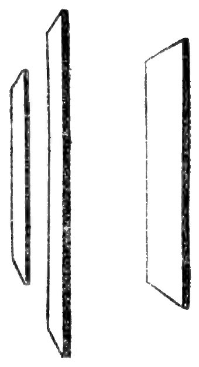

# Canto V

<!-- p. 48 (058) -->

## Argument

BEATRICE, rejoicing in Dante’s progress, explains the supreme gift of Free Will, shared by angels and men and by no other creature (1-24). Hence may be deduced the supreme significance of vows, wherein this Free Will, by its own act, sacrifices itself. Wherefore there can be nothing so august as to form a fitting substitute, nor any use of the once consecrated thing so hallowed as to excuse the breaking of the vow (25-33). And yet Holy Church grants dispensations (34-39). The explanation lies in the distinction between the content of the vow (the specific thing consecrated) and the act of vowing (40-45). The vow must in every case be kept, but he who has made it, may, under due authority, sometimes substitute for the specific content of the vow some other, worth half as much again; which last condition precludes any substitute for

<!-- p. 49 (059) -->

the complete self-dedication of monastic vows (46-63). And he who makes a vow such as God can not sanction, has in that act already done evil; to keep such a vow is only to deepen his guilt; and, kept or broken, it brings his religion into contempt (64-84). Dante’s further questioning is cut short by their ascent to Mercury, which grows brighter at their presence. Here, in the star that scarce asserts itself, but is lost to mortals in the sun’s rays, are the once ambitious souls, that now rejoice in the access of fresh objects of love. They approach Dante, and one of them, with lofty gratulations, offers himself as the vehicle of divine enlightenment. Dante questions him as to his history and the place assigned to him in heaven; whereon the spirit (Justinian) so glows with joy that his outward form is lost in light (85-139).

<!-- p. 48 (058), text -->

“S' io ti fiammeggio nel caldo d' amore <!-- label: Luna -->\
&emsp;di là dal modo che in terra si vede\
&emsp;sì che degli occhi tuoi vinco il valore,\
non ti maravigliar; chè ciò procede 4\
&emsp;da perfetto veder, che come apprende,\
&emsp;così nel bene appreso move il piede.\
Io veggio ben sì come già risplende 7\
&emsp;nello intelletto tuo l' eterna luce,\
&emsp;che, vista sola, sempre amore accende;\
e s' altra cosa vostro amor seduce, 10\
&emsp;non è se non di quella alcun vestigio\
&emsp;mal conosciuto, che quivi traluce.\
Tu vuoi saper, se con altro servigio, 13\
&emsp;per manco voto, si può render tanto,\
&emsp;che l' anima sicuri di litigio.”\
Sì cominciò Beatrice questo canto; 16\
&emsp;e sì com' uom che suo parlar non spezza,\
&emsp;continuò così il processo santo:

<!-- p. 49 (059), text -->

“If I flame on thee in the warmth of love, beyond the measure witnessed upon earth, and so vanquish the power of thine eyes, <!-- label: The inconstant -->

marvel not; for this proceedeth from perfect vision, which, as it apprehendeth, so doth advance its foot in the apprehended good.

Well do I note how in thine intellect already doth reglow the eternal light, which only seen doth ever kindle love;

and if aught else seduce your love, naught is it save some vestige of this light, ill understood, that shineth through therein.

Thou wouldst know whether with other service reckoning may be paid for broken vow, so great as to secure the soul from process.” <!-- label: Broken vows -->

So Beatrice began this chant, and, as one who interrupteth not his speech, continued thus the sacred progress:

<!-- p. 50 (060) -->

“Lo maggior don, che Dio per sua larghezza 19 <!-- label: Luna -->\
&emsp;fesse creando, ed alla sua bontate\
&emsp;più conformato, e quel ch' ei più apprezza,\
fu della volontà la libertate, 22\
&emsp;di che le creature intelligenti,\
&emsp;e tutte e sole furo e son dotate.\
Or ti parrà, se tu quinci argomenti, 25\
&emsp;l' alto valor del voto, s' è sì fatto,\
&emsp;che Dio consenta quando tu consenti;\
chè, nel fermar tra Dio e l' uomo il patto, 28\
&emsp;vittima fassi di questo tesoro,\
&emsp;tal qual io dico, e fassi col suo atto.\
Dunque che render puossi per ristoro? 31\
&emsp;Se credi bene usar quel ch' hai offerto,\
&emsp;di mal tolletto vuoi far buon lavoro.\
Tu se' omai del maggior punto certo; 34\
&emsp;ma, perchè santa Chiesa in ciò dispensa,\
&emsp;che par contra lo ver ch' io t' ho scoperto,\
convienti ancor sedere un poco a mensa, 37\
&emsp;però che il cibo rigido ch' hai preso\
&emsp;richiede ancora aiuto a tua dispensa.\
Apri la mente a quel ch' io ti paleso, 40\
&emsp;e fermalvi entro; chè non fa scienza,\
&emsp;senza lo ritenere, avere inteso.\
Due cose si convengono all' essenza 43\
&emsp;di questo sacrificio: l' una è quella\
&emsp;di che si fa, l' altra è la convenenza.\
Quest' ultima giammai non si cancella, 46\
&emsp;se non servata, ed intorno di lei\
&emsp;sì preciso di sopra si favella;\
però necessità fu agli Ebrei 49\
&emsp;pur l' offerere, ancor che alcuna offerta\
&emsp;si permutasse, come saper dei.

<!-- p. 51 (061) -->

“The greatest gift God of his largess made at the creation, and the most conformed to his own excellence, and which he most prizeth, <!-- label: The inconstant --> <!-- label: Free will -->

was the will’s liberty, wherewith creatures intelligent, both all and only, were and are endowed.

Now will appear to thee (if thence thou draw due inference) the high worth of the vow, if so made that God consent when thou consentest;

for in establishing the compact between God and man, the victim is made from out this treasure, such as I pronounce it, and made by its own act. <!-- label: and vows -->

What may be rendered, then, as restoration? If thou think to make good use of that which thou hadst consecrated, thou wouldst do good works from evil gains.

Thou art now assured as to the greater point; but since holy Church granteth herein dispensations, which seemeth counter to the truth I have unfolded to thee,

it behoves thee still to sit a while at table, because the stubborn food which thou hast taken demandeth further aid for thy digestion.

Open thy mind to that which I unfold to thee, and fix it there within; for to have understood without retaining maketh not knowledge.

Two things pertain to the essence of this sacrifice: first, that whereof it is composed, and then the compact’s self.

This last can ne’er be cancelled save by being kept; and concerning this it is that the discourse above is so precise;

therefore it was imperative upon the Hebrews to offer sacrifice in any case, though the thing offered might sometimes be changed, as thou shouldst know. <!-- label: Dispensations -->

<!-- p. 52 (062) -->

L' altra, che per materia t' è aperta, 52 <!-- label: Luna -->\
&emsp;puote bene esser tal, che non si falla,\
&emsp;se con altra materia si converta.\
Ma non trasmuti carco alla sua spalla 55\
&emsp;per suo arbitrio alcun, senza la volta\
&emsp;e della chiave bianca e della gialla;\
ed ogni permutanza creda stolta, 58\
&emsp;se la cosa dimessa in la sorpresa,\
&emsp;come il quattro nel sei, non è raccolta.\
Però qualunque cosa tanto pesa 61\
&emsp;per suo valor, che tragga ogni bilancia,\
&emsp;satisfar non si può con altra spesa.\
Non prendan li mortali il voto a ciancia: 64\
&emsp;siate fedeli, ed a ciò far non bieci;\
&emsp;come Jeptè alla sua prima mancia,\
cui più si convenia dicer: *Mal feci*, 67\
&emsp;che, servando, far peggio; e così stolto\
&emsp;ritrovar puoi lo gran duca dei Greci,\
onde pianse Ifigenia il suo bel volto, 70\
&emsp;e fe' pianger di sè li folli e i savi,\
&emsp;ch'udir parlar di così fatto colto.\
Siate, Cristiani, a movervi più gravi, 73\
&emsp;non siate come penna ad ogni vento,\
&emsp;e non crediate ch' ogni acqua vi lavi.\
Avete il vecchio e il nuovo testamento, 76\
&emsp;e il pastor della Chiesa che vi guida:\
&emsp;questo vi basti a vostro salvamento.\
Se mala cupidigia altro vi grida, 79\
&emsp;uomini siate, e non pecore matte,\
&emsp;sì che il Giudeo di voi tra voi non rida.\
Non fate come agnel che lascia il latte 82\
&emsp;della sua madre, e semplice e lascivo\
&emsp;seco medesmo a suo piacer combatte.”

<!-- p. 53 (063) -->

The other thing, which hath been unfolded to thee as the matter, may in sooth be such that there is no offence if it be interchanged with other matter. <!-- label: The inconstant -->

But let none shift the load upon his shoulder at his own judgment, without the turn both of the white and of the yellow key;

and let him hold all changing to be folly, unless the thing remitted be contained in that assumed in four to six proportion.

Wherefore what thing soe’er weigheth so heavy in virtue of its worth as to turn every scale, can never be made good by any other outlay.

Let mortals never take the vow in sport; be loyal, and in doing this not squint-eyed; like as was Jephthah in his firstling vow; <!-- label: Evil vows -->

whom it had more become to say: *I did amiss*, than keep it and do worse; and in like folly mayst thou track the great chief of the Greeks,

wherefore Iphigenia wept that her face was fair, and made simple and sage to weep for her, hearing of such a rite.

Ye Christians, be more sedate in moving, not like a feather unto every wind; nor think that every water cleanseth you.

Ye have the Old and the New Testament and the shepherd of the Church to guide you; let this suffice you, unto your salvation.

If sorry greed proclaim aught else to you, be men, not senseless sheep, lest the Jew in your midst should scoff at you. <!-- label: And evil pardoners -->

Do not ye as the lamb who leaves his mother’s milk, silly and wanton, fighting with himself for his disport.”

<!-- p. 54 (064) -->

Così Beatrice a me, com' io scrivo; 85 <!-- label: Salita -->\
&emsp;poi si rivolse tutta disiante\
&emsp;a quella parte ove il mondo è più vivo.\
Lo suo tacere e il trasmutar sembiante 88\
&emsp;poser silenzio al mio cupido ingegno,\
&emsp;che già nuove questioni avea davante.\
E sì come saetta, che nel segno 91\
&emsp;percote pria che sia la corda queta,\
&emsp;così corremmo nel secondo regno.\
Quivi la donna mia vid' io sì lieta, 94 <!-- label: Mercurio -->\
&emsp;come nel lume di quel ciel si mise,\
&emsp;che più lucente se ne fe' il pianeta.\
E se la stella si cambiò e rise, 97\
&emsp;qual mi fec' io, che pur di mia natura\
&emsp;trasmutabile son per tutte guise!\
Come in peschiera, ch' è tranquilla e pura, 100\
&emsp;traggonsi i pesci a ciò che vien di fuori\
&emsp;per modo che lo stimin lor pastura;\
sì vid' io ben più di mille splendori 103\
&emsp;trarsi ver noi, ed in ciascun s' udia:\
&emsp;*Ecco chi crescerà li nostri amori.*\
E sì come ciascuno a noi venia, 106\
&emsp;vedeasi l' ombra piena di letizia\
&emsp;nel fulgor chiaro che da lei uscia.\
Pensa, lettor, se quel che qui s' inizia 109\
&emsp;non procedesse, come tu avresti\
&emsp;di più sapere angosciosa carizia;\
e per te vederai, come da questi 112\
&emsp;m' era in disio d' udir lor condizioni,\
&emsp;sì come agli occhi mi fur manifesti.\
“O bene nato, a cui veder li Troni 115\
&emsp;del trionfo eternal concede grazia,\
&emsp;prima che la milizia s' abbandoni,

<!-- p. 55 (065) -->

Thus Beatrice to me, as I write; then turned her all in longing to that part where the world quickeneth most. <!-- label: The honour-seeking -->

Her ceasing and her transmuted semblance enjoined silence on my eager wit, which already had new questionings before it.

And even as an arrow which smiteth the targe ere the cord be still, so fled we to the second realm.

There I beheld my Lady so glad, when to the light of this heaven she committed her, that the planet’s self became the brighter for it.

And if the star was changed and laughed, what then did I, who of my very nature am subjected unto change through every guise!

As in a fish-pool still and clear, the fishes draw to aught that so droppeth from without as to make them deem it somewhat they may feed on, <!-- label: Approach of spirits -->

so did I see more than a thousand splendours draw towards us, and in each one was heard: *Lo! one who shall increase our loves.*

And as each one came up to us, the shade appeared full filled with joy, by the bright glow that issued forth of it.

Think, reader, if what I now begin proceeded not, how thou would’st feel an anguished dearth of knowing more,

and by thyself thou shalt perceive how it was in my longing to hear from these concerning their estate, soon as they were revealed unto my eyes.

“O happy-born, to whom grace concedeth to look upon the Thrones of the eternal triumph ere thou abandonest thy time of warfare, <!-- label: Justinian -->

<!-- p. 56 (066) -->

del lume che per tutto il ciel si spazia 118 <!-- label: Mercurio -->\
&emsp;noi semo accesi: e però, se disii\
&emsp;di noi chiarirti, a tuo piacer ti sazia.”\
Così da un di quelli spirti pii 121\
&emsp;detto mi fu; e da Beatrice: “Di', di',\
&emsp;sicuramente, e credi come a dii.”\
“Io veggio ben sì come tu t' annidi 124\
&emsp;nel proprio lume, e che dagli occhi il traggi,\
&emsp;perch' ei corruscan, sì come tu ridi;\
ma non so chi tu sei, nè perchè aggi, 127\
&emsp;anima degna, il grado della spera,\
&emsp;che si vela ai mortal con altrui raggi.”\
Questo diss' io diritto alla lumiera 130\
&emsp;che pria m' avea parlato, ond' ella fessi\
&emsp;lucente più assai di quel ch' ell' era.\
Sì come il sol, che si cela egli stessi 133\
&emsp;per troppa luce, come il caldo ha rose\
&emsp;le temperanze dei vapori spessi;\
per più letizia sì mi si nascose 136\
&emsp;dentro al suo raggio la figura santa,\
&emsp;e così chiusa chiusa mi rispose\
nel modo che il seguente canto canta. 139

<!-- p. 57 (067) -->

by the light that rangeth through all heaven are we enkindled; and therefore if thou desire to draw light from us, sate thee at thine own will.” <!-- label: The honour-seeking -->

Thus by one of those devout spirits was said to me, and by Beatrice: “Speak, speak securely, and believe as thou would’st deities.”

“Verily, I see how thou dost nestle in thine own light, and that thou dost draw it through thine eyes, because they sparkle as thou smilest; <!-- label: Dante -->

but I know nor who thou art, nor why, O worthy soul, thou art graded in this sphere, which veileth it to mortals in another’s rays.”

This I said, turned towards the light which first had spoken to me; whereat it glowed far brighter yet than what it was before.

Like as the sun which hideth him by excess of light when the heat hath gnawed away the tempering of the thick vapours,

so by access of joy the sacred figure hid him in his own rays, and thus enclosed, enclosed, answered me in such fashion as chanteth the following chant.

## Notes

<!-- p. 56 (066), notes -->

23-4. Angels and men.

26-7. Compare iii. 101-2.

32, 33. ‘To apply to some *other* good purpose what has been vowed, would only be like giving the proceeds of oppression or plunder in charity.’

34\. See lines 13-15.

51\. Regulations as to substitution or “redemption” are found in *Exodus* xiii. 13, xxxiv. 20, and *Numbers* xviii. 15-18. But the subject is most fully treated in the last chapter of *Leviticus*.

57\. In popular estimate, ‘the silver key of knowledge and the golden key of authority.’ But Aquinas says more accurately: “for either of these [*i.e.* to decide that the penitent is fit to be absolved, and actually to absolve him] a certain power or authority is needed; and so we distinguish between two keys, one pertaining to the judgment as to the fitness of him to be absolved, the other pertaining to the absolution itself.” Compare *Purg.* ix. 118-126.

<!-- p. 57 (067), notes -->

66-72. Both Jephthah (*Judges* xi.) and Agamemnon sacrificed their daughters.

79-84. ‘If ignorant and unauthorised ‘pardoners’ and others tempt you to light-hearted vows and offer you easy terms of remission, do not be so senseless as to be misled by them. The blessing of the Christian dispensation is turned into a curse by such as do the like, and the very Jews have a right to make a mock of them.’ Compare xxix. 118-126.

<!-- p. 58 (068) -->

87\. The Equator is the swiftest part of the heaven (*Conv.* ii. 4: 52-62.) The equinoctial point is the germinal point of the Universe (*Parad.* x. 1-21). The sun is the source of all mortal life (*Parad.* xxii. 116). Dante’s words may apply to any of the three; but since, at the date of the Vision, the sun is at the equinoctial point, they all coincide.

*Fig. to*

<!-- p. 59 (069) -->

105\. *Cf. Purg.* xv. 55-57, 71 *sqq.*

115\. Compare viii. 34-39, *note*; and ix. 61 *note.*

117\. The church on earth is *militant*; only in heaven *triumphant.*

124-126. The last reference to the features of a blessed spirit, as discerned by Dante, in any of the revolving spheres.

129\. Mercury is so near the sun as to be seldom visible.

*Canto II*
