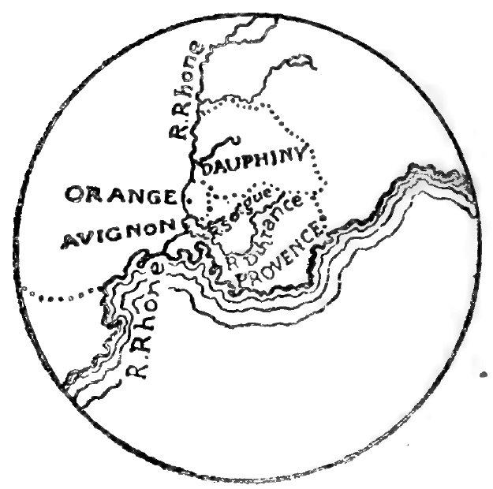
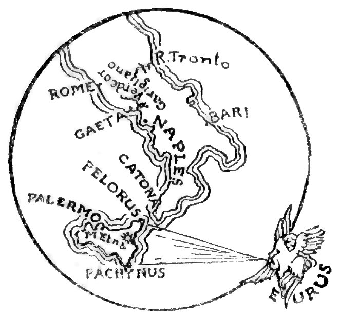

# Canto VII

<!-- p. 76 (086) -->

## Argument

IN significant connection with the Empire comes the treatment of the Redemption, the chief theological discourse in the Paradiso. Justinian and the other spirits vanish with hymns of triumph (1-9). Dante would fain ask a question, but when he raises his head to speak, he is overcome by awe, and bends it down again (10-15). Beatrice reads his thought, and bids him give good heed to her discourse (16-24). After man’s fall, the Word of God united to himself in his own person the once pure now contaminated human nature. That human Nature bore on the cross the just penalty of its sin, but that divine Person suffered by the same act the supremest outrage. At the act of justice God rejoiced and heaven opened. At the outrage the Jews exulted and the earth trembled; and vengeance fell upon Jerusalem (25-51). But why this method of redemption? (52-57). Only those who love can understand the answer. God’s love ungrudgingly reveals itself, and whatever it creates without intermediary is immortal, free, and god-like. Such was man till made unlike God by sin, and so disfranchised (58-81),

<!-- p. 77 (087) -->

only to be reinstated by a free pardon, or by full atonement (82-93). But man cannot humble himself below what he is entitled to, as much as he had striven to exalt himself above it; and therefore he cannot make atonement (94-102). So God must reinstate man; and since “all the ways of the Lord are mercy and truth,” God proceeded both by the way of mercy, and by the way of truth or justice, since by the incarnation man was made capable of reinstating himself (103-120). Beatrice further explains that the elements and their compounds are made not direct by God, but by angels, who also draw the life of animal and plant out of compound matter that has the potentiality of such life in it; whereas first matter, the angels, and the heavens are direct creations of God; and so were the bodies of Adam and Eve, which were therefore immortal, save for sin; as are therefore the bodies of the redeemed who are restored to all the privileges of unfallen man (121-148).

<!-- p. 76 (086), text -->

“*Osanna sanctus Deus Sabaoth,* <!-- label: Mercurio -->\
&emsp;*superillustrans claritate tua*\
&emsp;*felices ignes horum malachoth!*”\
Così, volgendosi alla nota sua, 4\
&emsp;fu viso a me cantare essa sustanza,\
&emsp;sopra la qual doppio lume s' addua:\
ed essa e l' altre mossero a sua danza, 7\
&emsp;e, quasi velocissime faville,\
&emsp;mi si velar di subita distanza.\
Io dubitava, e dicea: “Dille, dille,” 10\
&emsp;fra me, “dille,” diceva, “alla mia donna\
&emsp;che mi disseta con le dolci stille;”

<!-- p. 77 (087), text -->

“Hosannah! Holy God of Sabaoth! making lustrous by thy brightness from above the blessed fires of these kingdoms!” <!-- label: The honour-seeking -->

So, revolving to its own note, I saw that being sing, on whom the twin lights double one another:

and it and the others entered on their dance, and like most rapid sparks, veiled them from me by sudden distance.

I, hesitating, said, “speak to her, speak to her,” within myself, “speak to her,” I said, “to my lady who slaketh my thirst with the sweet drops;”

<!-- p. 78 (088) -->

ma quella riverenza che s' indonna 13 <!-- label: Mercurio -->\
&emsp;di tutto me, pur per BE e per ICE,\
&emsp;mi richinava come l'uom ch' assonna.\
Poco sofferse me cotal Beatrice, 16\
&emsp;e cominciò, raggiandomi d' un riso\
&emsp;tal, che nel foco faria l'uom felice:\
“Secondo mio infallibile avviso, 19\
&emsp;come giusta vendetta giustamente\
&emsp;vengiata fosse, t' ha in pensier miso;\
ma io ti solverò tosto la mente: 22\
&emsp;e tu ascolta, chè le mie parole\
&emsp;di gran sentenza ti faran presente.\
Per non soffrire alla virtù che vuole 25\
&emsp;freno a suo prode, quell' uom che non nacque,\
&emsp;dannando sè, dannò tutta sua prole;\
onde l' umana specie inferma giacque 28\
&emsp;giù per secoli molti in grande errore,\
&emsp;fin ch' al Verbo di Dio di scender piacque,\
u' la natura, che dal suo Fattore 31\
&emsp;s' era allungata, unio a sè in persona\
&emsp;con l' atto sol del suo eterno amore.\
Or drizza il viso a quel ch' or si ragiona: 34\
&emsp;Questa natura al suo Fattore unita,\
&emsp;qual fu creata, fu sincera e buona;\
ma per sè stessa fu ella sbandita 37\
&emsp;di Paradiso, però che si torse\
&emsp;da via di verità e da sua vita.\
La pena dunque che la croce porse, 40\
&emsp;s' alla natura assunta si misura,\
&emsp;nulla giammai sì giustamente morse;\
e così nulla fu di tanta ingiura, 43\
&emsp;guardando alla persona che sofferse,\
&emsp;in che era contratta tal natura.

<!-- p. 79 (089) -->

but that reverence which all o’ermastereth me, though but by Be or Ice, again down-bowed me, as a man who slumbers. <!-- label: The honour-seeking -->

Short time Beatrice left me thus; and began, casting the ray upon me of a smile such as would make one blessed though in the flame:

“According to my thought that cannot err, how just vengeance justly was avenged, hath set thee pondering;

but I will speedily release thy mind; and do thou hearken, for my words shall make thee gift of an august pronouncement.

Because he not endured for his own good a rein upon the power that wills, that man who ne’er was born, as he condemned himself, condemned his total offspring; <!-- label: The fall -->

wherefore the human race lay sick down there for many an age, in great error, till it pleased the Word of God to descend

where he joined that nature which had gone astray from its Creator to himself, in person, by sole act of his eternal Love.

Now turn thy sight to what I now discourse: This nature, so united to its Maker, as it was when created was unalloyed and good;

but by its own self had it been exiled from Paradise, because it swerved from the way of truth, and from its proper life.

As for the penalty, then, inflicted by the cross,—if it be measured by the Nature taken on, never did any other bite as justly; <!-- label: The crucifixion -->

and, in like manner, ne’er was any so outrageous if we look to the Person who endured it, in whom this nature was contracted.

<!-- p. 80 (090) -->

Però d' un atto uscir cose diverse; 46 <!-- label: Mercurio -->\
&emsp;chè a Dio ed ai Giudei piacque una morte:\
&emsp;per lei tremò la terra e il ciel s' aperse.\
Non ti dee oramai parer più forte, 49\
&emsp;quando si dice che giusta vendetta\
&emsp;poscia vengiata fu da giusta corte.\
Ma io veggi' or la tua mente ristretta 52\
&emsp;di pensier in pensier dentro ad un nodo,\
&emsp;del qual con gran disio solver s' aspetta.\
Tu dici: ‘Ben discerno ciò ch' i' odo; 55\
&emsp;ma, perchè Dio volesse, m' è occulto,\
&emsp;a nostra redenzion pur questo modo.’\
Questo decreto, frate, sta sepulto 58\
&emsp;agli occhi di ciascuno, il cui ingegno\
&emsp;nella fiamma d' amor non è adulto.\
Veramente, però ch' a questo segno 61\
&emsp;molto si mira, e poco si discerne,\
&emsp;dirò perchè tal modo fu più degno.\
La divina bontà, che da sè sperne 64\
&emsp;ogni livore, ardendo in sè scintilla\
&emsp;sì, che dispiega le bellezze eterne.\
Ciò che da lei senza mezzo distilla 67\
&emsp;non ha poi fine, perchè non si move\
&emsp;la sua imprenta, quand' ella sigilla.\
Ciò che da essa senza mezzo piove 70\
&emsp;libero è tutto, perchè non soggiace\
&emsp;alla virtute delle cose nuove.\
Più l' è conforme, e però più le piace; 73\
&emsp;chè l' ardor santo, ch' ogni cosa raggia,\
&emsp;nella più simigliante è più vivace.\
Di tutte queste cose s' avvantaggia 76\
&emsp;l' umana creatura, e, s' una manca,\
&emsp;di sua nobilità convien che caggia.

<!-- p. 81 (091) -->

So from one act issued effects apart; God and the Jews rejoiced in one same death; thereat shuddered the earth and heaven opened. <!-- label: The honour-seeking -->

No more, now, should it seem hard saying to thee that just vengeance was afterward avenged by a just court.

But now I see thy mind from thought to thought entangled in a knot, from which, with great desire, it release awaiteth.

Thou sayest, *Yea, what I hear I understand; but why God willed for our redemption this only mode, is hidden from me.* <!-- label: The redemption -->

This decree, my brother, is buried from the eyes of everyone whose wit is not matured within love’s flame.

But since this target much is aimed at, and discerned but little, I will declare why such mode was more worthy.

The divine excellence, which spurns all envy from it, burning within itself shooteth such sparkles out as to display the eternal beauties.

That which distilleth from it without mean, thereafter hath no end; because its imprint may not be removed when it hath stamped the seal. <!-- label: Unfallen man -->

That which down raineth from it without mean, is all free, because not subject to the power of changing things.

It is more close conformed to it, therefore more pleasing to it; for the sacred glow that rayeth over everything, in that most like itself is the most living.

All these points of vantage hath the human creature, and should one fail, needs must it fall from its nobility.

<!-- p. 82 (092) -->

Solo il peccato è quel che la disfranca, 79 <!-- label: Mercurio -->\
&emsp;e falla dissimile al sommo bene,\
&emsp;per che del lume suo poco s' imbianca;\
ed in sua dignità mai non riviene, 82\
&emsp;se non riempie dove colpa vota,\
&emsp;contra mal dilettar, con giuste pene.\
Vostra natura, quando peccò tota 85\
&emsp;nel seme suo, da queste dignitadi,\
&emsp;come da Paradiso fu remota;\
nè ricovrar poteansi, se tu badi 88\
&emsp;ben sottilmente, per alcuna via,\
&emsp;senza passar per l' un di questi guadi:\
o che Dio, solo per sua cortesia, 91\
&emsp;dimesso avesse, o che l' uom per sè isso\
&emsp;avesse satisfatto a sua follia.\
Ficca mo l' occhio per entro l' abisso 94\
&emsp;dell'eterno consiglio, quanto puoi\
&emsp;al mio parlar distrettamente fisso.\
Non potea l' uomo nei termini suoi 97\
&emsp;mai satisfar, per non poter ir giuso\
&emsp;con umiltate, ubbidiendo poi,\
quanto disubbidiendo intese ir suso; 100\
&emsp;e questa è la cagion perchè l' uom fue\
&emsp;da poter satisfar per sè dischiuso.\
Dunque a Dio convenia con le vie sue 103\
&emsp;riparar l' uomo a sua intera vita,\
&emsp;dico con l' una, o ver con ambo e due.\
Ma perchè l' opra è tanto più gradita 106\
&emsp;dell' operante, quanto più appresenta\
&emsp;della bontà del core ond' è uscita;\
la divina bontà, che il mondo imprenta, 109\
&emsp;di proceder per tutte le sue vie\
&emsp;a rilevarvi suso fu contenta;

<!-- p. 83 (093) -->

Sin only is the thing that doth disfranchise it, and maketh it unlike to the highest good, so that its light the less doth brighten it; <!-- label: The honour-seeking -->

and to its dignity it ne’er may come again, except it fill again where fault hath made a void, against the ill delight setting just penalty.

Your nature, when it sinned in its totality in its first seed, from these dignities, even as from Paradise, was parted; <!-- label: Paradise Lost -->

nor might they be recovered, if thou look right keenly, by any way save passing one or the other of these fords:

either that God, of his sole courtesy, should have remitted; or that man should of himself have given satisfaction for his folly.

Fix now thine eye within the abyss of the eternal counsel, as close attached as e’er thou mayest to my discourse.

Man had not power, within his own boundaries, ever to render satisfaction; since he might not go in humbleness by after-obedience so deep down

as in disobedience he had framed to exalt himself on high; and this the cause why from the power to render satisfaction by himself man was shut off.

Wherefore needs must God with his own ways reinstate man in his unmaimed life, I mean with one way or with both the two. <!-- label: Justice and mercy -->

But because the doer’s deed is the more gracious the more it doth present us of the heart’s goodness whence it issued,

the divine Goodness which doth stamp the world, deigned to proceed on all his ways to lift you up again;

<!-- p. 84 (094) -->

nè tra l' ultima notte e il primo die 112 <!-- label: Mercurio -->\
&emsp;sì alto e sì magnifico processo,\
&emsp;o per l' una o per l' altra fu o fie:\
chè più largo fu Dio a dar sè stesso, 115\
&emsp;a far l' uom sufficiente a rilevarsi,\
&emsp;che s'egli avesse sol da sè dimesso;\
e tutti gli altri modi erano scarsi 118\
&emsp;alla giustizia, se il Figliuol di Dio\
&emsp;non fosse umiliato ad incarnarsi.\
Or, per empierti bene ogni disio, 121\
&emsp;ritorno a dichiarare in alcun loco,\
&emsp;perchè tu veggi lì così com' io.\
Tu dici: ‘Io veggio l' acqua, io veggio il foco, 124\
&emsp;l' aer e la terra, e tutte lor misture\
&emsp;venire a corruzione, e durar poco’;\
e queste cose pur fur creature; 127\
&emsp;per che, se ciò ch' ho detto è stato vero,\
&emsp;esser dovrien da corruzion sicure.\
Gli angeli, frate, e il paese sincero 130\
&emsp;nel qual tu sei, dir si posson creati,\
&emsp;sì come sono, in loro essere intero;\
ma gli elementi che tu hai nomati 133\
&emsp;e quelle cose che di lor si fanno,\
&emsp;da creata virtù sono informati.\
Creata fu la materia ch' egli hanno, 136\
&emsp;creata fu la virtù informante\
&emsp;in queste stelle, che intorno a lor vanno.\
L' anima d' ogni bruto e delle piante 139\
&emsp;di complession potenziata tira\
&emsp;lo raggio e il moto delle luci sante.\
Ma vostra vita senza mezzo spira 142\
&emsp;la somma beninanza, e la innamora\
&emsp;di sè, sì che poi sempre la disira.

<!-- p. 85 (095) -->

nor between the last night and the first day was, nor shall be, so lofty and august a progress made on one or on the other; <!-- label: The honour-seeking -->

for more generous was God in giving of himself to make man able to uplift himself again, than had he only of himself granted remission;

and all other modes fell short of justice, except the Son of God had humbled him to become flesh. <!-- label: The incarnation -->

Now, to fill full for thee every desire, I go back to explain a certain passage, that thou may’st there discern e’en as do I.

Thou sayest: *I see the water, I see the fire, the air, the earth, and all their combinations meet their dissolution and endure but little*;

and yet these things were creatures, so that if that which I have said to thee be true, they ought to be secure against corruption.

The Angels, brother, and the unsullied country in which thou art, may be declared to be created, even as they are, in their entire being; <!-- label: Creation -->

but the elements which thou hast named and all the things compounded of them, have by created virtue been informed.

Created was the matter which they hold, created was the informing virtue in these stars which sweep around them.

The life of every brute and of the plants is drawn from compounds having potency, by the ray and movement of the sacred lights.

But your life is breathed without mean by the supreme beneficence who maketh it enamoured of itself, so that thereafter it doth ever long for it. <!-- label: Resurrection of the body -->

<!-- p. 86 (096) -->

E quinci puoi argomentare ancora 145 <!-- label: Mercurio -->\
&emsp;vostra resurrezion, se tu ripensi\
&emsp;come l'umana carne fessi allora\
che li primi parenti intrambo fensi.” 148

<!-- p. 87 (097) -->

And hence thou further may’st infer your resurrection, if thou think again how was the making of the human flesh then when the first parents both of them were formed.” <!-- label: The honour-seeking -->

## Notes

<!-- p. 86 (096), notes -->

5, 6. Justinian, on whom the glory of Lawgiver and the glory of Emperor combine their lights, each one making the other its twin.

14\. He is awed by anything that is so much as a fragment of Beatrice’s name.

15\. Compare iii. 6.

19-21. See vi. 91-93.

25\. Compare xxvi. 115-117, *note*.

30-33. Note the reference to the Three Persons of the Trinity in *Word, Creator, Love*. The like references abound throughout the poem. Further, compare line 31 with xxxiii. 4-9.

40-42. Compare *De Monarchia*, ii. 13. This doctrine of Dante’s that human nature, in its totality, was *judicially executed* on the Cross seems to be peculiar to himself.

64-66. The connection is close, though not obvious. Beatrice goes back to the creation in order to explain the state from which man fell; and begins by declaring that the Divine Goodness was moved to utter itself in creation by an impulse of love, and had no jealous reserve in communicating its own august attributes. Compare xxix. 13-18, *note*.

67\. For the distinction between mediate and immediate creation, see lines 130-144 of this canto.

71\. True freedom consists in being subject only to the eternal truth of things, not to the dominion of changing appearances. Compare *Purg.* xvi. 79-81. But there is a difficulty here, for amongst the primal group of direct creations are the material heavens and the *prima materia*, or undifferentiated material potentiality, which is the possibility of everything but the actuality of nothing. Compare xxix. 22-36. The heavens can only be called free in the sense that they follow out their nature unimpeded, not in the higher sense of having free choice. Compare v. 19-24. And the *prima materia* can scarcely claim freedom in any sense, nor exemption from the dominion of changing things. Still less has it any special conformity of nature to the Divine (line 73). No solution of this difficulty suggests itself. It would appear as though Dante had not the full range of “direct creations” under his view at the moment, and was thinking only of angels and men, and possibly the material heavens.

<!-- p. 87 (097), notes -->

79-120. It is in this section of the discourse that the influence (direct or indirect) of Anselm’s *Cur Deus homo* is most conspicuous. Anselm teaches that actually (though not in intention) Adam’s disobedience was an injury to himself, not at all to God (*cf.* line 80 of this canto), and that what was demanded, therefore, was not a propitiation or a ransom, but a restoration (*cf.* 82); which must be brought about by man giving what he did not owe in measure equal to that in which he had seized what he did not own (compare 83, 84), which is impossible, since he owes everything and owns nothing (compare 97, 98). Hence the being who alone owns that which he does not owe must become the being who alone stands in need of making such an unowed offering, *i.e.* God must become man (compare 115-117). See the *Cur Deus homo* passim, and (to avoid misconception) especially Bk. i. cap. 15.

103-105. Compare *Psalm* xxv. 10.

115-120. It will appear from a comparison of the *De Monarchia*, ii. 13, that Beatrice means ‘God determined to be merciful, but did better than remit the fault, for he made man capable of redeeming it. And he determined to be just, and therefore he assumed the whole of human nature into one person (his own) in order that it might collectively pay the penalty of its sin.’

124-129. See lines 67-69. ‘Why, then, do these creations of God (the elements and things compounded of them) perish?’

132\. Not only in their essential or ideal quality, but in their whole concrete being, just as they are. Compare i. 2, *note*.

<!-- p. 88 (098) -->

133-141. The *prima materia* is *informed* (*i.e.* so combined with a “form” or ideal and essential principle as to pass from the possibility of being *anything* to the actuality of being *something*) not direct by God, but by created powers, *i.e.* angels or heavenly influences. The transforming and vivifying power of the sun (and in lesser degree the moon) was supposed to have its analogies in equally real but less obvious influences of the other heavenly bodies, especially the planets. It is these heavenly influences collectively that draw the “soul” or *life* of plant (nutritive and reproductive) or animal (sensitive and locomotive) from the stage of potentiality in the germinal material into that of actuality in the living thing itself.

R.Rhone\
DAUPHINY\
ORANGE\
AVIGNON\
R. Sorgue\
R. Durance\
PROVENCE\
R.Rhone

*To Canto VIII.* 58-60.

<!-- p. 89 (099) -->

142-144. Compare *Purg.* xxv., especially lines 61-75. In *Conv.* iii. 6: 45-57, another and less orthodox doctrine seems to be taught.

145\. *Hence*, *i.e.* ‘from the distinctions now drawn’; for the bodies both of Adam and Eve were made immediately by God, and when the work of redemption is finally consummated (after the last judgment) man’s body will be restored to the dignity which it lost only by sin. The argument is Anselm’s. He meets the obvious objection that it does not cover the case of the “resurrection unto wrath,” by urging that if the saved rejoice both in body and soul, it is but fitting that the lost should suffer in both.

R.Tronto\
R.Verde or\
Garigliano\
ROME\
BARI\
GAETA\
NAPLES\
PELORUS\
CATONA\
PALERMO\
M.Etna\
PACHYNUS\
EURUS

*To Canto VIII.* 61-63, 67-69.
