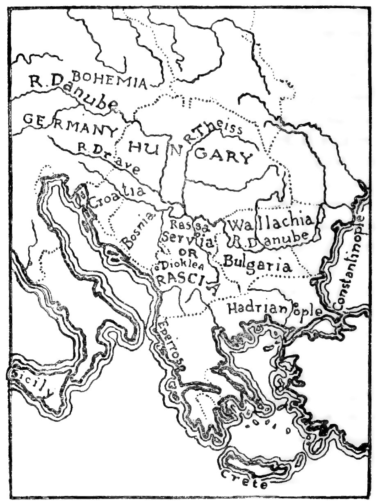
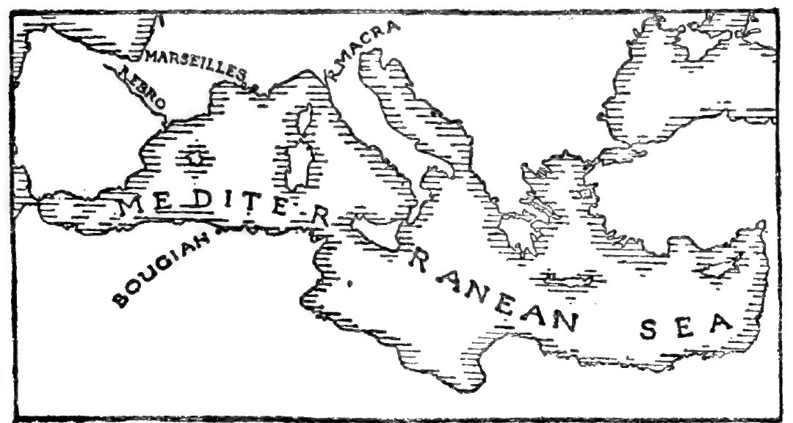

# Canto VIII

<!-- p. 90 (100) -->

## Argument

THE planet Venus and ancient idolatry (1-15). All angels, heavens and blessed spirits, from the Seraphim nearest God outwards, are twined in one concerted cosmic dance; this dance the spirits in Venus leave to minister to Dante, singing *Hosannah* as they come; and one of them declares their kinship of movement and of love with the celestial Beings to whom he had once addressed his love hymn (16-39). Dante, with Beatrice’s sanction, asks who the spirit is, and he with a flash of joy reveals himself as Dante’s friend, Carlo Martello, once heir to the lordship of Provence and the kingdom of Naples, and actual king of Hungary, though Sicily had revolted from his house in consequence of that ill government against which his brother, Robert of Naples, mean offspring of a generous sire, would do well to take warning (40-84). Dante’s joy in meeting his friend is increased by the knowledge that it is seen as clearly by that friend

<!-- p. 91 (101) -->

as by himself, and further, by the thought that it is in God that it is thus discerned (85-90). He asks him how it is that degenerate children can spring from noble parents (91-93). Carlo explains that for every natural attribute of any being there is provision of a corresponding good, and that since God is perfect and has made his ministers perfect for their offices, it follows that there is a fit place for everything and everyone, for which place it is designed and at which it is aimed (94-114). The social relations of man demand diversity of gift, which diversity is provided for by the action of the heavens on human natures, but without regard to descent, so that natural heredity is overruled by celestial influences (115-135). Whereas we in assigning a man’s place to him give heed only to hereditary position or such-like irrelevancies instead of studying his natural gift. Hence general confusion and incompetency (136-148).

<!-- p. 90 (100), text -->

Solea creder lo mondo in suo periclo <!-- label: Venere -->\
&emsp;che la bella Ciprigna il folle amore\
&emsp;raggiasse, volta nel terzo epiciclo:\
per che non pure a lei facean onore 4\
&emsp;di sacrificio e di votivo grido\
&emsp;le genti antiche nell' antico errore,\
ma Dione onoravano e Cupido, 7\
&emsp;quella per madre sua, questo per figlio,\
&emsp;e dicean ch' ei sedette in grembo a Dido;\
e da costei, ond' io principio piglio, 10\
&emsp;pigliavan il vocabol della stella\
&emsp;che il sol vagheggia or da coppa, or da ciglio.\
Io non m' accorsi del salire in ella; 13\
&emsp;ma d' esservi entro mi fece assai fede\
&emsp;la donna mia, ch' io vidi far più bella.

<!-- p. 91 (101), text -->

The world was wont to think in its peril that the fair Cyprian rayed down mad love, rolled in the third epicycle; <!-- label: The amorous -->

wherefore not only to her did they do honour of sacrifice and votive cry, those ancient folk in the ancient error,

but Dione did they honour, and Cupid, the one as her mother, the other as her son, and told how he had sat in Dido’s lap; <!-- label: Idolatry -->

and from her from whom I take my start, they took the name of the star which courts the sun, now from the nape, now from the brow.

I had no sense of rising into her, but my lady gave me full faith that I was there, because I saw her grow more beautiful.

<!-- p. 92 (102) -->

E come in fiamma favilla si vede, 16 <!-- label: Venere -->\
&emsp;e come in voce voce si discerne,\
&emsp;quando una è ferma e l' altra va e riede;\
vid' io in essa luce altre lucerne 19\
&emsp;moversi in giro più e men correnti,\
&emsp;al modo, credo, di lor viste eterne.\
Di fredda nube non disceser venti, 22\
&emsp;o visibili o no, tanto festini,\
&emsp;che non paressero impediti e lenti\
a chi avesse quei lumi divini 25\
&emsp;veduti a noi venir, lasciando il giro\
&emsp;pria cominciato in gli alti Serafini.\
E dentro a quei che più innanzi appariro, 28\
&emsp;sonava *Osanna* sì che unque poi\
&emsp;di riudir non fui senza disiro.\
Indi si fece l' un più presso a noi, 31\
&emsp;e solo incominciò: “Tutti sem presti\
&emsp;al tuo piacer, perchè di noi ti gioi.\
Noi ci volgiam coi Principi celesti 34\
&emsp;d' un giro, e d' un girare, e d' una sete,\
&emsp;ai quali tu del mondo già dicesti:\
*Voi che intendendo il terzo ciel movete;* 37\
&emsp;e sem sì pien d' amor che per piacerti\
&emsp;non fia men dolce un poco di quiete.”\
Poscia che gli occhi miei si furo offerti 40\
&emsp;alla mia donna riverenti, ed essa\
&emsp;fatti gli avea di sè contenti e certi,\
rivolsersi alla luce, che promessa 43\
&emsp;tanto s' avea, e: “Di' chi siete?” fue\
&emsp;la voce mia di grande affetto impressa.\
E quanta e quale vid' io lei far piùe 46\
&emsp;per allegrezza nuova che s' accrebbe,\
&emsp;quand' io parlai, all' allegrezze sue!

<!-- p. 93 (103) -->

And as we see a spark within a flame, and as a voice within a voice may be distinguished, if one stayeth firm, and the other cometh and goeth; <!-- label: The amorous -->

so in that light itself I perceived other torches moving in a circle more and less swift, after the measure, I suppose, of their eternal vision.

From a chill cloud there ne’er descended blasts, or visible or no, so rapidly as not to seem hindered and lagging

to whoso should have seen those lights divine advance towards us, quitting the circling that hath its first beginning in the exalted Seraphim.

And within those who most in front appeared, *Hosannah* sounded in such wise that never since have I been free from longing to re-hear it. <!-- label: Blessed spirits -->

Then one drew himself more nigh to us, and alone began: “All we are ready at thy will, that thou mayst have thy joy of us.

We roll with those celestial Princes in one circle and in one circling and in one thirst, to whom thou from the world didst sometime say: <!-- label: Carlo Martello -->

*Ye who by understanding give the third heaven motion,* and so full of love are we that, to pleasure thee, a space of quiet shall be no less sweet to us.”

When mine eyes had been raised in reverence to my Lady, and she had satisfied them with herself and given them assurance,

they turned them back to the light which so largely had made proffer of itself, and, “Say who ye be,” was my word, with great affection stamped. <!-- label: Dante -->

Ah! how I saw it wax in quantity and kind at the new joy which, when I spoke, was added to its joys!

<!-- p. 94 (104) -->

Così fatta mi disse: “Il mondo m' ebbe 49 <!-- label: Venere -->\
&emsp;giù poco tempo; e, se più fosse stato,\
&emsp;molto sarà di mal, che non sarebbe.\
La mia letizia mi ti tien celato, 52\
&emsp;che mi raggia dintorno, e mi nasconde\
&emsp;quasi animal di sua seta fasciato.\
Assai m' amasti, ed avesti bene onde; 55\
&emsp;chè, s' io fossi giù stato, io ti mostrava\
&emsp;di mio amor più oltre che le fronde.\
Quella sinistra riva che si lava 58\
&emsp;di Rodano, poi ch' è misto con Sorga,\
&emsp;per suo signore a tempo m' aspettava;\
e quel corno d' Ausonia, che s' imborga 61\
&emsp;di Bari, di Gaeta e di Catona,\
&emsp;da ove Tronto e Verde in mare sgorga.\
Fulgeami già in fronte la corona 64\
&emsp;di quella terra che il Danubio riga\
&emsp;poi che le ripe tedesche abbandona;\
e la bella Trinacria, che caliga 67\
&emsp;tra Pachino e Peloro, sopra il golfo\
&emsp;che riceve da Euro maggior briga,\
non per Tifeo, ma per nascente solfo, 70\
&emsp;attesi avrebbe li suoi regi ancora,\
&emsp;nati per me di Carlo e di Ridolfo,\
se mala signoria, che sempre accora 73\
&emsp;li popoli suggetti, non avesse\
&emsp;mosso Palermo a gridar: *Mora, mora.*\
E se mio frate questo antivedesse, 76\
&emsp;l' avara povertà di Catalogna\
&emsp;già fuggiria, perchè non gli offendesse;\
chè veramente provveder bisogna 79\
&emsp;per lui, o per altrui, sì ch' a sua barca\
&emsp;carcata più di carco non si pogna.

<!-- p. 95 (105) -->

Thus changed, it said to me: “The world held me below but little space; had it been more much ill shall be that had not been. <!-- label: The amorous -->

My joy holdeth me concealed from thee, raying around me, and hideth me like to a creature swathed in its own silk. <!-- label: Carlo -->

Much didst thou love me, and thou hadst good cause; for had I stayed below I had shown thee a further growth of love than the mere leaves.

That left bank which is bathed by Rhone after it hath mingled with Sorgue, me for its timely lord awaited; <!-- label: Provence -->

so did that corner of Ausonia, down from where Tronto and Verde discharge into the sea, citied by Bari, Gaeta and Catona. <!-- label: Apulia -->

Upon my brow already glowed the crown of the land the Danube watereth after it hath left its German banks; <!-- label: Hungary -->

and fair Trinacria which darkeneth between Pachynus and Pelorus, o’er the gulf tormented most by Eurus, <!-- label: Sicily -->

(not for Typheus, but for sulphur that ariseth there) would yet have looked to have its kings, sprung through me from Charles and Rudolf,

had not ill lordship, which doth ever cut the heart of subject peoples, moved Palermo to shriek out: *Die! die!*

And had my brother seen it in good time, he would already flee the greedy poverty of Catalonia, lest it should work him ill; <!-- label: Robert of Sicily -->

and of a truth provision needs be made by him or by another, lest on his barque already laden heavier load be laid.

<!-- p. 96 (106) -->

La sua natura, che di larga parca 82 <!-- label: Venere -->\
&emsp;discese, avria mestier di tal milizia\
&emsp;che non curasse di mettere in arca.”\
“Però ch' io credo che l' alta letizia 85\
&emsp;che il tuo parlar m' infonde, signor mio,\
&emsp;là 've ogni ben si termina e s' inizia,\
per te si veggia, come la vegg' io, 88\
&emsp;grata m' è più, e anco questo ho caro,\
&emsp;perchè il discerni rimirando in Dio.\
Fatto m' hai lieto, e così mi fa chiaro, 91\
&emsp;poichè, parlando, a dubitar m' hai mosso,\
&emsp;come uscir può di dolce seme amaro.”\
Questo io a lui; ed egli a me: “S' io posso 94\
&emsp;mostrarti un vero, a quel che tu domandi\
&emsp;terrai il viso come tieni il dosso.\
Lo ben che tutto il regno che tu scandi 97\
&emsp;volge e contenta, fa esser virtute\
&emsp;sua provvidenza in questi corpi grandi;\
e non pur le nature provvedute 100\
&emsp;son nella mente ch' è da sè perfetta,\
&emsp;ma esse insieme con la lor salute.\
Per che quantunque questo arco saetta 103\
&emsp;disposto cade a provveduto fine,\
&emsp;sì come cosa in suo segno diretta.\
Se ciò non fosse, il ciel che tu cammine 106\
&emsp;producerebbe sì li suoi effetti,\
&emsp;che non sarebbero arti, ma ruine;\
e ciò esser non può, se gl' intelletti 109\
&emsp;che movon queste stelle non son manchi,\
&emsp;e manco il primo che non gli ha perfetti.\
Vuoi tu che questo ver più ti s' imbianchi?” 112\
&emsp;Ed io: “Non già, perchè impossibil veggio\
&emsp;che la natura, in quel ch' è uopo, stanchi.”

<!-- p. 97 (107) -->

His nature,—mean descendant from a generous forebear,—were in need of soldiery who should not give their care to storing in the chest.” <!-- label: The amorous -->

“Sire, in that I believe the lofty joy which thy discourse poureth into me, there where every good hath end and hath beginning <!-- label: Dante -->

is seen by thee even as I see it, ’t is more grateful to me; and this too I hold dear, that thou discernest it looking on God.

Thou hast rejoiced me, now enlighten me; for in speaking thou hast moved me to question how from sweet seed may come forth bitter.”

Thus I to him; and he to me: “If I can show a certain truth to thee, thou wilt get before thine eyes the thing thou askest just as thou hast it now behind thy back. <!-- label: Carlo -->

The Good which doth revolve and satisfy the whole realm thou art climbing, maketh its providence become a virtuous power in these great bodies;

and not only is provision made for the diverse-natured creatures, by the mind that is perfection in itself, but for their weal too, co-related with them.

Wherefore whate’er this bow dischargeth doth alight disposed to a provided end, even as a thing directed to its mark.

Were this not so, the heaven thou art traversing would so bring its effects to being, that they would be not works of art, but ruins;

and this may not be, if the intellects which move these stars be not defective, and defective, too, that primal one which failed to perfect them.

Wouldst thou that this truth be more illuminated?” And I: “Not so, for I see ’tis impossible that nature, in the needful, should fall short.”

<!-- p. 98 (108) -->

Ond' egli ancora: “Or di', sarebbe il peggio 115 <!-- label: Venere -->\
&emsp;per l' uomo in terra se non fosse cive?”\
&emsp;“Sì, rispos' io, e qui ragion non cheggio.”\
“E può egli esser, se giù non si vive 118\
&emsp;diversamente per diversi offici?\
&emsp;No, se il maestro vostro ben vi scrive.”\
Sì venne deducendo insino a quici; 121\
&emsp;poscia conchiuse: “Dunque esser diverse\
&emsp;convien dei vostri effetti le radici:\
per che un nasce Solone, ed altro Xerse, 124\
&emsp;altro Melchisedech, ed altro quello\
&emsp;che volando per l' aere il figlio perse.\
La circular natura, ch' è suggello 127\
&emsp;alla cera mortal, fa ben sua arte,\
&emsp;ma non distingue l' un dall' altro ostello.\
Quinci addivien ch' Esaù si diparte 130\
&emsp;per seme da Iacob, e vien Quirino\
&emsp;da sì vil padre che si rende a Marte.\
Natura generata il suo cammino 133\
&emsp;simil farebbe sempre ai generanti,\
&emsp;se non vincesse il provveder divino.\
Or quel che t' era retro t' è davanti; 136\
&emsp;ma perchè sappi che di te mi giova,\
&emsp;un corollario voglio che t' ammanti.\
Sempre natura, se fortuna trova 139\
&emsp;discorde a sè, come ogni altra semente\
&emsp;fuor di sua region, fa mala prova.\
E se il mondo laggiù ponesse mente 142\
&emsp;al fondamento che natura pone,\
&emsp;seguendo lui, avria buona la gente.\
Ma voi torcete alla religione 145\
&emsp;tal che fia nato a cingersi la spada,\
&emsp;e fate re di tal ch' è da sermone;\
onde la traccia vostra è fuor di strada.” 148

<!-- p. 99 (109) -->

Whence he again: “Now, say, would it be worse for man on earth were he no citizen?” “Yea,” I replied, “and here I ask no reason.” <!-- label: The amorous -->

“And may that be, except men live below diversely and with diverse offices? No, if your master write the truth for you.”

Up to this point he came deduction-wise; then the conclusion: “Therefore must needs the roots of your effects be diverse;

wherefore is one born Solon and one Xerxes, one Melchizedek, and one the man who, soaring through the welkin, lost his son. <!-- label: Heredity and influence of the Heavens -->

That which in circling hath its nature, and is the seal upon the mortal wax, plieth aright its art, but maketh not distinction between one or other tenement.

Wherefore it cometh that Esau severeth himself in seed from Jacob, and Quirinus cometh of so base father that he is assigned to Mars.

The begotten nature would ever take a course like its begetters, did not divine provision overrule.

Now that which was behind thee is before; but that thou mayst know that I delight in thee, I will have a corollary wrap thee round.

Ever doth nature, if she find fortune unharmonious with herself, like any other seed out of its proper region, make an ill essay. <!-- label: Capacity and office -->

And if the world down there took heed to the foundation nature layeth, and followed it, it would have satisfaction in its folk.

But ye wrench to a religious order him born to gird the sword, and make a king of him who should be for discourse; wherefore your track runneth abroad the road.”

## Notes

<!-- p. 100 (110) -->

1-9. See iv. 61-63 and *note*; and also “Dante’s Paradise” at the end of this volume.

22, 23. Visible and invisible blasts=lightning and wind. “And it also appears that lightnings are winds kindled or enflamed by the swiftness of their motion.” And again “Because a hot exhalation, when it mounts up, strikes a cold and moist region, and it comes to pass that it is cast earthwards and chilled with a certain coldness, and a downward direction is given to it” *Averroes.*

34-39. When Dante wrote the ode here referred to (see *Conv.* ii., *Canzone*) he believed, with Brunetto Latini, that the angels who presided over the Heaven of Venus belonged to the order of *Thrones*. See *Conv.* ii. 6: 109. He afterwards followed “Dionysius” in assigning them to the order of *Principalities*. See xxviii. 125. “Princes” in line 34 may be equivalent to “Principalities” and so imply the correction, but since both terms are generic (see *Conv.* ii. 6: 40) this need not be so. In ix. 61, still in the planet Venus, there is a reference to *Thrones* so specific that one would take it to indicate Dante’s continued belief in the special connection between *Thrones* and the planet Venus, were it not that in v. 115, in the planet Mercury, there is a similar specific reference to *Thrones*. The apparent confusion is not easy to remove. For a suggested solution see xxviii. 103-5, *note*.

BOHEMIA\
R. Danube\
GERMANY\
R. Theiss\
HUNGARY\
R. Drave\
Croatia\
Wallachia\
Rassa\
R. Danube\
Bosnia\
Servia\
Bulgaria\
OR\
Dioklea\
RASCIA\
Constantinople\
Hadrianople\
Epeiros\
Sicily\
Crete

*To Cantos VIII. and XIX.*

<!-- p. 101 (111) -->

49-84. On Charles Martel, see ix. 1-6, *note*. See also maps on pp. 88 and 89, and on the opposite page.

52-54. The illustration of a silk-worm in its cocoon corresponds closely to representations, in early Italian art, of souls surrounded by a yellow glory.

63\. From this, together with *Purg.* iii. 131, it has been inferred that the R. Garigliano was formerly known as the Verde.

85-90. The distinction is subtle but real. ‘I rejoice that you see it (which you do, in God), and I rejoice that it is in God (and not otherwise) that you see it.’

97-99. Compare ii. 112 *sqq. note*.

103-105. Compare i. 119 and xxix. 24.

120\. Aristotle. See *Wallace* 68-70.

124, 5. Lawgiver, soldier, priest. Melchizedek is the priest *par excellence*, because he offered “bread and wine.” See *Gen.* xiv. 18.

126\. Dædalus, the typical mechanician. *Inf.* xvii. 109.

127\. The heavens.

MARSEILLES\
R. MACRA\
R. EBRO\
MEDITERRANEAN SEA\
BOUGIAN

*To Canto IX.*
