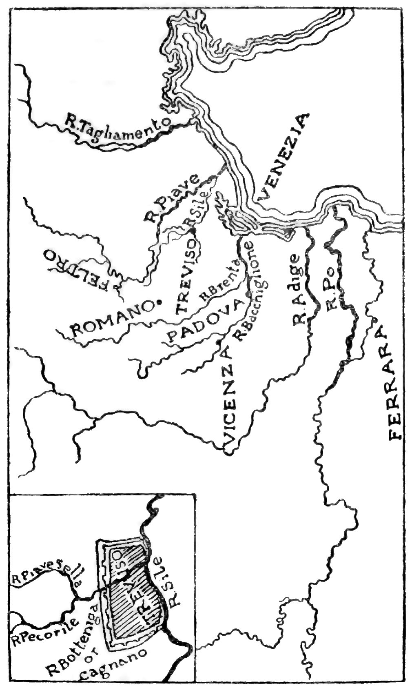

# Canto IX

<!-- p. 102 (112) -->

## Argument

CHARLES, after a note of warning, turns again to God, whom we so impiously neglect (1-12). Cunizza approaches; she describes the site of Romano whence she and the tyrant Ezzelin, her brother, sprang. She tells how her past sins no longer trouble her (13-36). She speaks of the fair fame on earth of the troubadour Folco, and laments that no such fame is now sought by her countrymen of Venetia; whose woes she predicts and whose crimes she denounces; and then seeming no longer to heed Dante drops again into her place in the cosmic dance (37-66). Folco now flashes brighter in Dante’s sight, and at his entreaty diverts his voice from its place in the universal song (which, like the universal dance, takes its note from the Seraphim) to minister to his special need (67-81). He indicates his birth place of Marseilles (82-93). He tells of his amorous youth (94-102)

<!-- p. 103 (113) -->

but shows how in heaven there is no repentance, because the sin is only seen or remembered as the occasion of the act of God by which the fallen one was uplifted again into his true element: and it is on this divine power and grace that the soul’s whole thought and love are centred (103-108). He points out to Dante the light of Rahab, speaks of this heaven as just within the range of the cone of the earth’s shadow, thereby indicating that the place of these souls in heaven is, in part, determined by the earthly sin that is now no longer in their minds; refers to Rahab’s help given to Joshua in conquering the Holy Land, and denounces the Pope for his indifference to its recovery (109-126). It is devil-planted Florence that corrupts the world, both shepherd and flock, by her *florins* (127-138). But vengence shall not lag (139-142).

<!-- p. 102 (112), text -->

Da poi che Carlo tuo, bella Clemenza, <!-- label: Venere -->\
&emsp;m' ebbe chiarito, mi narrò gl' inganni\
&emsp;che ricever dovea la sua semenza;\
ma disse: “Taci, e lascia volger gli anni”; 4\
&emsp;sì ch' io non posso dir, se non che pianto\
&emsp;giusto verrà di retro ai vostri danni.\
E già la vita di quel lume santo 7\
&emsp;rivolta s' era al sol che la riempie,\
&emsp;come quel ben ch' ad ogni cosa è tanto.\
Ahi, anime ingannate, e fatture empie, 10\
&emsp;che da sì fatto ben torcete i cori,\
&emsp;drizzando in vanità le vostre tempie!\
Ed ecco un altro di quelli splendori 13\
&emsp;ver me si fece, e il suo voler piacermi\
&emsp;significava nel chiarir di fuori.

<!-- p. 103 (113), text -->

When thy Charles, fair Clemence, had enlightened me, he told me of the frauds his seed was destined to encounter; <!-- label: The amorous. Clemence -->

but added: “Hold thy peace, and let the years revolve”; so that I can say naught, save that wailing well-deserved shall track your wrongs.

And already the life of that sacred light had turned to the sun that filleth it, as to the good ample for all things.

Ah! souls deceived, ah! creatures impious, who from such good wry-twist your hearts, squaring your temples unto vanity!

And lo, another of those splendours drew him towards me, and signified his will to pleasure me, by brightening outwardly.

<!-- p. 104 (114) -->

Gli occhi di Beatrice, ch' eran fermi 16 <!-- label: Venere -->\
&emsp;sopra me, come pria, di caro assenso\
&emsp;al mio disio certificato fermi.\
“Deh metti al mio voler tosto compenso, 19\
&emsp;beato spirto, dissi, e fammi prova\
&emsp;ch' io possa in te rifletter quel ch' io penso.”\
Onde la luce che m' era ancor nuova, 22\
&emsp;del suo profondo, ond' ella pria cantava,\
&emsp;seguette, come a cui di ben far giova:\
“In quella parte della terra prava 25\
&emsp;Italica, che siede tra Rialto\
&emsp;e le fontane di Brenta e di Piava,\
si leva un colle, e non surge molt' alto, 28\
&emsp;là dove scese già una facella,\
&emsp;che fece alla contrada un grande assalto.\
D' una radice nacqui ed io ed ella; 31\
&emsp;Cunizza fui chiamata, e qui refulgo,\
&emsp;perchè mi vinse il lume d' esta stella.\
Ma lietamente a me medesma indulgo 34\
&emsp;la cagion di mia sorte, e non mi noia,\
&emsp;che parria forse forte al vostro vulgo.\
Di questa luculenta e cara gioia 37\
&emsp;del nostro cielo, che più m' è propinqua,\
&emsp;grande fama rimase, e, pria che moia,\
questo centesim' anno ancor s' incinqua. 40\
&emsp;Vedi se far si dee l' uomo eccellente,\
&emsp;sì ch' altra vita la prima relinqua!\
E ciò non pensa la turba presente, 43\
&emsp;che Tagliamento ed Adice richiude,\
&emsp;nè per esser battuta ancor si pente.\
Ma tosto fia che Padova al palude 46\
&emsp;cangerà l' acqua che Vicenza bagna,\
&emsp;per esser al dover le genti crude.

<!-- p. 105 (115) -->

Beatrice’s eyes, fixed on me as before, of dear assent to my desire assured me. <!-- label: The amorous -->

“Nay! make swift counterpoise unto my will,” I said, “thou blessed spirit, and give proof that I can cast reflection upon thee of what I think.”

Whereat the light which was new to me, from out its depth, wherein it first was singing, went on as one rejoicing to do well:

“In that region of the depraved Italian land which sitteth ’twixt Rialto and the springs of Brenta and Piave, <!-- label: Cunizza -->

riseth a hill, lifted to no great height, whence erst came down a firebrand that made a dire assault upon the country.

Out of one root spring I with it; Cunizza was I called, and here I glow because the light of this star overcame me. <!-- label: Ezzelino of Romano -->

But joyously I grant myself indulgence for the occasion of my lot, nor doth it grieve me, which would seem, mayhap, hard saying to your common herd.

Of this shining and dear gem of our heaven, which most doth neighbour me, great fame remaineth, and ere it shall perish <!-- label: Folco -->

this centenary year shall be five times repeated. See if a man should make himself excel, so that the first life leave another after!

And of this thinketh not the present crowd that Tagliamento and Adige enclose; the which, though smitten, yet repenteth not.

But soon shall come to pass that Padua at the pool shall change the water that doth bathe Vicenza, because the folk are stubborn against duty.

<!-- p. 106 (116) -->

E dove Sile e Cagnan s' accompagna, 49 <!-- label: Venere -->\
&emsp;tal signoreggia e va con la testa alta,\
&emsp;che già per lui carpir si fa la ragna.\
Piangerà Feltro ancora la diffalta 52\
&emsp;dell' empio suo pastor, che sarà sconcia\
&emsp;sì che per simil non s' entrò in Malta.\
Troppo sarebbe larga la bigoncia 55\
&emsp;che ricevesse il sangue Ferrarese,\
&emsp;e stanco chi il pesasse ad oncia ad oncia,\
che donerà questo prete cortese, 58\
&emsp;per mostrarsi di parte; e cotai doni\
&emsp;conformi fieno al viver del paese.\
Su sono specchi, voi dicete Troni, 61\
&emsp;onde rifulge a noi Dio giudicante,\
&emsp;sì che questi parlar ne paion buoni.”\
Qui si tacette, e fecemi sembiante 64\
&emsp;che fosse ad altro volta, per la rota\
&emsp;in che si mise, com' era davante.\
L' altra letizia, che m' era già nota 67\
&emsp;preclara cosa, mi si fece in vista\
&emsp;qual fin balascio in che lo sol percota.\
Per letiziar lassù folgor s' acquista, 70\
&emsp;sì come riso qui; ma giù s' abbuia\
&emsp;l' ombra di fuor, come la mente è trista.\
“Dio vede tutto, e tuo veder s' inluia, 73\
&emsp;diss' io, beato spirto, sì che nulla\
&emsp;voglia di sè a te puote esser fuia.\
Dunque la voce tua, che il ciel trastulla 76\
&emsp;sempre, col canto di quei fochi pii\
&emsp;che di sei ali fannosi cuculla,\
perchè non satisface ai miei disii? 79\
&emsp;Già non attenderei io tua domanda,\
&emsp;s' io m' intuassi, come tu t' immii.”

<!-- p. 107 (117) -->

And where Sile meets Cagnano, one holdeth sway and goeth with uplifted head to catch whom even now the net is being woven. <!-- label: The amorous -->

A wail shall yet arise from Feltro for the trespass of its impious pastor, which shall be so foul that for the like none ever entered Malta. <!-- label: Richard and Alexander -->

Too ample were the charger which should receive Ferrara’s blood, and weary who should weigh it ounce by ounce,

which this obliging priest shall give to prove himself a partisan; and such-like gifts shall suit the country’s way of life.

Aloft are mirrors,—ye name them Thrones,—whence God in judgment shineth upon us so that these words approve themselves to us.”

Here she was silent, and to me her semblance was of one who turneth him to other heeding, judging as by the wheel whereto she gave herself, like as she was before.

The other joy, noted already to me as a thing illustrious, shone in my sight like a fine ruby that the sun should strike. <!-- label: Folco -->

By joy up there brightness is won, just as a smile on earth; but down below darkeneth the shade externally as the mind saddeneth.

“God seeth all, and into him thy seeing sinketh,” said I, “blessed spirit, so that no wish may steal itself from thee. <!-- label: Dante -->

Then wherefore doth thy voice, which gladdeneth Heaven ceaselessly,—together with the singing of those Flames devout, which make themselves a cowl with the six wings,—

not satisfy my longings? Not till now had I awaited thy demand, were I in thee even as thou art in me.”

<!-- p. 108 (118) -->

“La maggior valle in che l' acqua si spanda, 82 <!-- label: Venere -->\
&emsp;incominciaro allor le sue parole,\
&emsp;fuor di quel mar che la terra inghirlanda,\
tra i discordanti liti, contra il sole 85\
&emsp;tanto sen va che fa meridiano\
&emsp;là dove l' orizzonte pria far suole.\
Di quella valle fu' io littorano 88\
&emsp;tra Ebro e Macra, che, per cammin corto,\
&emsp;lo Genovese parte dal Toscano.\
Ad un occaso quasi e ad un orto 91\
&emsp;Buggea siede e la terra ond' io fui,\
&emsp;che fe' del sangue suo già caldo il porto.\
Folco mi disse quella gente, a cui 94\
&emsp;fu noto il nome mio, e questo cielo\
&emsp;di me s'imprenta, com' io fei di lui;\
chè più non arse la figlia di Belo, 97\
&emsp;noiando ed a Sicheo ed a Creusa,\
&emsp;di me, in fin che si convenne al pelo;\
nè quella Rodopeia, che delusa 100\
&emsp;fu da Demofoonte, nè Alcide\
&emsp;quando Iole nel cor ebbe richiusa.\
Non però qui si pente, ma si ride, 103\
&emsp;non della colpa, ch' a mente non torna,\
&emsp;ma del valor ch' ordinò e provide.\
Qui si rimira nell' arte che adorna 106\
&emsp;cotanto effetto, e discernesi il bene\
&emsp;per che al mondo di su quel di giù torna.\
Ma perchè le tue voglie tutte piene 109\
&emsp;ten porti, che son nate in questa spera,\
&emsp;procedere ancor oltre mi conviene.\
Tu vuoi saper chi è in questa lumiera, 112\
&emsp;che qui appresso me così scintilla,\
&emsp;come raggio di sole in acqua mera.

<!-- p. 109 (119) -->

“The greatest valley in which water stretcheth,” then began his words, “forth from that sea which garlandeth the earth, <!-- label: The amorous -->

betwixt opposing shores, against the sun, goeth so far that it meridian maketh of what was first horizon.

Of this valley was I a shoresman, midway ’twixt the Ebro and the Macra, which, with short course, parteth the Genoese and Tuscan. <!-- label: Marseilles -->

Almost alike for sunset and for sunrise the site of Bougiah and of the place I spring from, which with its blood once made the harbour warm.

Folco they called me to whom my name was known, and this heaven is stamped by me, as I was stamped by it;

for Belus’ daughter, wronging alike Sichæus and Creüsa, did not more burn than I, so long as it consorted with my locks;

nor yet the Rhodopeian maid who was deluded by Demophoön, neither Alcides when he had shut Iole in his heart.

Yet here we not repent, but smile; not at the sin, which cometh not again to mind, but at the Worth that ordered and provided. <!-- label: No repentance in Heaven -->

Here gaze we on the Art that beautifieth its so great effect, and here discern the Good which bringeth back the world below unto the world above.

But that thou mayst bear away full satisfied all the desires born within this sphere, needs must I yet proceed.

Thou wouldst know who is within that light which here by me so sparkleth as the sun’s ray in pure water.

<!-- p. 110 (120) -->

Or sappi che là entro si tranquilla 115 <!-- label: Venere -->\
&emsp;Raab, ed a nostr' ordine congiunta\
&emsp;di lei nel sommo grado si sigilla.\
Da questo cielo, in cui l' ombra s' appunta 118\
&emsp;che il vostro mondo face, pria ch' altr' alma\
&emsp;del trionfo di Cristo fu assunta.\
Ben si convenne lei lasciar per palma 121\
&emsp;in alcun cielo dell' alta vittoria,\
&emsp;che s' acquistò con l' una e l' altra palma;\
perch' ella favorò la prima gloria 124\
&emsp;di Josuè in su la Terrasanta,\
&emsp;che poco tocca al papa la memoria.\
La tua città, che di colui è pianta 127\
&emsp;che pria volse le spalle al suo Fattore,\
&emsp;e di cui è la invidia tanto pianta,\
produce e spande il maledetto fiore 130\
&emsp;ch' ha disviate le pecore e gli agni,\
&emsp;però che fatto ha lupo del pastore.\
Per questo l' Evangelio e i dottor magni 133\
&emsp;son derelitti, e solo ai Decretali\
&emsp;si studia sì che pare ai lor vivagni.\
A questo intende il papa e i cardinali: 136\
&emsp;non vanno i lor pensieri a Nazzarette,\
&emsp;là dove Gabriello aperse l' ali.\
Ma Vaticano e l' altre parti elette 139\
&emsp;di Roma, che son state cimiterio\
&emsp;alla milizia che Pietro seguette,\
tosto libere fien dell' adulterio.” 142

<!-- p. 111 (121) -->

Now know that there within hath Rahab peace; and when she joined our order, it stamped itself with her in the highest grade. <!-- label: The amorous, Rahab -->

By this heaven,—touched by the shadow’s point which your world casteth,—ere other soul was she uptaken from Christ’s triumph.

And soothly it beseemed to leave her as a trophy, in some heaven, of the lofty victory which was achieved with the one and the other palm;

because she favoured Joshua’s first glory in the Holy Land, which little toucheth the Papal memory.

Thy city,—of his planting who first turned his shoulders on his Maker, and from whose envy hath such wailing sprung,— <!-- label: Florence -->

maketh and spreadeth that accursed flower which hath set sheep and lambs astray, for it hath turned the shepherd to a wolf.

Therefore it is the Gospel and great Doctors are deserted, and only the Decretals are so studied, as may be seen upon their margins.

Thereon the Pope and Cardinals are intent; ne’er wend their thoughts to Nazareth, where Gabriel spread his wings.

But Vatican, and the other parts elect of Rome, the cemetery of the soldiery that followed Peter, shall soon be freed from the adultery.”

## Notes

<!-- p. 110 (120), notes -->

1-6. Charles of Anjou, brother of St. Louis, conquered Naples and Sicily from Manfred, son of Frederick II., and became Charles I. Towards the end of his life his misgovernment of Sicily caused the massacre known as the “Sicilian Vespers” (A.D. 1282) and the loss of Sicily (viii. 73-75) Villani vii. 61. His son Charles II. (see vi. 106-108 and *note*. Dante nowhere else allows him the generosity ascribed to him in viii. 82) was the father of a numerous family, including Dante’s friend, Charles Martel, who died before his father (1295); and Robert. Charles married Clemence, daughter of the Emperor Rudolph; hence the allusion in viii. 72. He visited Florence in the last year of his life, and it was probably then that Dante formed his acquaintance. On his death his son, Caroberto, became heir to the throne of Naples; but his uncle Robert (known as Robert the Wise), supported by Charles II.’s will, ousted him from the succession. This was in 1309. At the date of the vision, therefore, Robert could not yet have been abusing his powers as king; but according to Charles (viii. 76), he was already preparing to do so by cultivating the Spanish friendships he had formed when a hostage in Spain, and so laying the train for oppression of the much enduring Apulia by the instrumentality of Spanish favourites. As to the Clemence of line 1 there has been much discussion. It would be natural to suppose that she is Charles’s wife. It was her son Caroberto that Robert of Naples had excluded from the succession to Naples and Provence; and to her and her son, therefore, the “vostri danni” of line 6 would naturally apply. But the date of her death is given in recent commentaries as 1301, long before the time at which these words were written; and evidence has now been produced to show that she really died in 1295, as indeed several of the early commentators declare; and in that case she had been dead some years before the assumed date of the vision, 1300. This would make the direct address to her in line 1 difficult, and the implied communication in lines 2-6 well nigh impossible. And yet the only alternative seems still more difficult to accept, namely, that the Clemence addressed was Charles’s daughter who married Louis X., *le Hutin* (*cf.* Villani, ix. 66), and was living in 1328. This Clemence was in no special way wronged by the proceedings of Robert, nor is it easily conceivable that Dante in speaking of a father to a daughter would call him “thy Charles.” The reader must take his choice between these two impossibilities. As to the woes that are said to be approaching, we note that since no conspicuous disaster had overtaken Robert, Dante has to fall back upon general forebodings of evil.

<!-- p. 111 (121), notes -->

<!-- p. 112 (122) -->

20, 21. By answering before I ask.

29, 30. The hideous tyrant Ezzelino da Romano (Compare *Inf.* xii. 109, 110); whose mother dreamed she gave birth to a firebrand that consumed the whole district.

<!-- p. 113 (123) -->

33-36. Her amours with Sordello were specially notorious. In 1265 (when she was about 67 years old) she executed a deed of manumission, conferring formal freedom on a number of slaves (who probably had already secured the reality) in the house of Dante’s friends the Cavalcanti. It is therefore possible that Dante was in possession of private sources of information as to penitence in closing years, an edifying end, grateful dependents who prayed for the departed soul, etc. No such knowledge, however, except that she had a certain reputation for humanity, has reached the world at large, and the scandalised protest which Dante anticipated and defied has not failed to make itself heard!

46-48. A much discussed passage, which probably refers to the defeats inflicted on the Paduans at Vicenza by Can Grande of Verona (see Villani, ix. 63) in and about 1314. ‘Paduan blood shall dye the Bacchiglione red because of Paduan resistance to the Empire.’

49-51. Riccardo da Cammino, Lord of Trevīso. He was murdered in 1312. He was the son of the “Good Gherard” (*Purg.* xvi. 124-140, *Conv.* iv. 14: 111-130), and the husband of Judge Nino’s daughter Giovanna (*Purg.* viii. 71).

53\. Alessandro Novello, Bishop of Feltre, 1298-1320. In 1314 he surrendered certain Ghibelline refugees from Ferrara to Pino della Tosa, King Robert’s vicar there, who executed them.

54\. A papal prison on lake Bolsēna, or perhaps in Viterbo.

61\. Compare viii. 34-39. xxviii. 103-105, *notes.* “For they are called *Thrones* by whom God doth exercise his judgments” Gregory, quoted by Aquinas.

66\. Compare viii. 25-27.

76-78. Compare viii. 25-27. *Argument.* Compare *Isaiah* vi. 2.

85-93. At Gibraltar, where the Mediterranean flows out of the ocean, the sun (according to Dante’s geography) is on the horizon when it is noon-day on the Levant. Thus the stretch of the sea makes zenith at its end of what is horizon at its beginning; *i.e.* It extends over a quadrant. See map on p. 101.

<!-- p. 114 (124) -->

93\. When Cæsar’s fleet won a victory over the Pompeians in B.C. 49. Cf. *Purg.* xviii. 102.

94\. Folco of Marseilles was a Troubadour (fl. 1180-1195), and afterwards a Cistercian monk. As bishop of Toulouse (1205-1231) he took a leading part in the infamous Albigensian Crusades.

97\. Dido, whose love for Æneas wronged the memory of her husband Sichæus and of his wife Crëūsa.

100, 101. Phyllis, beloved of Demophoön the son of Theseus and Phedra, was the daughter of the Thracian king Sithon, and hence is called Rhodopeian, after the mountain Rhodŏpe in Thrace. According to Ovid, Demophoön ultimately returned to keep his plighted faith, but Phyllis had already slain herself in despair at his protracted absence.

102\. Iŏle was the last love of Hercules (Alcides). On hearing of this attachment, Dejanira, the wife of Hercules, sent him the fatal shirt of Nessus, thus causing his death. Nessus the Centaur had offered an insult to Dejanira as he was bearing her across a stream, and Hercules shot him. As he expired he told Dejanira that the garment, steeped in his blood, would have the power of winning back the affections of Hercules if ever they wandered from her. It is this vengeance of the Centaur which is referred to by Dante in *Inf.* xii. 67-69.

126\. Rebukes the slackness of the Pope in face of the capture of Acre by the Saracens in 1291, after which the Christians had no foothold in the Holy Land. Cf. *Villani* vii. 145.

134-5. Compare *Parad.* xii. 83. There was money to be got out of studying Ecclesiastical Law. Compare *Conv.* i. 9: 18-25, etc.

<!-- p. 115 (125) -->

R. Tagliamento\
VENEZIA\
R. Piave\
R. Sile\
TREVISO\
FELTRO\
R. Brenta\
R. Bacchiglione\
ROMANO\
PADOVA\
R. Adige\
R. Po\
FERRARA\
VICENZA\
R. Piavesella\
R. Pecorile\
TREVISO\
R. Sile\
R. Botteniga\
or\
Cagnano
