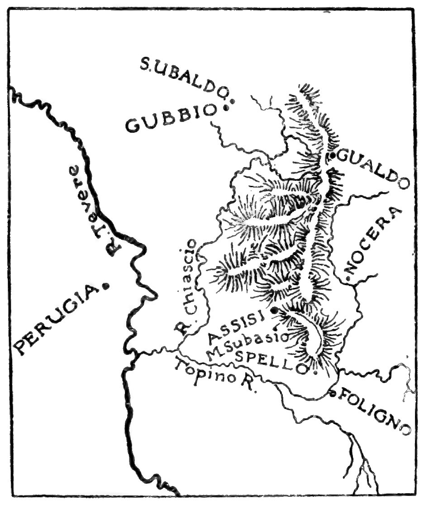

# Canto XI

<!-- p. 130 (140) -->

## Argument

CONTRAST between earth and heaven (1-12). Thomas, reading Dante’s thoughts, renews his discourse in order to remove certain difficulties (13-27). Providence raised up Francis and Dominic to succour the Church (28-42). From Assisi Francis rose sunlike, even as the sun in which Doctor and Poet are now discoursing rises to mortals from Ganges or elsewhere according to the place of their abode (43-54). His

<!-- p. 131 (141) -->

marriage with poverty (55-75). The founding and confirming of his order (76-99). He preaches to the Soldan, receives the stigmata, and dies commending his bride to his disciples (100-117). If he was such, what must Dominic have been, seeing that he was worthy to be his colleague (118-123). But almost all his followers are degenerate (124-139).

<!-- p. 130 (140), text -->

O insensata cura dei mortali, <!-- label: Sole -->\
&emsp;quanto son difettivi sillogismi\
&emsp;quei che ti fanno in basso batter l' ali!\
Chi retro a iura, e chi ad aforismi 4\
&emsp;sen giva, e chi seguendo sacerdozio,\
&emsp;e chi regnar per forza o per sofismi,\
e chi rubare, e chi civil negozio, 7\
&emsp;chi nel diletto della carne involto\
&emsp;s' affaticava, e chi si dava all' ozio;\
quando, da tutte queste cose sciolto, 10\
&emsp;con Beatrice m' era suso in cielo\
&emsp;cotanto gloriosamente accolto.\
Poi che ciascuno fu tornato ne lo 13\
&emsp;punto del cerchio, in che avanti s' era,\
&emsp;fermossi come a candelier candelo.\
Ed io senti' dentro a quella lumiera, 16\
&emsp;che pria m' avea parlato, sorridendo\
&emsp;incominciar, facendosi più mera:\
“Così com' io del suo raggio risplendo, 19\
&emsp;sì, riguardando nella luce eterna,\
&emsp;li tuoi pensieri, onde cagioni, apprendo.\
Tu dubbi, ed hai voler che si discerna 22\
&emsp;in sì aperta e in sì distesa lingua\
&emsp;lo dicer mio, ch' al tuo sentir si sterna,

<!-- p. 131 (141), text -->

Insensate care of mortals! Oh how false the arguments which make thee downward beat thy wings! <!-- label: The prudent -->

One was following after law, and one aphorisms, one was pursuing priesthood, and one dominion by violence or by quibbles,

and another plunder, and another civil business, and one, tangled in the pleasures of the flesh, was moiling, and one abandoned him to ease;

the whilst, from all these things released, with Beatrice up in heaven thus gloriously was I received. <!-- label: Earth and Heaven -->

When each had come again to that point of the circle whereat he was before, he stayed him, as the taper in its stand.

And within that light which first had spoken to me I heard smiling begin, as it grew brighter:

“Even as I glow with its ray, so, gazing into the Eternal Light, I apprehend whence thou dost take occasion for thy thoughts. <!-- label: Thomas -->

Thou questionest and wouldst fain discern, in such open and dispread discourse as may be level to thine understanding, my utterance

<!-- p. 132 (142) -->

ove dinanzi dissi: *u' ben s' impingua*, 25 <!-- label: Sole -->\
&emsp;e là u' dissi: *non surse il secondo*;\
&emsp;e qui è uopo che ben si distingua.\
La provvidenza, che governa il mondo 28\
&emsp;con quel consiglio nel quale ogni aspetto\
&emsp;creato è vinto pria che vada al fondo,\
però che andasse ver lo suo diletto 31\
&emsp;la sposa di colui, ch' ad alte grida\
&emsp;disposò lei col sangue benedetto,\
in sè sicura ed anco a lui più fida, 34\
&emsp;due principi ordinò in suo favore,\
&emsp;che quinci e quindi le fosser per guida.\
L' un fu tutto serafico in ardore, 37\
&emsp;l' altro per sapienza in terra fue\
&emsp;di cherubica luce uno splendore.\
Dell' un dirò, però che d' ambedue 40\
&emsp;si dice l' un pregiando, qual ch' uom prende,\
&emsp;perchè ad un fine fur l' opere sue.\
Intra Tupino e l' acqua che discende 43\
&emsp;del colle eletto del beato Ubaldo,\
&emsp;fertile costa d' alto monte pende,\
onde Perugia sente freddo e caldo 46\
&emsp;da porta Sole, e di retro le piange\
&emsp;per grave giogo Nocera con Gualdo.\
Di questa costa, là dov' ella frange 49\
&emsp;più sua rattezza, nacque al mondo un sole,\
&emsp;come fa questo talvolta di Gange.\
Però chi d' esso loco fa parole 52\
&emsp;non dica *Ascesi*, che direbbe corto,\
&emsp;ma *Oriente*, se proprio dir vuole.\
Non era ancor molto lontan dall' orto, 55\
&emsp;ch' ei cominciò a far sentir la terra\
&emsp;della sua gran virtute alcun conforto;

<!-- p. 133 (143) -->

wherein I said but now: *Where is good fattening*, and wherein I said: *No second ever rose*; and here we need to make precise distinction. <!-- label: The prudent -->

The providence which governeth the world,—with counsel wherein every creature’s gaze must stay, defeated, e’er it reach the bottom,—

in order that the spouse of him, who with loud cries espoused her with the blessed blood, might go toward her delight,

secure within herself and faithfuller to him, two Princes did ordain on her behalf, who on this side and that should be for guides.

The one was all seraphic in his ardour, the other by his wisdom was on earth a splendour of cherubic light. <!-- label: Francis and Dominic -->

Of one will I discourse, because of both the two he speaketh who doth either praise, which so he will; for to one end their works.

Between Tupino and the stream that drops from the hill chosen by the blessed Ubaldo, a fertile slope hangs from a lofty mount, <!-- label: Assisi -->

wherefrom Perugia feeleth cold and heat through Porta Sole, and behind it waileth Nocera, for the heavy yoke, and Gualdo.

From this slope, where most it breaks the steepness of decline, was born into the world a sun, even as is this some whiles from Ganges. <!-- label: Francis -->

Wherefore who speaketh of that place, let him not say *Assisi*, ’twere to speak short, but *Orient*, would he name it right.

Not yet was he far distant from his rising when he began to make the earth to feel from his great power a certain strengthening;

<!-- p. 134 (144) -->

chè per tal donna giovinetto in guerra 58 <!-- label: Sole -->\
&emsp;del padre corse, a cui, com' alla morte,\
&emsp;la porta del piacer nessun disserra;\
ed innanzi alla sua spirital corte, 61\
&emsp;*et coram patre* le si fece unito;\
&emsp;poscia di dì in dì l' amò più forte.\
Questa, privata del primo marito, 64\
&emsp;mille e cent' anni e più dispetta e scura\
&emsp;fino a costui si stette senza invito.\
Nè valse udir che la trovò sicura 67\
&emsp;con Amiclate, al suon della sua voce,\
&emsp;colui ch' a tutto il mondo fe' paura;\
nè valse esser costante nè feroce, 70\
&emsp;sì che, dove Maria rimase giuso,\
&emsp;ella con Cristo salse in sulla croce.\
Ma perch' io non proceda troppo chiuso, 73\
&emsp;Francesco e Povertà per questi amanti\
&emsp;prendi oramai nel mio parlar diffuso.\
La lor concordia e i lor lieti sembianti 76\
&emsp;amore e maraviglia e dolce sguardo\
&emsp;faceano esser cagion di pensier santi;\
tanto che il venerabile Bernardo 79\
&emsp;si scalzò prima, e retro a tanta pace\
&emsp;corse, e correndo gli parv' esser tardo.\
O ignota ricchezza, o ben ferace! 82\
&emsp;Scalzasi Egidio, scalzasi Silvestro,\
&emsp;retro allo sposo, sì la sposa piace.\
Indi sen va quel padre e quel maestro 85\
&emsp;con la sua donna, e con quella famiglia\
&emsp;che già legava l' umile capestro;\
nè gli gravò viltà di cor le ciglia, 88\
&emsp;per esser fi' di Pietro Bernardone,\
&emsp;nè per parer dispetto a maraviglia.

<!-- p. 135 (145) -->

for in his youth for such a lady did he rush into war against his father, to whom, as unto death, not one unbars the gate of his good pleasure; <!-- label: The prudent -->

and in the spiritual court that had rule over him, and in his father’s presence he was united to her, and then from day to day loved her more strongly. <!-- label: My lady poverty -->

She, reft of her first husband, a thousand and a hundred years and more, despised, obscure, even till him stood without invitation.

And nought availed her the report that she was found unterrified together with Amyclas, when sounded that man’s voice, who struck all the world with terror;

and nought availed her to have been so constant and undaunted, that she, when Mary stayed below, mounted the cross with Christ.

But, lest I should proceed too covertly, Francis and Poverty as these two lovers now accept in speech outspread. <!-- label: Francis and poverty -->

Their harmony and joyous semblance, made love and wonder and tender looks the cause of sacred thoughts;

so that the venerable Bernard first cast off his sandals and ran to follow so great peace, and as he ran him thought him all too slow. <!-- label: The first disciples -->

Oh wealth unrecognised, oh fertile good! Unsandals him Egidius, unsandals him Sylvester, following the spouse, so doth the bride delight.

Thence took his way, this father and this master, together with his lady, and with the household already binding on the humble cord;

nor abjectness of heart weighed down his brow, that he was Pietro Bernadone’s son, nor that he seemed so marvellous despised.

<!-- p. 136 (146) -->

Ma regalmente sua dura intenzione 91 <!-- label: Sole -->\
&emsp;ad Innocenzio aperse, e da lui ebbe\
&emsp;primo sigillo a sua religione.\
Poi che la gente poverella crebbe 94\
&emsp;retro a costui, la cui mirabil vita\
&emsp;meglio in gloria del ciel si canterebbe,\
di seconda corona redimita 97\
&emsp;fu per Onorio dall' eterno spiro\
&emsp;la santa voglia d' esto archimandrita.\
E poi che, per la sete del martiro, 100\
&emsp;nella presenza del Soldan superba\
&emsp;predicò Cristo e gli altri che il seguiro,\
e per trovare a conversione acerba 103\
&emsp;troppo la gente, per non stare indarno,\
&emsp;reddissi al frutto dell' italica erba;\
nel crudo sasso, intra Tevero ed Arno, 106\
&emsp;da Cristo prese l' ultimo sigillo,\
&emsp;che le sue membra due anni portarno.\
Quando a colui ch' a tanto ben sortillo 109\
&emsp;piacque di trarlo suso alla mercede,\
&emsp;ch' ei meritò nel suo farsi pusillo,\
ai frati suoi, sì com' a giuste rede, 112\
&emsp;raccomandò la sua donna più cara,\
&emsp;e comandò che l' amassero a fede;\
e del suo grembo l' anima preclara 115\
&emsp;mover si volle, tornando al suo regno,\
&emsp;ed al suo corpo non volle altra bara.\
Pensa oramai qual fu colui, che degno 118\
&emsp;collega fu a mantener la barca\
&emsp;di Pietro in alto mar per dritto segno!\
E questi fu il nostro patriarca; 121\
&emsp;per che qual segue lui, com' ei comanda,\
&emsp;discerner puoi che buone merce carca.

<!-- p. 137 (147) -->

But royally his stern intent to Innocent revealed he, and from him had the first imprint upon his Order. <!-- label: The prudent -->

When the poor folk increased, after his track whose marvellous life were better sung in heaven’s glory,

then was the holy will of this chief shepherd circled with a second crown by Honorius at the eternal inspiration. <!-- label: The order founded and confirmed -->

And when, in thirst of martyrdom, in the proud presence of the Soldan, he preached Christ and his followers;

and because he found the folk too crude against conversion,—not to stay in vain,—returned to gather fruit from the Italian herbage;

then on the harsh rock between Tiber and Arno, from Christ did he receive that final imprint which his limbs two years carried. <!-- label: The stigmata -->

When it pleased him who for such good ordained him, to draw him up to his reward which he had earned in making himself lowly,

to his brethren, as to his right heirs, his dearest lady he commended, and bade that they should love her faithfully;

and from her bosom the illustrious soul willed to depart, turning to its own realm, and for its body would no other bier.

Think now what he was, who was a worthy colleague to maintain the barque of Peter in deep sea towards the right sign! <!-- label: Dominic -->

And such was our patriarch; wherefore who followeth him as he commandeth, thou must perceive, loadeth him with good wares.

<!-- p. 138 (148) -->

Ma il suo peculio di nuova vivanda 124 <!-- label: Sole -->\
&emsp;è fatto ghiotto sì ch' esser non puote\
&emsp;che per diversi salti non si spanda;\
e quanto le sue pecore remote 127\
&emsp;e vagabonde più da esso vanno,\
&emsp;più tornano all' ovil di latte vote.\
Ben son di quelle che temono il danno, 130\
&emsp;e stringonsi al pastor; ma son sì poche,\
&emsp;che le cappe fornisce poco panno.\
Or, se le mie parole non son fioche, 133\
&emsp;se la tua audienza è stata attenta,\
&emsp;se ciò ch' ho detto alla mente rivoche,\
in parte fia la tua voglia contenta, 136\
&emsp;perchè vedrai la pianta onde si scheggia,\
&emsp;e vedrai il coregger che argomenta,\
*U' ben s' impingua, se non si vaneggia.*” 139

<!-- p. 139 (149) -->

But his flock hath grown so greedy for new viands, it may not be but that through divers glades it strayeth; <!-- label: The prudent -->

and the more his sheep distant and wandering depart from him, the emptier of milk they return foldwards.

There are of them, indeed, who fear the loss and cleave close to the shepherd, but they are so few that little cloth doth furnish forth their cowls. <!-- label: The Dominicans -->

Now if my words have not been faint, if thy listening hath been attent, if thou call back to mind what I have said,

in part thy will must now be satisfied, for thou shalt see the plant from which they whittle, and thou shalt see the rebuke that is intended in: *Where is good fattening if there be no straying.*”

## Notes

<!-- p. 138 (148), notes -->

4\. *Aphorisms*. The name of a celebrated work of Hippocrates (B.C. 460-357). Hence equivalent to *medicine*.

25, 26. See x. 96, 114.

27\. Compare xiii. 115-116. To “distinguish” is a technical term of logic. It consists in showing that the inference is not correct though the premises are true, because there is a difference between the sense in which a word is used in the true premise and the sense in which alone it would justify the false conclusion. If an argument is refuted by denying one of the premises the process is called *interemption*=“destruction.” Compare *De Monarchia*, iii. 4: 39-44.

37-39. The Seraphs, in popular estimate, are symbolical of love, and the Cherubs of knowledge. Hence Francis (1182-1226), known as the Seraphic Father, and Dominic (1170-1221) are respectively akin to them. But see xxviii. 109-111, and *note*.

43\. The Chiascio.

44\. Ubaldo (bishop of Gubbio, †1160) selected this hill for his hermitage, but (according to Scartazzini) was never able to carry out his intention of retiring to it. Hence the term *chosen*.

<!-- p. 139 (149), notes -->

47\. *Porta Sole*, the Eastern gate of Perugia.

48\. They were under the Angevin dynasty so hated by Dante. Compare vi. 106, *note*, &c., &c. But others (with less probability) interpret *greve giogo* as referring to the barren eastern slope of Monte Subasio.

53\. *Ascesi*, an old form of Assisi, may be translated “I have ascended.” A play upon the word, in connection with *Oriente*, is found by some commentators. The comparison of Francis to the rising Sun is ancient and wide spread. “Glowing as the light-bearer and as the morning star, yea, even as the rising Sun, illuminating, cleansing and fertilising the world like some new luminary, was Francis seen to arise,” says the Prologue of one of the earliest Lives.

58\. He was about twenty-four when he began to woo Poverty.

58-117. In the early biographies of Francis (including the *Fioretti* or popular stories of him) with which every reader of Dante should be familiar, we are told how he fell in love with Poverty; how his father indignantly sought to reclaim him; how he appealed to the Bishop, stripped himself naked before him, giving to his earthly father Pietro Bernadone that which was his, and dedicating himself to his heavenly father, and thus publicly espousing Poverty; how Bernard, the nobleman of Assisi, was converted by overhearing his devotions; how Egidius whose thoughts were already turning from the world flung himself at the feet of Francis and implored him to receive him as a companion; how Sylvester, the priest, tried to cheat him over some stones he had from him with which to repair a Church and was overcome by his unworldly generosity; how he rejoiced in all suffering and humiliation; how he loved and rejoiced in all God’s creatures; how two successive Popes sanctioned his Order (1210(?) and 1223); how he preached to the Soldan in Egypt; and finally, how he received the stigmăta or impress of the nails and the lance as a testimony to his oneness of spirit with Christ (b. 1182, d. 1226).

<!-- p. 140 (150) -->

64\. Jesus Christ.

68\. Lucan tells how Cæsar found the fisherman, Amyclas, lying on a bed of seaweed, undismayed when he roused him to demand his services, and unmoved by the revolutions of the times, secure in his poverty.

72\. Nearly all the MSS. read *pianse* (wept) for *salse* (rose) and the best modern editions for the most part follow them. Dr Moore, however (rightly as we think) adheres to the reading we have adopted. It is supported not only by internal evidence but by some of the old commentators and by the analogy of the ancient prayer for Poverty ascribed to St. Francis, in which are the words “when thy very mother, *because the cross was so high* . . . could not come at thee, Lady Poverty embraced thee more closely,” &c.

87\. The rope girdle worn by the Franciscans.

93, 97, 107. Note the *first*, *second,* *final*.

96\. An enigmatical phrase, since it is in heaven that the song of praise is being sung. Compare xii. 81.

106\. Alvernia.

117\. “And when he had blessed the brothers he had them take off his tunic, and place him naked on the ground” (Old Biography).

<!-- p. 141 (151) -->

118-132. St Thomas now passes to his own founder, Dominic, and rebukes the degenerate Dominicans. Compare xii. 106-126, *note*.

138\. Another reading is *coreggier*, which would mean *the Dominican* (that is, one girt with the leather thong), and would refer either to the speaker (St. Thomas) himself or to any Dominican who might reprove his order in this way.

S. UBALDO\
GUBBIO\
GUALDO\
R. Tevere\
NOCERA\
R. Chiascio\
ASSISI\
PERUGIA\
Mt Subasio\
SPELLO\
Topino R.\
FOLIGNO
