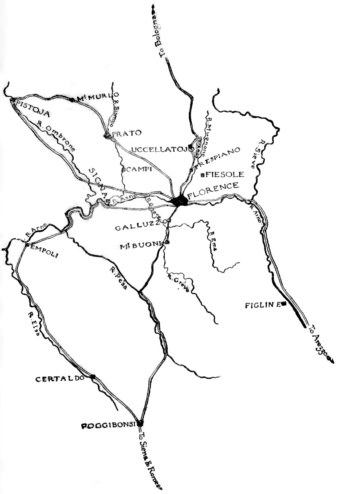

# Canto XV

<!-- p. 180 (190) -->

## Argument

THE souls of the warriors of God upon the cross of Mars cease their hymn, that Dante may converse with one of their number, who shoots like a falling star from his place and, approaching Dante with such joy as Anchises showed to Æneas in the Elysian fields, greets him as his offspring and as the recipient of unique grace, the twice-received (now and at his death) of heaven (1-30). Dante, giving heed to him and (now first in this higher sphere) looking on Beatrice, is smitten with two-fold marvel (31-36). The spirit, after rapturous words beyond the scope of the poet’s comprehension, gives thanks to God, tells Dante how eager yet how sweet has been his longing for his arrival, fore-read in the heavens; confirms his thought that the spirits see all things in God, as the true mathematician

<!-- p. 181 (191) -->

sees all number in the conception of unity; but bids him none the less speak out his questions, though already known to him, in God, with their appointed answers (37-69). Dante, unlike the souls in glory, has no utterance adequate to show forth his thanks (70-84). The spirit, in answer to his question, reveals himself as his great-great-grandfather, the father of Alighieri from whom the poet’s family name is derived (85-96). He describes the ancient Florence, confined within the walls to which the Badia was adjacent, and dwells upon the simple ways of her citizens (97-129). In such a city was he born, baptised and married (130-138). Thence he followed Conrad in his crusade, was knighted, was slain, and arose to the peace of heaven (139-148).

<!-- p. 180 (190), text -->

Benigna volontade, in cui si liqua <!-- label: Marte -->\
&emsp;sempre l' amor che drittamente spira,\
&emsp;come cupidità fa nell' iniqua,\
silenzio pose a quella dolce lira, 4\
&emsp;e fece quietar le sante corde,\
&emsp;che la destra del cielo allenta e tira.\
Come saranno ai giusti preghi sorde 7\
&emsp;quelle sustanzie, che, per darmi voglia\
&emsp;ch' io le pregassi, a tacer fur concorde?\
Ben è che senza termine si doglia 10\
&emsp;chi, per amor di cosa che non duri,\
&emsp;eternalmente quell' amor si spoglia.\
Quale per li seren tranquilli e puri 13\
&emsp;discorre ad ora ad or subito foco,\
&emsp;movendo gli occhi che stavan sicuri,\
e pare stella che tramuti loco, 16\
&emsp;se non che dalla parte ond' ei s' accende\
&emsp;nulla sen perde, ed esso dura poco;

<!-- p. 181 (191), text -->

The benign will—wherein distilleth ever the love that hath the right perfume, as doth, in the grudging will, cupidity— <!-- label: The courageous -->

imposed silence on that sweet lyre and stilled the sacred strings, which the right hand of heaven looseneth and stretcheth. <!-- label: Silence in Heaven -->

How shall those beings unto righteous prayers be deaf, who, to excite in me the will to make my prayer to them, agreed in silence?

Right is it he should grieve without a limit, who, for the love of what endureth not, eternally doth strip him of this love.

As through the tranquil and pure skies darteth, from time to time, a sudden flame setting a-moving eyes that erst were steady,

seeming a star that changeth place, save that from where it kindleth no star is lost, and that itself endureth but a little;

<!-- p. 182 (192) -->

tale, dal corno che in destro si stende, 19 <!-- label: Marte -->\
&emsp;al piè di quella croce corse un astro\
&emsp;della costellazion che lì risplende:\
nè si partì la gemma dal suo nastro, 22\
&emsp;ma per la lista radial trascorse,\
&emsp;che parve foco retro ad alabastro.\
Sì pia l' ombra d' Anchise si porse, 25\
&emsp;se fede merta nostra maggior musa,\
&emsp;quando in Elisio del figlio s' accorse.\
“*O sanguis meus, o superinfusa* 28\
&emsp;*gratia Dei, sicut tibi, cui*\
&emsp;*bis unquam coeli ianua reclusa?*”\
Così quel lume; ond' io m' attesi a lui, 31\
&emsp;poscia rivolsi alla mia donna il viso,\
&emsp;e quinci e quindi stupefatto fui:\
chè dentro agli occhi suoi ardeva un riso 34\
&emsp;tal ch' io pensai co' miei toccar lo fondo\
&emsp;della mia grazia e del mio Paradiso.\
Indi, a udire ed a veder giocondo, 37\
&emsp;giunse lo spirto al suo principio cose\
&emsp;ch' io non intesi, sì parlò profondo:\
nè per elezion mi si nascose, 40\
&emsp;ma per necessità, chè il suo concetto\
&emsp;al segno dei mortal si soprappose.\
E quando l' arco dell' ardente affetto 43\
&emsp;fu sì sfocato, che il parlar discese\
&emsp;in ver lo segno del nostro intelletto;\
la prima cosa che per me s' intese, 46\
&emsp;“Benedetto sie tu, fu, trino ed uno,\
&emsp;che nel mio seme sei tanto cortese.”\
E seguitò: “Grato e lontan digiuno, 49\
&emsp;tratto leggendo nel magno volume\
&emsp;u' non si muta mai bianco nè bruno,

<!-- p. 183 (193) -->

such from the horn that stretcheth to the right unto that cross’s foot, darted a star of the constellation that is there a-glow; <!-- label: The courageous -->

nor did the gem depart from off its riband, but coursed along the radial line, like fire burning behind alabaster.

With suchlike tenderness Anchises’ shade proffered itself, if our greatest Muse deserveth credit, when in Elysium he perceived his son.

“Oh blood of mine! oh grace of God poured o’er thee! to whom, was ever twice, as unto thee, heaven’s gate thrown open?”

So spake that light; wherefore I gave my heed to him. Then I turned back my sight unto my Lady, and on this side and that I was bemazed; <!-- label: Dante and Beatrice -->

for in her eyes was blazing such a smile, I thought with mine I had touched the bottom both of my grace and of my Paradise.

Then—joyous both to hearing and to sight—the spirit added things to his beginning I understood not, so profound his speech; <!-- label: Cacciaguida -->

neither of choice hid he himself from me, but of necessity, for above the target of mortals his thought took its place.

And when the bow of ardent love was so tempered that his discourse descended towards the target of our intellect;

the first I understood was, “Blessed be thou, thou Three and One, who art so greatly courteous in my seed.”

And followed on: “A dear long-cherished hunger, drawn from the reading of the mighty volume wherein not changeth ever white nor black,

<!-- p. 184 (194) -->

soluto hai, figlio, dentro a questo lume 52 <!-- label: Marte -->\
&emsp;in ch' io ti parlo, mercè di colei\
&emsp;ch' all' alto volo ti vestì le piume.\
Tu credi che a me tuo pensier mei 55\
&emsp;da quel ch' è primo, così come raia\
&emsp;dall' un, se si conosce, il cinque e il sei;\
e però chi io mi sia, e perch' io paia 58\
&emsp;più gaudioso a te, non mi domandi,\
&emsp;che alcun altro in questa turba gaia.\
Tu credi il vero; chè minori e grandi 61\
&emsp;di questa vita miran nello speglio,\
&emsp;in che, prima che pensi, il pensier pandi.\
Ma perchè il sacro amore, in che io veglio 64\
&emsp;con perpetua vista e che m' asseta\
&emsp;di dolce disiar, s' adempia meglio,\
la voce tua sicura, balda e lieta 67\
&emsp;suoni la volontà, suoni il disio,\
&emsp;a che la mia risposta è già decreta.”\
Io mi volsi a Beatrice, e quella udio 70\
&emsp;pria ch' io parlassi, ed arrosemi un cenno\
&emsp;che fece crescer l' ali al voler mio.\
Poi cominciai così: “L' affetto e il senno, 73\
&emsp;come la prima equalità v' apparse,\
&emsp;d' un peso per ciascun di voi si fenno;\
però che il sol, che v' allumò ed arse 76\
&emsp;col caldo e con la luce, è sì iguali,\
&emsp;che tutte simiglianze sono scarse.\
Ma voglia ed argomento nei mortali, 79\
&emsp;per la cagion ch' a voi è manifesta,\
&emsp;diversamente son pennuti in ali.\
Ond' io che son mortal, mi sento in questa 82\
&emsp;disagguaglianza, e però non ringrazio\
&emsp;se non col core alla paterna festa.

<!-- p. 185 (195) -->

thou hast assuaged, my son, within this light, wherein I speak to thee; thanks unto her who for the lofty flight clad thee with wings. <!-- label: The courageous -->

Thou deemest that to me thy thought hath way e’en from the primal Thought, as ray forth from the monad, rightly known, the pentad and the hexad;

and therefore, who I be, or why I seem to thee more gladsome than another in this festive throng thou makest not demand.

Rightly thou deemest; for less and great in this life gaze on the mirror whereon, or ere thou thinkest, thou dost outspread thy thought.

But that the sacred love, wherein I watch with sight unintermitted, and which setteth me athirst with a sweet longing, may be fulfilled the better,

secure and bold and joyous let thy voice sound forth the will, sound forth the longing, whereto my answer already is decreed.”

I turned to Beatrice, and she heard ere that I spoke, and granted me a signal that made the wings of my desire increase.

Then I thus began: “Love and intelligence, soon as the prime equality appeared to you, became of equal poise to each of you, <!-- label: Dante -->

because the sun which lightened you and warmed with heat and brightness hath such equality that illustrations all fall short of it.

But unto mortals, will and instrument, for reason manifest to you, unequally are feathered in their wings.

Wherefore I, a mortal, feel the stress of this unequalness, and therefore only with my heart give thanks for the paternal greeting.

<!-- p. 186 (196) -->

Ben supplico io a te, vivo topazio, 85 <!-- label: Marte -->\
&emsp;che questa gioia preziosa ingemmi,\
&emsp;perchè mi facci del tuo nome sazio.”\
“O fronda mia, in cu' io compiacemmi 88\
&emsp;pure aspettando, io fui la tua radice”;\
&emsp;cotal principio, rispondendo, femmi.\
Poscia mi disse: “Quel da cui si dice 91\
&emsp;tua cognazion, e che cent' anni e piùe\
&emsp;girato ha il monte in la prima cornice,\
mio figlio fu, e tuo bisavo fue: 94\
&emsp;ben si convien che la lunga fatica\
&emsp;tu gli raccorci con l' opere tue.\
Fiorenza, dentro dalla cerchia antica, 97\
&emsp;ond' ella toglie ancora e terza e nona,\
&emsp;si stava in pace, sobria e pudica.\
Non avea catenella, non corona, 100\
&emsp;non donne contigiate, non cintura\
&emsp;che fosse a veder più che la persona.\
Non faceva, nascendo, ancor paura 103\
&emsp;la figlia al padre, chè il tempo e la dote\
&emsp;non fuggian quinci e quindi la misura.\
Non avea case di famiglia vote; 106\
&emsp;non v' era giunto ancor Sardanapalo\
&emsp;a mostrar cio che in camera si puote.\
Non era vinto ancora Montemalo 109\
&emsp;dal vostro Uccellatoio, che, com' è vinto\
&emsp;nel montar su, così sarà nel calo.\
Bellincion Berti vid' io andar cinto 112\
&emsp;di cuoio e d' osso, e venir dallo specchio\
&emsp;la donna sua senza il volto dipinto;\
e vidi quel del Nerlo e quel del Vecchio 115\
&emsp;esser contenti alla pelle scoperta,\
&emsp;e le sue donne al fuso ed al pennecchio.

<!-- p. 187 (197) -->

But I may and do entreat thee, living topaz, who dost be-gem this precious jewel, that thou assuage me with thy name.” <!-- label: The courageous -->

“Oh leaf of mine, in whom I took delight, only expecting thee, I was thy taproot,” such opening in his answer made he me. <!-- label: Cacciaguida -->

Then said: “He from whom thy kindred hath its name, and who a hundred years and more hath circled round the Mount on the first terrace,

was son to me, and thy grandfather’s father; meet it is, that with thy works thou shouldst abate his long-stretched toil for him.

Florence, within the ancient circling wherefrom she still receiveth tierce and nones, abode in peace, sober and chaste. <!-- label: Florence in olden time -->

There was no chain or coronet, nor dames decked out, nor girdle that should set folk more a-gaze than she who wore it.

As yet the daughter’s birth struck not the father with dismay; for wedding day and dowry evaded not the measure on this side and on that.

There were no mansions empty of the household; Sardanapalus had not yet arrived to show what may be done within the chamber.

Not yet was Montemalo overpassed by your Uccellatoio, which, as it hath been passed in the uprising, shall be in the fall.

Bellincion Berti have I seen go girt with bone and leather, and his dame come from her mirror with unpainted face;

I have seen him of the Nerlo, and him of the Vecchio, content with the skin jerkin and nought over it, and their dames at the spindle and the flax.

<!-- p. 188 (198) -->

O fortunate! ciascuna era certa 118 <!-- label: Marte -->\
&emsp;della sua sepoltura, ed ancor nulla\
&emsp;era per Francia nel letto deserta.\
L' una vegghiava a studio della culla, 121\
&emsp;e consolando usava l' idioma\
&emsp;che pria li padri e le madri trastulla;\
l' altra traendo alla rocca la chioma, 124\
&emsp;favoleggiava con la sua famiglia\
&emsp;dei Troiani, di Fiesole e di Roma.\
Saria tenuta allor tal maraviglia, 127\
&emsp;una Cianghella, un Lapo Salterello,\
&emsp;qual or saria Cincinnato o Corniglia.\
A così riposato, a così bello 130\
&emsp;viver di cittadini, a così fida\
&emsp;cittadinanza, a così dolce ostello,\
Maria mi diè, chiamata in alte grida, 133\
&emsp;e nell' antico vostro Batisteo\
&emsp;insieme fui Cristiano e Cacciaguida.\
Moronto fu mio frate ed Eliseo; 136\
&emsp;mia donna venne a me di val di Pado,\
&emsp;e quindi il soprannome tuo si feo.\
Poi seguitai lo imperador Currado, 139\
&emsp;ed ei mi cinse della sua milizia,\
&emsp;tanto per bene oprar gli venni in grado.\
Retro gli andai incontro alla nequizia 142\
&emsp;di quella legge, il cui popolo usurpa,\
&emsp;per colpa dei pastor, vostra giustizia.\
Quivi fu' io da quella gente turpa 145\
&emsp;disviluppato dal mondo fallace,\
&emsp;il cui amor molte anime deturpa,\
e venni dal martiro a questa pace.” 148

<!-- p. 189 (199) -->

Oh happy they, each one of them secure of her burial-place, and none yet deserted in her couch because of France. <!-- label: The courageous -->

The one kept watch in minding of the cradle, and soothing spake that speech which first delighteth fathers and mothers;

another, as she drew its locks from the distaff, would tell her household about the Trojans, and Fiesole, and Rome.

Then a Cianghella, or a Lapo Salterello, would have been as great a marvel as now would Cincinnatus or Cornelia. <!-- label: Changed manners -->

To so reposeful and so fair a life among the citizens, to so faithful cityhood, to so sweet abode,

Mary — with deep wailings summoned — gave me; and, in your ancient Baptistery, at once a Christian I became and Cacciaguida.

Moronto was my brother and Eliseo; my wife came to me from Po valley, and from her was thy surname derived.

Then followed I the Emperor Conrad, who girt me with his knighthood, so much by valiant work did I advance me in his grace. <!-- label: Cacciaguida’s death -->

In his train I marched against the infamy of that Law whose people doth usurp, shame to the pastors, what is yours by right.

There by that foul folk was I unswathed of the deceitful world, whose love befouleth many a soul, and came from martyrdom unto this peace.”

## Notes

<!-- p. 188 (198), notes -->

25-27. For the meeting of Anchises and Æneas, see *Æneid*, vi. 679, *sqq.* For family tree, see p. 373.

<!-- p. 189 (199), notes -->

62\. God.

73-81. God who is the supreme “equality,” *i. e.*, in whom all things realise their absolute proportion and perfection (*cf.* xxxiii. 103-105), fills the blessed spirits with love and insight in equal measure, so that their utterance is the perfect expression of their emotion, but we mortals find our wills out-flying our power of utterance.

<!-- p. 190 (200) -->

92\. Dante has fallen into a slight error. There is documentary evidence that this Alighieri was living in 1201.

98\. An allusion to the Badia, from the belfry of which the canonical hours were sounded. Tierce was at nine o’clock, nones at twelve. *Conv.* iii. 6: 12-32.

105\. The bride’s age too little, her dowry too much.

106\. The families being decayed, or in exile.

107\. Sardanapālus, king of Nineveh, is taken as the general type of luxury.

109\. Montemalo, or Montemario, was the first point at which the traveller on the road from Viterbo came in sight of Rome, and the Uccellatojo is the first place at which the traveller along the *old* road from Bologna comes in sight of Florence.

112\. Bellincion Berti was the father of the “good Gualdrada” (*Inf.* xvi. 37). See Villani, v. 37.

118-120. None was in fear lest she should die in exile. The reference to France is obscure; perhaps it alludes to the frequency of travel in France, in Dante’s time, for business or other purposes.

126\. Compare the early chapters of Villani.

128\. Cianghella della Tosa, a notorious shrew, married an Imolese. Benvenuto da Imola, declares he could tell us many tales of her. Lapo Salterello, took an active part in the patriotic task of resisting the encroachments of Boniface (see Gardner, i. 4, “the Jubilee,” &c.), but appears to have been a worthless person. He was one of Dante’s fellow exiles. Cf. xvii. 61-63.

133\. The Virgin Mary was invoked by women in labour, as the virgin goddess Diana had been in Pagan times. Cf. *Purg.* xx. 19-21.

136\. The name Eliseo may be taken as an indication, but not as a proof, of the connection of the Alighieri with the noble family of the Elisei, asserted by Boccaccio. Compare xvi. 40-42: and Gardner, i. 2.

139\. Conrad III. (reigned 1137-1152) joined Bernard’s crusade in 1147.

143\. *Law* here as elsewhere=“Religion.” See *Conv.* ii. 9: 69-72.

<!-- p. 191 (201) -->

To Bologna\
Mt. MURLO\
R. Bisenzio\
PISTOJA\
R. Mugnone\
R. Ombrone\
PRATO\
R. Sieve\
NEW ROAD\
UCCELLATOJO\
TRESPIANO\
CAMPI\
FIESOLE\
SIGNA\
FLORENCE\
R. Arno\
R. Arno\
R. Greve\
GALLUZZO\
R. Arno\
R. Ema\
Mt. BUONI\
EMPOLI\
R. Pesa\
R. Greve\
R. Elsa\
FIGLINE\
To Arezzo\
CERTALDO\
POGGIBONSI\
To Siena & Rome
