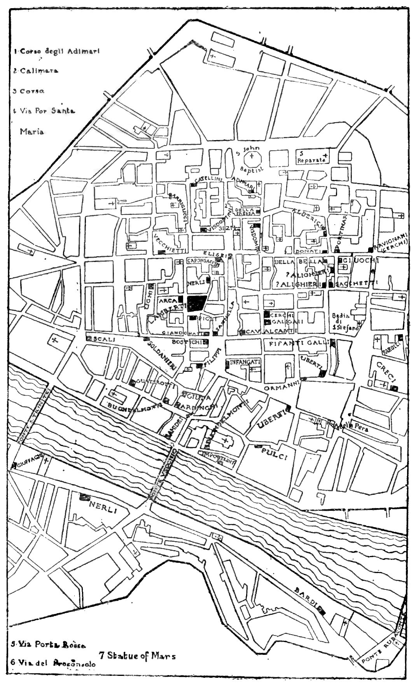

# Canto XVI

<!-- p. 192 (202) -->

## Argument

IN profound reverence for his ancestor, and not without a sense of his own derived dignity, Dante addresses the spirit with the ceremonious plural *ye*, said to have originated in Rome, though no longer in use there; and hereon Beatrice (only moderately interested in Florentine antiquities, and so standing a little apart, but keenly alert to all that may effect the moral or spiritual weal of her charge) checks his rising vanity with a warning smile (1-15). Dante, full of such lofty joy as would on earth strain the mind to bursting, questions Cacciaguida as to ancient Florence (16-27), whereon he, in the speech of an earlier day, tells the date of his birth and the place where his forebears dwelt, declining, in enigmatical terms, to say more of them (28-45). The population of military age was then but a fifth of what it had since become, and the narrow limits of the territory of Florence kept the blood of her citizens pure. Would that it were so yet! But lust of power, the confusion resulting from Papal ambition, and the fatal quarrel between the Buondelmonti

<!-- p. 193 (203) -->

and Amidei, have ruined all, and have given unwieldy bulk to Florence while polluting her blood (46-72). Then follows a dirge on the great families of ancient Florence, introduced by tragic reflections on the tide-like instability of all earthly things. Many of these families are mentioned by name, others are indicated by their characteristics or their blazon (73-126). Count Hugo ennobled the six families that bear his coat of arms, with various differences, though Giano della Bella had since joined the people (127-132). The Gualterotti and Importuni were already in Florence, but the Buondelmonti were not yet—would that they had never been!—their neighbours. The Amidei and their associates were held in honour. Alas that Buondelmonte broke his marriage word with them, and gave rise to all the internal strife of Florence. How much ill had been avoided if God had plunged him into the Ema as he rode into Florence. But it was fated that she should make her sacrifice to that torso of Mars, at whose feet he was slain (133-154).

<!-- p. 192 (202), text -->

O poca nostra nobiltà di sangue! <!-- label: Marte -->\
&emsp;se gloriar di te la gente fai\
&emsp;quaggiù, dove l' affetto nostro langue,\
mirabil cosa non mi sarà mai; 4\
&emsp;chè là, dove appetito non si torce,\
&emsp;dico nel cielo, io me ne gloriai.\
Ben sei tu manto che tosto raccorce, 7\
&emsp;sì che, se non s' appon di dìe in dìe,\
&emsp;lo tempo va dintorno con le force.\
Dal *voi* che prima Roma sofferie, 10\
&emsp;in che la sua famiglia men persevra,\
&emsp;ricominciaron le parole mie;

<!-- p. 193 (203), text -->

Ah puny blood-nobility of ours! If thou makest folk glory in thee here below, where our affections sicken, <!-- label: The courageous -->

it shall be marvel to me never more; for there, where appetite is unwarped, I mean in heaven, I gloried me therein. <!-- label: Pride of Birth -->

Yet verily thou art a mantle that soon shrinketh, so that, if day by day there be nought added, time goeth round with the shears.

With that *ye* that Rome was first to allow wherein her household doth least persevere, my words began again;

<!-- p. 194 (204) -->

onde Beatrice, ch' era un poco scevra, 13 <!-- label: Marte -->\
&emsp;ridendo, parve quella che tossio\
&emsp;al primo fallo scritto di Ginevra.\
Io cominciai: “Voi siete il padre mio, 16\
&emsp;voi mi date a parlar tutta baldezza,\
&emsp;voi mi levate sì ch' io son più ch' io.\
Per tanti rivi s' empie d' allegrezza 19\
&emsp;la mente mia, che di sè fa letizia,\
&emsp;perchè può sostener che non si spezza.\
Ditemi dunque, cara mia primizia, 22\
&emsp;quai fur li vostri antichi, e quai fur gli anni\
&emsp;che si segnaro in vostra puerizia.\
Ditemi dell' ovil di San Giovanni 25\
&emsp;quanto era allora, e chi eran le genti\
&emsp;tra esso degne di più alti scanni.”\
Come s' avviva allo spirar dei venti 28\
&emsp;carbone in fiamma, così vidi quella\
&emsp;luce risplendere ai miei blandimenti;\
e come agli occhi miei si fe' più bella, 31\
&emsp;così con voce più dolce e soave,\
&emsp;ma non con questa moderna favella,\
dissemi: “Da quel dì che fu detto *Ave* 34\
&emsp;al parto in che mia madre, ch' è or santa,\
&emsp;s' alleviò di me ond' era grave,\
al suo Leon cinquecento cinquanta 37\
&emsp;e trenta fiate venne questo foco\
&emsp;a rinfiammarsi sotto la sua pianta.\
Gli antichi miei ed io nacqui nel loco, 40\
&emsp;dove si trova pria l' ultimo sesto\
&emsp;da quel che corre il vostro annual gioco.\
Basti dei miei maggiori udirne questo; 43\
&emsp;chi ei si furo, ed onde venner quivi,\
&emsp;più è tacer, che ragionare, onesto.

<!-- p. 195 (205) -->

whereon Beatrice, who was a little sundered from us, smiled, and seemed to me like her who coughed at the first trespass writ of Guinivere. <!-- label: The courageous -->

I began: “Ye are my father, ye give me full boldness to speak, ye so uplift me, that I am more than I. <!-- label: Dante -->

By so many streams my mind is filled with gladness, it giveth itself joy that it can bear it and yet not be rent.

Tell me, then, dear stock from which I spring, what was your ancestry, and what the years recorded in your boyhood.

Tell me of the sheepfold of St John, how great it then was, and who were the folk worthy of loftiest seats in it.”

As a coal quickeneth into flame at the wind’s breathing, so did I see that light glow forth at my caressing words;

and even as to my sight it grew more beauteous, so with a voice more sweet and gentle, but not in this our modern dialect,

he said: “From the day on which *Ave* was uttered, to the birth wherein my mother, now sainted, unburdened her of me with whom she was laden, <!-- label: Cacciaguida -->

five hundred, fifty, and thirty times did this flame return to his own Lion to rekindle him beneath his feet.

My forebears and myself were born in the spot where he who runneth in your annual games doth first encounter the last sesto.

About my ancestors let it suffice so much to hear; of who they were and whence they hither came silence were comelier than discourse.

<!-- p. 196 (206) -->

Tutti color ch' a quel tempo eran ivi 46 <!-- label: Marte -->\
&emsp;da poter arme, tra Marte e il Batista,\
&emsp;erano il quinto di quei che son vivi.\
Ma la cittadinanza, ch' è or mista 49\
&emsp;di Campi, di Certaldo e di Fighine,\
&emsp;pura vedeasi nell' ultimo artista.\
O quanto fora meglio esser vicine 52\
&emsp;quelle genti ch' io dico, ed al Galluzzo\
&emsp;ed a Trespiano aver vostro confine,\
che averle dentro, e sostener lo puzzo 55\
&emsp;del villan d' Aguglion, di quel da Signa,\
&emsp;che già per barattare ha l' occhio aguzzo!\
Se la gente, ch' al mondo più traligna, 58\
&emsp;non fosse stata a Cesare noverca,\
&emsp;ma, come madre a suo figliuol, benigna,\
tal fatto è Fiorentino, e cambia e merca, 61\
&emsp;che si sarebbe volto a Simifonti,\
&emsp;là dove andava l' avolo alla cerca.\
Sariasi Montemurlo ancor dei Conti, 64\
&emsp;sariansi i Cerchi nel pivier d' Acone,\
&emsp;e forse in Val di Greve i Buondelmonti.\
Sempre la confusion delle persone 67\
&emsp;principio fu del mal della cittade,\
&emsp;come del corpo il cibo che s' appone.\
E cieco toro più avaccio cade 70\
&emsp;che 'l cieco agnello, e molte volte taglia\
&emsp;più e meglio una che le cinque spade.\
Se tu riguardi Luni ed Urbisaglia 73\
&emsp;come son ite, e come se ne vanno\
&emsp;di retro ad esse Chiusi e Sinigaglia;\
udir come le schiatte si disfanno, 76\
&emsp;non ti parrà nuova cosa nè forte,\
&emsp;poscia che le cittadi termine hanno.

<!-- p. 197 (207) -->

At that time all who were there, between Mars and the Baptist, capable of arms, were but the fifth of the now living ones. <!-- label: The courageous -->

But the citizenship, contaminated now from Campi, from Certaldo and from Fighine, saw itself pure down to the humblest artizan.

Oh, how much better were it for these folk of whom I speak to be your neighbours, and to have your boundary at Galluzzo and at Trespiano,

than to have them within, and bear the stench of the hind of Aguglion, and of him of Signa, who still for jobbery hath his eye alert! <!-- label: Undue growth of Florence -->

Had the race, which goeth most degenerate on earth, not been to Cæsar as a step-mother, but, as a mother to her son, benign,

one who is now a Florentine and changeth coin and wares, had been dispatched to Simifonte, where his own grandfather went round a-begging.

Still would Montemurlo pertain unto the Conti, still were the Cerchi in Acone parish, and perchance in Valdigreve were still the Buondelmonti.

Ever was mingling of persons the source of the city’s woes, as piled on food is of the body’s.

And a blind bull falleth more presently than a blind lamb, and many a time cutteth one sword better and more than five. <!-- label: Unwieldy bulk -->

If thou regard Luni and Urbisaglia, how they have perished, and how are following them Chiusi and Sinigaglia;

it shall not seem a novel or hard thing to hear how families undo themselves, since even cities have their term.

<!-- p. 198 (208) -->

Le vostre cose tutte hanno lor morte, 79 <!-- label: Marte -->\
&emsp;sì come voi; ma celasi in alcuna\
&emsp;che dura molto, e le vite son corte.\
E come il volger del ciel della luna 82\
&emsp;copre ed iscopre i liti senza posa,\
&emsp;così fa di Fiorenza la fortuna;\
per che non dee parer mirabil cosa 85\
&emsp;ciò ch' io dirò degli alti Fiorentini,\
&emsp;onde la fama nel tempo è nascosa.\
Io vidi gli Ughi, e vidi i Catellini, 88\
&emsp;Filippi, Greci, Ormanni ed Alberichi,\
&emsp;già nel calare, illustri cittadini;\
e vidi così grandi come antichi, 91\
&emsp;con quel della Sannella, quel dell' Arca,\
&emsp;e Soldanieri, ed Ardinghi, e Bostichi.\
Sopra la porta, che al presente è carca 94\
&emsp;di nuova fellonia di tanto peso\
&emsp;che tosto fia jattura della barca,\
erano i Ravignani, ond' è disceso 97\
&emsp;il conte Guido, e qualunque del nome\
&emsp;dell' alto Bellincion ha poscia preso.\
Quel della Pressa sapeva già come 100\
&emsp;regger si vuole, ed avea Galigaio\
&emsp;dorata in casa sua già l' elsa e il pome.\
Grande era già la colonna del Vaio, 103\
&emsp;Sacchetti, Giuochi, Fifanti e Barucci,\
&emsp;e Galli, e quei che arrossan per lo staio.\
Lo ceppo, di che nacquero i Calfucci, 106\
&emsp;era già grande, e già erano tratti\
&emsp;alle curule Sizii ed Arrigucci.\
O quali io vidi quei che son disfatti 109\
&emsp;per lor superbia! e le palle dell' oro\
&emsp;fiorian Fiorenza in tutti suoi gran fatti.

<!-- p. 199 (209) -->

Your affairs all have their death, even as have ye; but in such an one as long endureth, it escapeth note because your lives are short. <!-- label: The courageous -->

And as the rolling of the lunar heaven covereth and layeth bare the shores incessantly, so fortune doth to Florence;

wherefore it should appear no wondrous thing which I shall tell of the exalted Florentines whose fame lieth concealed by time.

I have seen the Ughi, seen the Catellini, Filippi, Greci, Ormanni, and Alberichi, illustrious citizens, already in decline; <!-- label: Florentine families -->

I have seen, even as great as ancient, with him of the Sannella, him of the Arca, and Soldanieri and Ardinghi and Bostichi.

Over the gate which is now laden with new felony of so great weight, that soon ’twill be the wrecking of the barque,

were the Ravignani, whence descendeth the County Guy, and whoso since hath taken lofty Bellincione’s name.

The Della Pressa knew already how to govern, and Galigaio in his mansion already had the hilt and pummel gilt.

Great already were the Vair column, Sacchetti, Giuochi, Fifanti, and Barucci; and Galli, and they who blush red for the bushel. <!-- label: Pigli -->

The stock whence the Calfucci sprang was great already, and already drawn to curule office were Sizii and Arrigucci. <!-- label: Donati -->

Oh, how great have I seen those now undone by their pride! And the balls of gold adorned Florence in all her mighty feats. <!-- label: Uberti and Lamberti -->

<!-- p. 200 (210) -->

Così facean li padri di coloro 112 <!-- label: Marte -->\
&emsp;che, sempre che la vostra chiesa vaca,\
&emsp;si fanno grassi stando a consistoro.\
L' oltracotata schiatta, che s' indraca 115\
&emsp;retro a chi fugge, ed a chi mostra il dente\
&emsp;o ver la borsa com' agnel si placa,\
già venia su, ma di picciola gente, 118\
&emsp;sì che non piacque ad Ubertin Donato\
&emsp;che poi il suocero il fe' lor parente.\
Già era il Caponsacco nel mercato 121\
&emsp;disceso giù da Fiesole, e già era\
&emsp;buon cittadino Giuda ed Infangato.\
Io dirò cosa incredibile e vera; 124\
&emsp;nel picciol cerchio s' entrava per porta,\
&emsp;che si nomava da quei della Pera.\
Ciascun che della bella insegna porta 127\
&emsp;del gran barone, il cui nome e il cui pregio\
&emsp;la festa di Tommaso riconforta,\
da esso ebbe milizia e privilegio; 130\
&emsp;avvenga che col popol si raduni\
&emsp;oggi colui che la fascia col fregio.\
Già eran Gualterotti ed Importuni; 133\
&emsp;ed ancor saria Borgo più quieto,\
&emsp;se di nuovi vicin fosser digiuni.\
La casa di che nacque il vostro fleto, 136\
&emsp;per lo giusto disdegno che v' ha morti\
&emsp;e posto fine al vostro viver lieto,\
era onorata ed essa e suoi consorti. 139\
&emsp;O Buondelmonte, quanto mal fuggisti\
&emsp;le nozze sue per gli altrui conforti!\
Molti sarebbon lieti, che son tristi, 142\
&emsp;se Dio t' avesse conceduto ad Ema\
&emsp;la prima volta che a città venisti.

<!-- p. 201 (211) -->

So did their fathers who, whene’er your church is vacant, stand guzzling in consistory. <!-- label: The courageous -->

The outrageous tribe that playeth dragon after whoso fleeth, and to whoso showeth tooth—or purse—is quiet as a lamb, <!-- label: Adimari -->

was coming up already, but from humble folk, so that it pleased not Ubertin Donato when his father-in-law made him their relative.

Already Caponsacco had come down from Fiesole into the market-place; and good citizens already were Giuda and Infangato.

I will tell a thing incredible but true: the little circuit was entered by a gate named after them of Pera. <!-- label: The Pera gate -->

Each one who beareth aught of the fair arms of the great baron whose name and worth the festival of Thomas keepeth living, <!-- label: Count Hugo -->

from him derived knighthood and privilege; though he who fringeth it around hath joined him now unto the people. <!-- label: Della Bella -->

Already there were Gualterotti and Importuni; and still were Borgo a more quiet spot, if from new neighbours they were still afasting.

The house from which your wailing sprang, because of the just anger which hath slain you and placed a term upon your joyous life, <!-- label: Amidei -->

was honoured, it and its associates. Oh Buondelmonte, how ill didst thou flee its nuptials at the prompting of another!

Joyous had many been who now are sad, had God committed thee unto the Ema the first time that thou camest to the city.

<!-- p. 202 (212) -->

Ma conveniasi a quella pietra scema 145 <!-- label: Marte -->\
&emsp;che guarda il ponte, che Fiorenza fesse\
&emsp;vittima nella sua pace postrema.\
Con queste genti, e con altre con esse, 148\
&emsp;vid' io Fiorenza in sì fatto riposo,\
&emsp;che non avea cagion onde piangesse;\
con queste genti vid' io glorioso 151\
&emsp;e giusto il popol suo, tanto che il giglio\
&emsp;non era ad asta mai posto a ritroso,\
nè per division fatto vermiglio.” 154

<!-- p. 203 (213) -->

But to that mutilated stone which guardeth the bridge ’twas meet that Florence should give a victim in her last time of peace. <!-- label: The courageous -->

With these folk, and with others with them, did I see Florence in such full repose, she had not cause for wailing; <!-- label: Statue of Mars -->

with these folk I saw her people so glorious and so just, ne’er was the lily on the shaft reversed, nor yet by faction dyed vermilion.”

## Notes

<!-- p. 202 (212), notes -->

1-9. Dante deals with the subject of nobility in the *De Monarchia*, ii. 3: especially lines 12-20; and in *Conv.* iv. *passim*; but especially 14: 111-130.

10-12. The legend ran that when Cæsar united in himself all the high offices of state, he was addressed as a plurality of individuals, “ye”; but as a matter of fact in Dante’s time the Romans adhered to the old-fashioned *thou*. “Nay, they would not address either Pope or Emperor save as *thou*.”—Benvenuto.

13-15. “At these words which the queen spake to him [Lancelot] it came to pass that the lady of Malehaut coughed, of a set purpose, and uplifted her head which she had bowed down.” Romance of Lancelot. See Toynbee under *Galeotto*.

25\. Florence, the patron saint of which was St. John Baptist.

33\. Does not imply that Cacciaguida spoke throughout in Latin as he had begun (xv. 28-30), but that he spoke in the ancient Florentine dialect of his day. Dante was well aware of the rapidity with which spoken dialects, not yet fixed by a standard literature, vary. See *De Vulgari Eloquentia*, i. 9: 60-77.

34-39. Some MSS. and editions read *three* for *thirty*; and the question is also raised whether the period of Mars is to be calculated at the rough approximation of two years (compare *Conv.* ii. 15: 145, where the half revolution is given at “about a year”), or at the nearer approximation of 687 days, which was known in Dante’s age. Two of the four combinations which might thus arise are excluded by the date of Conrad’s crusade, 1147. (Compare xv. 139). Two years multiplied by 553 would give A.D. 1106 as the year of Cacciaguida’s birth, and 687 days multiplied by 580 would give the year 1091. The former date would make Cacciaguida forty-one when he went on crusade, which seems more appropriate than fifty-six; but the reading that gives the latter has the better authority.

<!-- p. 203 (213), notes -->

37\. *His own lion.* Apparently the kinship between Leo and Mars is to be found in the attribute of courage, not in any specific astrological belief of the time.

40-42. The annual race was run along the *Corso*, and the Sesto of St. Peter was the last that the racers entered. Just as you come to it you pass the house of the Elisei on your right. (Compare xv. 136, *note*). It is a place of ancient families. On the Quarters and Sesti of Ancient Florence, see Villani, iii. 2.

43-45. The reader may make what he can of this ambiguous utterance. The commentators throw no fresh light on it.

47\. The baptistery lay at the north of the ancient Florence, and the statue of Mars (at the head of the Ponte Vecchio on the north side) was practically its southern boundary. On this statue of Mars compare *Inf.* xiii. 143-150. Further, see Villani, i. 42: 60; iii. 1; v. 38. The associations with this torso of Mars are so vivid and pervading that every student of Dante should make himself thoroughly acquainted with them. See further lines 145-7, *note*.

52\. *Neighbours*, not fellow-citizens.

<!-- p. 204 (214) -->

56\. Baldo d’Aguglione and Fazio de’ Mori Ubaldini da Signa, both of them lawyers, and both of them deserters from the White to the Black faction in 1302. Baldo was a prior in 1298 and in 1311, in which last year he drew up the decree recalling many of the exiles, but expressly excluding Dante. (Gardner, i. 6, “Letters and Fresh Sentence.”) In 1299 he had been convicted of cutting an inconvenient entry out of the public records of the courts of justice. Compare *Purg.* xii. 105. Fazio held several high offices from 1310 onwards. He was a bitter opponent of the Whites and also of Henry VII.

58-63. Simifonti was a fortress in Valdelsa, captured in 1202. See Villani, v. 30. The specific allusion is obscure. Does it refer to a descendant of the traitor mentioned by Villani? or to some event more closely connected with papal intrigues and aggressions? Lines 58-60, a clear reference to the Roman priesthood, point to the latter interpretation. (Compare *Purg.* xvi. 103-120.)

64\. *Montemurlo*, between Prato and Pistoja, was sold by the Conti Guidi to the Florentines in 1254, as they themselves felt unequal to the task of defending it against the Pistojans. Its acquisition, therefore, marks a step in the aggressive expansion of Florence.

65\. *Acone* was probably in the Val di Sieve. Well if the Cerchi (leaders of the Whites) had stayed there! Compare lines 94-96.

66\. This is the climax. The implication is that in that case all the intestine conflicts of Florence would have been averted. Compare lines 133-147, *note*.

73\. *Luni* or Luna, “now destroyed,” Villani, i. 50. It was on the Macra, the northern boundary of Tuscany, and was celebrated in legendary lore.

*Urbisaglia*, a decayed city of the March of Ancona.

75\. *Chiusi*, the ancient Clusium, was in the pestilent Val di Chiana (compare xiii. 23, *note*). Hence probably its decline. Like Sinigalia (on the sea shore, north of Ancona) it has escaped the complete desolation which Dante anticipated for it.

88-135. Information concerning many of these families will be found up and down the pages of Villani, especially iv. 10-13; and the sites of their houses, as identified by Carbone, are given (with the exception of the Chiarmontesi, the Gangalandi, the Uccellini and the Gherardeschi) in the accompanying map, which also follows Carbone. The alternative site of the house of the Alighieri is taken from Witte.

<!-- p. 205 (215) -->

94-99. The gate of St. Peter, the abode in Dante’s time of the Cerchi. Compare line 65. (Gardner, i. 4, “Blacks and Whites”). Further, compare xv. 112, *note*.

102\. Insignia of knighthood.

103\. The Pigli whose arms are barred with vair (=ermine).

105\. The Chiarmontesi, a Guelf family who dwelt in the quarter of St. Peter, but the site of whose houses has not been further identified. One of the family, in Dante’s time, had falsified the measure by which in his public capacity he issued salt to the Florentines. Compare *Purg.* xii. 105.

106, 107. The Donati, of whom the Calfucci were a branch.

109, 110. The Uberti, once the dominating family in Florence (see Villani, v. 9, and many other passages). Their characteristic pride survived in the great Farinata. (Compare *Inf.* x., especially 31-36). The *golden balls* were the device of the Lamberti, of whom was Mosca. *Inf.* xxviii. 106.

112-114. The Visdomini, who, with the Della Tosa, “were patrons and defenders of the bishopric.” Villani, iv. 10. Hence Dante’s taunt that they fed fat on the sequestrated revenues when the See was vacant.

115-117. The Ademari, between whom and Dante there was an implacable hostility.

118-120. Ubertino Donati had married a daughter of Bellincion Berti, and, says Cacciaguida, objected to another of Bellincion’s daughters being given in marriage to one of the Ademari. Compare Gardner, i. 3; last paragraph.

124-126. “Who would believe that the della Pera were an ancient family? But I say to thee that they are so ancient that a gate of the first circle of the city was called after them.”—Ottimo Comento.

127-130. Hugh of Brandenbourg, Imperial Vicar of Tuscany, died on St Thomas’ Day, 1006, “and whilst the said Hugh was living, he made in Florence many knights of the family of the Giandonati, of the Pulci, of the Nerli, of the Counts of Gangalandi, and of the family Della Bella, which all, for love of him, retained and bore his arms, barry, white and red, with divers charges.” Villani, iv. 2; where the whole story of Hugh is given. To these families the Ciuffagni are added in iv. 13.

<!-- p. 206 (216) -->

131, 132. Giano della Bella, the great democratic leader, the prime mover of the “Ordinances of Justice.” Compare Gardner, i. 4; Villani, *Introduction* § 5, especially pages xxxix. sqq.; and book viii. § 1, 8, &c. The della Bella had a border of gold on their coat of arms.

133-135. The reference is to the Buondelmonti, whose houses will be seen to neighbour those of the Gualterotti and the Importuni.

136-138. The Amidei. See note on 145-147.

139\. *Associates*, the Uccellini and Gherardini. In the democratic legislation against the Magnates (who systematically defied the civic law and recognised no authority save that of the Family Council), members of a family who had ceased to act with it were regarded as no longer belonging to it, and members of another family who had joined its Tower-club, that is to say, its association for the maintenance of a tower for military purposes, were regarded as its “consorts,” or associates, forming one *consorteria* with it, and therefore legally identified with it.

145-7. Buondelmonte was betrothed to a maiden of the Amidei; but a lady of the Donati, introducing him to her beautiful daughter, persuaded him to break faith with his bride. Her friends and relatives held a council of war and debated whether to slay him or be content with some lesser chastisement. Then “Mosca de’ Lamberti said the evil word: ‘Thing done hath an end’; to wit, that he should be slain; and so it was done.” He was slain at the foot of the statue of Mars. Villani v. 38.

153\. By the triumphant foe.

154\. The old standard of Florence bore white lilies on a red field. It was maintained by the Ghibellines. In 1251 the Guelfs adopted a red lily on a white field. (See Villani, vi. 43.)

<!-- p. 207 (217) -->

1 Corso degli Adimari\
2 Calimara\
3 Corso\
4 Via Por Santa Maria\
S John Baptist\
S Reparata\
CATELLINI\
ADIMARI\
ARRIGUCCI\
ALDERIGHI\
VISDOMINI\
2\
DELLA TOSA\
VISDOMINI\
SIZI\
PORTINARI\
VECCHIETTI\
ELISEI\
DONATI\
RAVIGNANI (CERCHI)\
CAPONSACCO\
DELLA BELLA\
GIUOCHI\
ER\
? ALIGHIERI\
6\
NERLI\
? ALIGHIERI\
SACCHETTI\
UGHI\
ARCA\
CERCHI\
LAMBERTI\
PIGLI\
SANTHELLA\
GALIGARI\
Badia di S. Stefano\
GIANDONATI\
CAVALCANTI\
BARUCCI\
SCALI\
BOSTICHI\
FIFANTI\
GALLI\
INFANGATI\
SOLDANIERI\
FILIPPI\
UBERTI\
GRECI\
ORMANNI\
GUALTEROTTI\
GIUDA\
della Pera\
BUONDELMONTI\
BARDINGHI\
AMIDEI\
BUONDELMONTI\
UBERTI\
PULCI\
IMPORTUNI\
PONTE S. TRINITA\
PONTE VECCHIO\
GIUFFAGNI\
NERLI\
BARDI\
PONTE RUBACONTE\
5\. Via Porta Rossa\
6 Via del Proconsolo\
7 Statue of Mars
