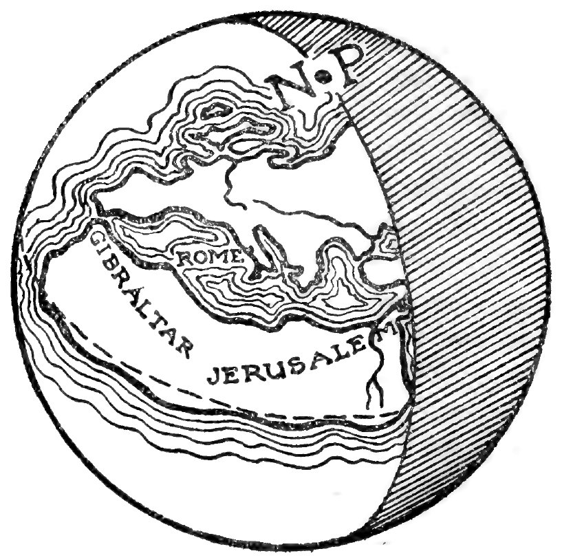
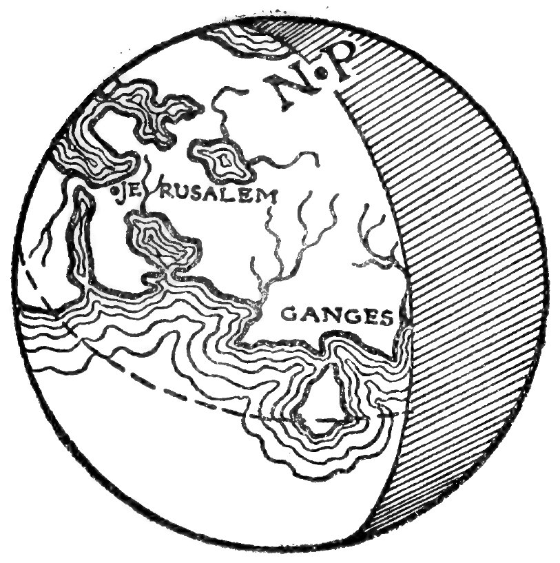

# Canto XXXII

<!-- p. 386 (396) -->

## Argument

BEGINNING with Mary, Bernard indicates to Dante the great distinctions of heaven. Cleaving the rose downwards into two halves run the lines that part those who looked forward to Christ about to come from those who looked back upon him after he had come. Mary who had faith in Christ before he was conceived ranks as a Hebrew, and John Baptist who, when still in the womb, greeted him and afterwards proclaimed him as already come, ranks as a Christian. The two aspects of the faith embrace equal numbers of saints, the one tale being already full and the other near upon it. Midway across the cleaving lines runs the circle that divides the infants who died ere they

<!-- p. 387 (397) -->

had exercised free choice, and who were saved by the faith and the due observances of their parents, from those whose own acts of faith or merit have contributed to their salvation. The children are ranked in accordance with the abysmal but just and orderly judgments of God in the assignment of primal endowment (1-84). Dante then gazes in transport upon the face of Mary and sees the rejoicing Gabriel exult before her (85-114). He looks upon other great denizens of heaven, and is then bidden to turn again in prayer to Mary that after this so great preparation he may receive from her the final grace to enable him to lift his eyes right upon the Primal Love (115-151).

<!-- p. 386 (396), text -->

Affetto al suo piacer, quel comtemplante <!-- label: Empireo -->\
&emsp;libero ufficio di dottore assunse,\
&emsp;e cominciò queste parole sante:\
“La piaga, che Maria richiuse ed unse, 4\
&emsp;quella ch' è tanto bella da' suoi piedi\
&emsp;è colei che l'aperse e che la punse.\
Nell' ordine, che fanno i terzi sedi, 7\
&emsp;siede Rachel di sotto da costei\
&emsp;con Beatrice, sì come tu vedi.\
Sara, Rebecca, Judit, e colei 10\
&emsp;che fu bisava al cantor, che, per doglia\
&emsp;del fallo, disse: *Miserere mei*,\
puoi tu veder così di soglia in soglia 13\
&emsp;giù digradar, com' io ch' a proprio nome\
&emsp;vo per la rosa giù di foglia in foglia.\
E dal settimo grado in giù, sì come 16\
&emsp;infino ad esso, succedono Ebree,\
&emsp;dirimendo del fior tutte le chiome;

<!-- p. 387 (397), text -->

With his love fixed on his Delight, that contemplating saint took the free office of the teacher on him, and began these sacred words: <!-- label: Church triumphant -->

“The wound which Mary closed and annointed, she who is so beauteous at her feet opened and thrust.

In the order which the third rank maketh sitteth below her, Rachael with Beatrice, even as thou seest. <!-- label: From Mary to Ruth -->

Sarah, Rebecca, Judith, and her from whom, third in descent, the singer came who for grief at his sin cried out *have pity on me!*

these mayst thou see from rank to rank descending; even as I, naming their proper names, go down the rose petal by petal.

And down from the seventh onward, even as thereto, follow Hebrew dames, disparting all the flower’s locks;

<!-- p. 388 (398) -->

perchè, secondo lo sguardo che fee 19 <!-- label: Empireo -->\
&emsp;la fede in Cristo, queste sono il muro\
&emsp;a che si parton le sacre scalee.\
Da questa parte, onde il fior è maturo 22\
&emsp;di tutte le sue foglie, sono assisi\
&emsp;quei che credettero in Cristo venturo.\
Dall' altra parte, onde sono intercisi 25\
&emsp;di voti, in semicircoli si stanno\
&emsp;quei ch' a Cristo venuto ebber li visi.\
E come quinci il glorioso scanno 28\
&emsp;della donna del cielo, e gli altri scanni\
&emsp;di sotto lui cotanta cerna fanno,\
così di contra quel del gran Giovanni, 31\
&emsp;che sempre santo il diserto e il martiro\
&emsp;sofferse, e poi l' Inferno da due anni;\
e sotto lui così cerner sortiro 34\
&emsp;Francesco, Benedetto ed Augustino,\
&emsp;ed altri sin quaggiù di giro in giro.\
Or mira l'alto provveder divino, 37\
&emsp;chè l' uno e l' altro aspetto della fede\
&emsp;egualmente empierà questo giardino.\
E sappi che dal grado in giù, che fiede 40\
&emsp;a mezzo il tratto le due discrezioni,\
&emsp;per nullo proprio merito si siede,\
ma per l'altrui, con certe condizioni; 43\
&emsp;chè tutti questi son spiriti assolti\
&emsp;prima ch' avesser vere elezioni.\
Ben te ne puoi accorger per li volti, 46\
&emsp;ed anco per le voci puerili,\
&emsp;se tu li guardi bene e se gli ascolti.\
Or dubbi tu, e dubitando sili; 49\
&emsp;ma io ti solverò il forte legame,\
&emsp;in che ti stringon li pensier sottili.

<!-- p. 389 (399) -->

because, accordant with the way faith looked to Christ, these are the partition-wall whereat the sacred steps are parted. <!-- label: Church triumphant -->

On this side, wherein the flower is mature in all its petals, are seated who believed in Christ to come.

On the other side, where they are broke by empty seats, abide in semi-circles such as had their sight turned to-wards Christ come.

And as on the one side the glorious seat of the Lady of heaven and the other seats below it make so great partition,

so, over against her, doth the seat of that great John who ever holy endured the desert and the martyr death and thereafter Hell for two years’ space; <!-- label: From John to Augustine -->

and beneath him the making of such severance hath been assigned to Francis, Benedict and Augustine, and others down to here from circle unto circle.

Now marvel at the deep divine provision; for either aspect of the faith, in equal measure shall fill full this garden.

And know that, downward from the rank which in mid line cleaveth the two divisions, in virtue of no merit of their own they have their seats, <!-- label: Children -->

but by another’s, under fixed conditions; for these are spirits all released ere they had exercised true choice.

Well mayst thou perceive it by their faces, and also their child voices if thou look aright and if thou listen.

Now thou art perplexed, and in perplexity thou keepest silence; but I will loose the hard knot for thee wherein thy subtle thoughts are binding thee.

<!-- p. 390 (400) -->

Dentro all' ampiezza di questo reame 52 <!-- label: Empireo -->\
&emsp;casual punto non puote aver sito,\
&emsp;se non come tristizia, o sete, o fame;\
chè per eterna legge è stabilito 55\
&emsp;quantunque vedi, sì che giustamente\
&emsp;ci si risponde dall' anello al dito.\
E però questa festinata gente 58\
&emsp;a vera vita non è *sine causa*\
&emsp;intra sè qui più e meno eccellente.\
Lo rege, per cui questo regno pausa 61\
&emsp;in tanto amore ed in tanto diletto,\
&emsp;che nulla volontà è di più ausa,\
le menti tutte nel suo lieto aspetto 64\
&emsp;creando, a suo piacer di grazia dota\
&emsp;diversamente; e qui basti l'effetto.\
E ciò espresso e chiaro vi si nota 67\
&emsp;nella scrittura santa in quei gemelli,\
&emsp;che nella madre ebber l'ira commota.\
Però, secondo il color dei capelli 70\
&emsp;di cotal grazia, l'altissimo lume\
&emsp;degnamente convien che s' incappelli.\
Dunque, senza mercè di lor costume, 73\
&emsp;locati son per gradi differenti,\
&emsp;sol differendo nel primiero acume.\
Bastava sì nei secoli recenti 76\
&emsp;con l'innocenza, per aver salute,\
&emsp;solamente la fede dei parenti;\
poichè le prime etadi fur compiute, 79\
&emsp;convenne ai maschi all' innocenti penne,\
&emsp;per circoncidere, acquistar virtute.\
Ma poichè il tempo della grazia venne, 82\
&emsp;senza battesmo perfetto di Cristo\
&emsp;tale innocenza laggiù si ritenne.

<!-- p. 391 (401) -->

Within this kingdom’s amplitude no chance point may have place, no more than sadness may nor thirst, nor hunger; <!-- label: Church triumphant -->

because established by eternal law is whatsoe’er thou seest, so that the correspondence is exact between the ring and finger.

Wherefore this swift-sped folk to the true life is here, not without cause, more or less excellent in mutual order. <!-- label: Children -->

The King through whom this realm resteth in so great love and in so great delight that never will hath daring for aught more,

as he createth all minds in his own glad sight, doth at his pleasure with grace endow them diversely; and here let the effect suffice.

And this, express and clear, is noted unto you in Holy Writ, anent those twins whose wrath was stirred within their mother’s womb.

Wherefore accordant to the colour of the locks of such grace, needs must the lofty light enchaplet them after their worth.

Wherefore, without reward for their own ways, they are placed in different ranks, differing only in their primal keenness.

Thus, in the new-born ages the parents’ faith alone sufficed, with innocence, to secure salvation; <!-- label: Conditions of their salvation -->

when the first ages were complete male children behoved to gather power to their innocent wings by circumcision.

But when the time of grace had come, then without perfect baptism of Christ such innocence was held back there below.

<!-- p. 392 (402) -->

Riguarda omai nella faccia ch' a Cristo 85 <!-- label: Empireo -->\
&emsp;più si somiglia, chè la sua chiarezza\
&emsp;sola ti può disporre a veder Cristo.”\
Io vidi sopra lei tanta allegrezza 88\
&emsp;piover, portata nelle menti sante\
&emsp;create a trasvolar per quella altezza,\
che quantunque io avea visto davante, 91\
&emsp;di tanta ammirazion non mi sospese,\
&emsp;nè mi mostrò di Dio tanto sembiante.\
E quell'amor che primo lì discese, 94\
&emsp;cantando: *Ave, Maria, gratia plena,*\
&emsp;dinanzi a lei le sue ali distese.\
Rispose alla divina cantilena 97\
&emsp;da tutte parti la beata corte,\
&emsp;sì ch' ogni vista sen fe' più serena.\
“O santo Padre, che per me comporte 100\
&emsp;l'esser quaggiù lasciando il dolce loco\
&emsp;nel qual tu siedi per eterna sorte,\
qual è quell' angel, che con tanto gioco 103\
&emsp;guarda negli occhi la nostra Regina,\
&emsp;innamorato sì che par di foco?”\
Così ricorsi ancora alla dottrina 106\
&emsp;di colui ch'abbelliva di Maria,\
&emsp;come del sole stella mattutina.\
Ed egli a me: “Baldezza e leggiadria, 109\
&emsp;quanta esser può in Angelo ed in alma,\
&emsp;tutta è in lui, e sì volem che sia,\
perch' egli è quegli che portò la palma 112\
&emsp;giù a Maria, quando il figliuol di Dio\
&emsp;carcar si volle della nostra salma.\
Ma vieni omai con gli occhi, sì com' io 115\
&emsp;andrò parlando, e nota i gran patrici\
&emsp;di questo imperio giustissimo e pio.

<!-- p. 393 (403) -->

Look now upon the face which is most likened unto Christ; for its brightness, and no other, hath power to fit thee to see Christ.” <!-- label: Church triumphant -->

I saw rain down upon that face such joyance (borne on the sacred minds created for flying through that lofty region), <!-- label: Mary -->

that all which I had seen before held me not in suspense of so great marvelling, nor showed me so great semblance of God.

And that Love which first descended to her, singing: *Hail, Mary, full of grace* now spread his wings before her.

The divine canticle was answered from every side by the blest Court, so that every face thereby gathered serenity.

“O holy Father, who for my sake acceptest being here below, leaving the sweet place wherein thou sittest by eternal lot,

what is that angel who with such delight looketh our Queen in the eyes, enamoured so he seemeth all aflame?” <!-- label: Gabriel -->

So did I turn again unto his teaching who drew beauty from Mary, as from the sun the morning star.

And he to me, “Exultancy and winsomeness as much as there may be in angel or in soul, is all in him; and we would have it so,

for he it is who brought down the palm to Mary, when the Son of God willed to load him with our burden.

But come now with thine eyes even as I shall traverse in discourse, and note the great patricians of this most just and pious empire.

<!-- p. 394 (404) -->

Quei due che seggon lassù più felici, 118 <!-- label: Empireo -->\
&emsp;per esser propinquissimi ad Augusta,\
&emsp;son d' esta rosa quasi due radici.\
Colui che da sinistra le s'aggiusta, 121\
&emsp;è il padre, per lo cui ardito gusto\
&emsp;l'umana specie tanto amaro gusta.\
Dal destro vedi quel padre vetusto 124\
&emsp;di santa Chiesa, cui Cristo le chiavi\
&emsp;raccomandò di questo fior venusto.\
E quei che vide tutt' i tempi gravi, 127\
&emsp;pria che morisse, della bella sposa\
&emsp;che s'acquistò con la lancia e coi chiavi,\
siede lungh' esso; e lungo l'altro posa 130\
&emsp;quel duca, sotto cui visse di manna\
&emsp;la gente ingrata, mobile e ritrosa.\
Di contro a Pietro vedi sedere Anna, 133\
&emsp;tanto contenta di mirar sua figlia,\
&emsp;che non move occhi per cantare Osanna.\
E contro al maggior padre di famiglia 136\
&emsp;siede Lucia, che mosse la tua donna,\
&emsp;quando chinavi, a ruinar, le ciglia.\
Ma perchè il tempo fugge, che t'assonna, 139\
&emsp;qui farem punto, come buon sartore\
&emsp;che, com' egli ha del panno, fa la gonna;\
e drizzeremo gli occhi al primo amore, 142\
&emsp;sì che, guardando verso lui, penetri,\
&emsp;quant' è possibil, per lo suo fulgore.\
Veramente (nè forse tu t'arretri 145\
&emsp;movendo l'ali tue, credendo oltrarti)\
&emsp;orando grazia convien che s' impetri,\
grazia da quella che può aiutarti; 148\
&emsp;e tu mi segui con l'affezione,\
&emsp;sì che dal dicer mio lo cor non parti.”\
E cominciò questa santa orazione. 151

<!-- p. 395 (405) -->

Those two who sit up there, most blest by being nearest to the Empress, are as two roots of this our rose. <!-- label: Church triumphant -->

He who neighboureth her upon the left is that Father because of whose audacious tasting the human race tasteth such bitterness. <!-- label: Adam and Peter -->

On the right, look upon that ancient Father of Holy Church to whom Christ commended the keys of this lovesome flower.

And he who, ere he died, saw all the grievous seasons of that fair spouse who with the lance and with the nails was won, <!-- label: John -->

sitteth by his side; and by the other resteth that leader under whom was fed by manna the folk ungrateful, fickle and mutinous. <!-- label: Moses -->

Over against Peter see Anna sit, so satisfied to gaze upon her daughter that she removeth not her eyes to sing Hosanna. <!-- label: Anna -->

And o’er against the greatest of housefathers sitteth Lucy who moved thy Lady when thou wert stooping down thy brows to thy destruction. <!-- label: Lucy -->

But since the time that doth entrance thee fleeth, here let us make a stop, like to the careful tailor who to the cloth he hath cutteth the garment;

and let us turn our eyes to the Primal Love, so that gazing toward him thou mayst pierce as far as may be into his shining.

But—lest perchance thou backward fall as thou dost ply thy wings, thinking to forward thee,—by prayer behoveth grace to be acquired, <!-- label: Prayer for grace -->

grace from her who hath power to aid thee; and do thou follow me with such affection that from my words thy heart be severed not.” And he began this holy prayer.

## Notes

<!-- p. 396 (406) -->

1-60. Compare the diagram in illustration of the Rose of Paradise in Gardner.

10-13. See *Ruth* iv. 21, 22. “Boaz [the husband of Ruth] begat Obed, and Obed begat Jesse, and Jesse begat David.” Compare, further, *Psalm* li. (Vulgate l.) and its inscription.

33\. The two years that elapsed between his martyrdom and the descent of Christ to Limbo. Compare *Inf.* iv. 52-63.

57\. *Ring and finger*=the thing fitting and the thing to be fitted; here the grace that is given and the grace that would be appropriate.

66\. Compare *Purg.* iii. 37.

67-69. See *Genesis* xxv. 22, 23; and compare *Parad.* viii. 130, 131.

II\
N·P\
ROME\
GIBRALTAR\
JERUSALEM

*To Canto XXVII.*

<!-- p. 397 (407) -->

70\. *The colour of the locks* seems to mean nothing more than the complexion, tone, or quality of grace.

75\. *Keenness* of vision, *i.e.* power to see God.

84\. It is noteworthy that Bernard himself, in a treatise addressed to Hugo of St. Victor, shrinks from this appalling conclusion. “We must suppose that the ancient sacraments were efficacious as long as it can be shown that they were not notoriously prohibited. And after that? It is in God’s hands. Not mine be it to set the limit!”

127-129. John the Evangelist. The allusion is not to his long life, but to the vision recorded in the *Apocalypse*, regarded as a prophecy of the future sufferings of the Church.

137, 138. See *Inf.* ii.

I\
N·P\
JERUSALEM\
GANGES

*To Canto XXII.*
