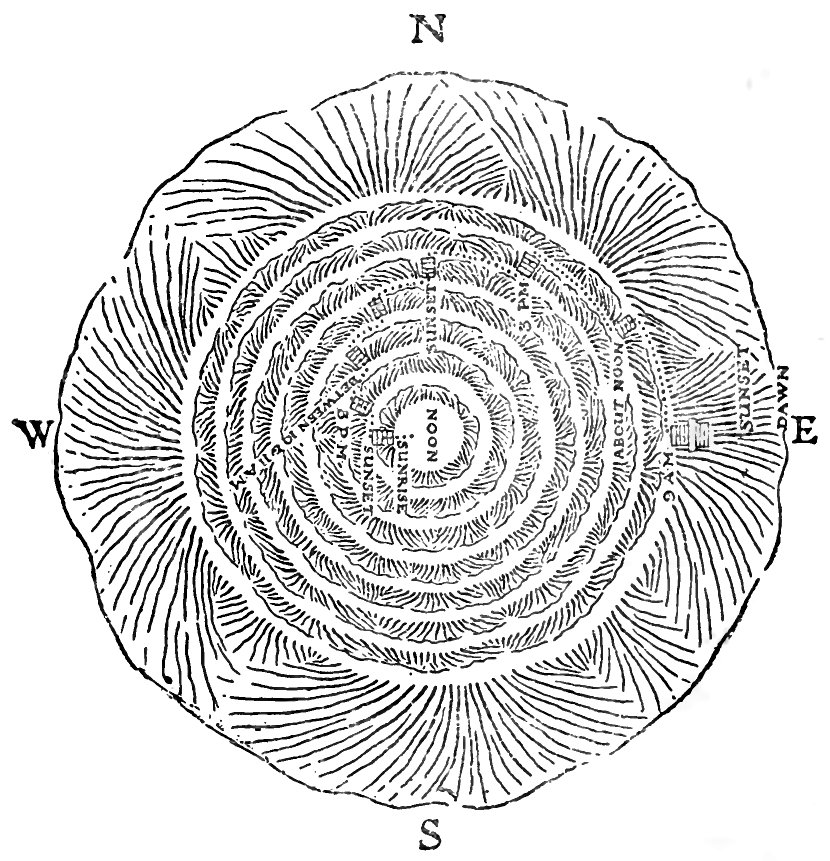
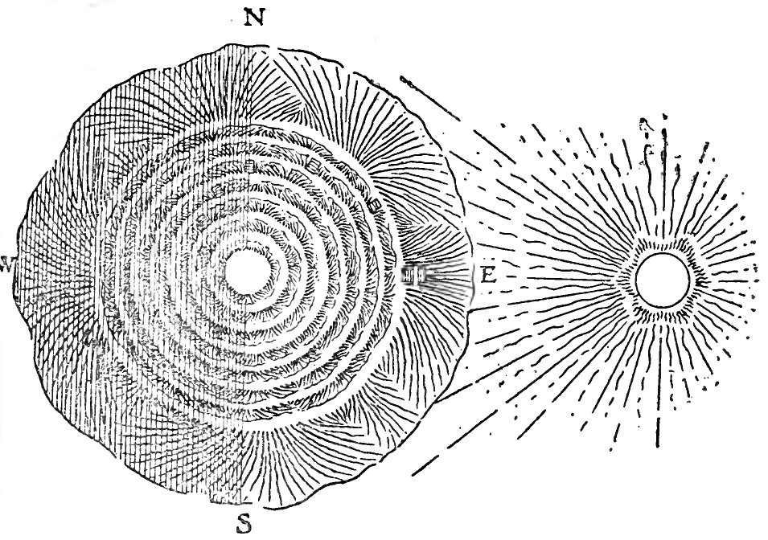

# Canto I

<!-- p. 2 (014) -->

## Argument

PROLOGUE (1-12). The poets issue on the low-lying shore east of the Mount of Purgatory, and Dante’s eyes, which in Hell have shared the misery of his heart, become once more the instruments of delight, as he looks into the clear blue sky and sees Venus near the eastern horizon (13-21). The South Pole of the Heavens is well above the southern horizon, and all is bathed in the light of the glorious constellation never seen since man, at the Fall, was banished to the Northern Hemisphere (22-27). Turning north, the poet perceives the venerable figure of Cato, his face illuminated by the four stars, typifying the four moral virtues (28-39). He challenges the poets as though fugitives from Hell (40-48); but Virgil pleads the command of a Lady of Heaven, and explains that Dante still

<!-- p. 3 (015) -->

lives, and is seeking that liberty for love of which Cato himself had renounced his life. He further appeals to him, by his love of Marcia, to further their journey through his realm (49-84). Cato is untouched by the thought of Marcia, from whom he is now inwardly severed; but in reverence for the heavenly mandate he bids Virgil gird Dante with the rush of humility and cleanse his face with dew from the stains of Hell, that he may be ready to meet the ministers of Heaven. The sun, now rising, will teach them the ascent (85-108). The poets seek the shore, as the sea ripples under the morning breeze; and Virgil follows Cato’s behest, cleansing Dante’s face with dew, and plucking the rush, which instantly springs up again miraculously renewed (109-136).

<!-- p. 2 (014), text -->

Per correr miglior acqua alza le vele <!-- label: Anti-purgatorio -->\
&emsp;omai la navicella del mio ingegno,\
&emsp;che lascia retro a sè mar sì crudele.\
E canterò di quel secondo regno, 4\
&emsp;dove l' umano spirito si purga\
&emsp;e di salire al ciel diventa degno.\
Ma qui la morta poesì risurga, 7\
&emsp;o sante Muse, poichè vostro sono,\
&emsp;e qui Calliopè alquanto surga,\
seguitando il mio canto con quel suono, 10\
&emsp;di cui le Piche misere sentiro\
&emsp;lo colpo tal che disperar perdono.\
Dolce color d' oriental zaffiro, 13\
&emsp;che s' accoglieva nel sereno aspetto\
&emsp;dell' aer puro infino al primo giro,\
agli occhi miei ricominciò diletto, 16\
&emsp;tosto ch' i' uscii fuor dell' aura morta,\
&emsp;che m' avea contristati gli occhi e il petto.

<!-- p. 3 (015), text -->

To course o’er better waters now hoists sail the little bark of my wit, leaving behind her a sea so cruel. <!-- label: Proem -->

And I will sing of that second realm, where the human spirit is purged and becomes worthy to ascend to Heaven.

But here let dead poesy rise up again, O holy Muses, since yours am I, and here let Calliope rise somewhat, <!-- label: Invocation -->

accompanying my song with that strain whose stroke the wretched Pies felt so that they despaired of pardon.

Sweet hue of orient sapphire which was gathering on the clear forehead of the sky, pure even to the first circle, <!-- label: Approach of Dawn -->

to mine eyes restored delight, soon as I issued forth from the dead air which had afflicted eyes and heart.

<!-- p. 4 (016) -->

Lo bel pianeta che ad amar conforta 19 <!-- label: Anti-purgatorio -->\
&emsp;faceva tutto rider l' oriente,\
&emsp;velando i Pesci ch' erano in sua scorta.\
Io mi volsi a man destra, e posi mente 22\
&emsp;all' altro polo, e vidi quattro stelle\
&emsp;non viste mai fuor che alla prima gente.\
Goder pareva il ciel di lor fiammelle. 25\
&emsp;O settentrional vedovo sito,\
&emsp;poichè privato sei di mirar quelle!\
Com' io dal loro sguardo fui partito, 28\
&emsp;un poco me volgendo all' altro polo\
&emsp;là onde il Carro già era sparito,\
vidi presso di me un veglio solo, 31\
&emsp;degno di tanta riverenza in vista,\
&emsp;che più non dee a padre alcun figliuolo.\
Lunga la barba e di pel bianco mista 34\
&emsp;portava, a' suoi capegli simigliante,\
&emsp;de' quai cadeva al petto doppia lista.\
Li raggi delle quattro luci sante 37\
&emsp;fregiavan sì la sua faccia di lume,\
&emsp;ch' io 'l vedea come il sol fosse davante.\
“Chi siete voi, che contro al cieco fiume 40\
&emsp;fuggito avete la prigione eterna?”\
&emsp;diss' ei, movendo quell' oneste piume.\
“Chi v' ha guidati? o chi vi fu lucerna, 43\
&emsp;uscendo fuor della profonda notte\
&emsp;che sempre nera fa la valle inferna?\
Son le leggi d' abisso così rotte? 46\
&emsp;o è mutato in ciel nuovo consiglio,\
&emsp;che dannati venite alle mie grotte?”\
Lo duca mio allor mi diè di piglio, 49\
&emsp;e con parole e con mano e con cenni,\
&emsp;riverenti mi fe' le gambe e il ciglio.

<!-- p. 5 (017) -->

The fair planet which hearteneth to love was making the whole East to laugh, veiling the Fishes that were in her train. <!-- label: The Planet Venus -->

I turned me to the right hand, and set my mind on the other pole, and saw four stars never yet seen save by the first people. <!-- label: The Four Stars -->

The heavens seemed to rejoice in their flames. O Northern widowed clime, since thou art bereft of beholding them!

When I was parted from gazing at them, turning me a little to the other pole, there whence the Wain had already disappeared,

I saw near me an old man solitary, worthy of such great reverence in his mien, that no son owes more to a father. <!-- label: Cato -->

Long he wore his beard and mingled with white hair, like unto his locks of which a double list fell on his breast.

The rays of the four holy lights adorned his face so with brightness, that I beheld him as were the sun before him.

“Who are ye that against the dark stream have fled the eternal prison?” said he, moving those venerable plumes.

“Who hath guided you? or who was a lamp unto you issuing forth from the deep night that ever maketh black the infernal vale?

Are the laws of the pit thus broken, or is there some new counsel changed in Heaven that being damned ye come to my rocks?”

Then did my Leader lay hold on me, and with words, and with hand, and with signs, made reverent my knees and brow. <!-- label: Virgil -->

<!-- p. 6 (018) -->

Poscia rispose lui: “Da me non venni. 52 <!-- label: Anti-purgatorio -->\
&emsp;Donna scese del ciel, per li cui preghi\
&emsp;della mia compagnia costui sovvenni.\
Ma da ch' è tuo voler che più si spieghi 55\
&emsp;di nostra condizion com' ella è vera,\
&emsp;esser non puote il mio che a te si neghi.\
Questi non vide mai l' ultima sera, 58\
&emsp;ma per la sua follia le fu sì presso,\
&emsp;che molto poco tempo a volger era.\
Sì come io dissi, fui mandato ad esso 61\
&emsp;per lui campare, e non v' era altra via\
&emsp;che questa per la quale io mi son messo.\
Mostrato ho lui tutta la gente ria; 64\
&emsp;ed ora intendo mostrar quelli spirti,\
&emsp;che purgan sè sotto la tua balìa.\
Come io l' ho tratto, saria lungo a dirti: 67\
&emsp;dell' alto scende virtù che m' aiuta\
&emsp;conducerlo a vederti ed a udirti.\
Or ti piaccia gradir la sua venuta: 70\
&emsp;libertà va cercando, che è sì cara,\
&emsp;come sa chi per lei vita rifiuta.\
Tu il sai, chè non ti fu per lei amara 73\
&emsp;in Utica la morte, ove lasciasti\
&emsp;la vesta che al gran dì sarà sì chiara.\
Non son gli editti eterni per noi guasti: 76\
&emsp;chè questi vive e Minos me non lega;\
&emsp;ma son del cerchio ove son gli occhi casti\
di Marzia tua, che in vista ancor ti prega, 79\
&emsp;o santo petto, che per tua la tegni:\
&emsp;per lo suo amore adunque a noi ti piega.\
Lasciane andar per li tuoi sette regni: 82\
&emsp;grazie riporterò di te a lei,\
&emsp;se d' esser mentovato laggiù degni.”

<!-- p. 7 (019) -->

Then answered him: “Of myself I came not. A lady came down from Heaven through whose prayers I succoured this man with my company. <!-- label: Virgil discourses of Dante’s journey -->

But since it is thy will that more be unfolded of our state, how it truly is, my will it cannot be that thou be denied.

He hath ne’er seen the last hour, but by his madness was so near to it, that very short time there was to turn.

Even as I said, I was sent to him to rescue him, and no other way there was but this along which I have set me.

I have shown him all the guilty people, and now do purpose showing those spirits that purge them under thy charge.

How I have brought him, ’twere long to tell thee: Virtue descends from on high which aids me to guide him to see thee and to hear thee.

Now may it please thee to be gracious unto his coming: he seeketh freedom, which is so precious, as he knows who giveth up life for her. <!-- label: His prayer to Cato -->

Thou knowest it; since for her sake death was not bitter to thee in Utica, where thou leftest the raiment which at the great day shall be so bright.

The eternal laws by us are not violated, for he doth live and Minos binds me not; but I am of the circle where are the chaste eyes

of thy Marcia, who visibly yet doth pray thee, O holy breast, that thou hold her for thine own: for love of her then incline thee unto us.

Let us go through thy seven kingdoms: thanks of thee I will bear back to her, if thou deign to be mentioned there below.”

<!-- p. 8 (020) -->

“Marzia piacque tanto agli occhi miei, 85 <!-- label: Anti-purgatorio -->\
&emsp;mentre ch' io fui di là,” diss' egli allora,\
&emsp;“che quante grazie volse da me, fei.\
Or che di là dal mal fiume dimora, 88\
&emsp;più mover non mi può per quella legge\
&emsp;che fatta fu quando me n' uscii fuora.\
Ma se donna del ciel ti move e regge, 91\
&emsp;come tu di', non c' è mestier lusinghe:\
&emsp;bastiti ben che per lei mi richegge.\
Va dunque, e fa che tu costui ricinghe 94\
&emsp;d' un giunco schietto, e che gli lavi il viso\
&emsp;sì che ogni sucidume quindi stinghe:\
chè non si converria l' occhio sorpriso 97\
&emsp;d' alcuna nebbia andar davanti al primo\
&emsp;ministro, ch' è di quei di Paradiso.\
Questa isoletta intorno ad imo ad imo, 100\
&emsp;laggiù, colà dove la batte l' onda,\
&emsp;porta de' giunchi sopra il molle limo.\
Null' altra pianta, che facesse fronda 103\
&emsp;o indurasse, vi puote aver vita,\
&emsp;però che alle percosse non seconda.\
Poscia non sia di qua vostra reddita; 106\
&emsp;lo sol vi mostrerà, che surge omai,\
&emsp;prender lo monte a più lieve salita.”\
Così sparì; ed io su mi levai 109\
&emsp;senza parlare, e tutto mi ritrassi\
&emsp;al duca mio, e gli occhi a lui drizzai.\
Ei cominciò: “Figliuol, segui i miei passi: 112\
&emsp;volgiamci indietro, chè di qua dichina\
&emsp;questa pianura a' suoi termini bassi.”\
L' alba vinceva l' ôra mattutina 115\
&emsp;che fuggia innanzi, sì che di lontano\
&emsp;conobbi il tremolar della marina.

<!-- p. 9 (021) -->

“Marcia was so pleasing to mine eyes while I was yonder,” said he then, “that every grace she willed of me I did. <!-- label: Cato replies to Virgil -->

Now that she dwells beyond the evil stream, no more may she move me, by that law which was made when I thence came forth.

But if a heavenly lady moves and directs thee, as thou sayest, no need is there for flattery: let it suffice thee that in her name thou askest me.

Go then, and look that thou gird this man with a smooth rush, and that thou bathe his face so that all filth may thence be wiped away:

for ’twere not meet with eye obscured by any mist to go before the first minister of those that are of Paradise.

This little isle all round about the very base, there, where the wave beats it, bears rushes on the soft mud.

No other plant that would put forth leaf or harden can live there, because it yields not to the buffetings.

Then be not this way your return; the sun, which now is rising, will show you how to take the mount at an easier ascent.”

So he vanished; and I uplifted me without speaking, and drew me all back to my Leader, and directed mine eyes to him. <!-- label: Virgil and Dante -->

He began: “Son, follow thou my steps: turn we back, for this way the plain slopes down to its low bounds.”

The dawn was vanquishing the breath of morn which fled before her, so that from afar I recognised the trembling of the sea.

<!-- p. 10 (022) -->

Noi andavam per lo solingo piano, 118 <!-- label: Anti-purgatorio -->\
&emsp;com' uom che torna alla perduta strada,\
&emsp;che infino ad essa gli par ire in vano.\
Quando noi fummo dove la rugiada 121\
&emsp;pugna col sole, per essere in parte\
&emsp;dove ad orezza, poco si dirada,\
ambo le mani in su l' erbetta sparte 124\
&emsp;soavemente il mio maestro pose;\
&emsp;ond' io che fui accorto di su' arte,\
porsi ver lui le guance lagrimose: 127\
&emsp;quivi mi fece tutto discoperto\
&emsp;quel color che l' inferno mi nascose.\
Venimmo poi in sul lito diserto, 130\
&emsp;che mai non vide navicar sue acque\
&emsp;uomo che di tornar sia poscia esperto.\
Quivi mi cinse sì come altrui piacque: 133\
&emsp;o maraviglia! che qual egli scelse\
&emsp;l' umile pianta, cotal si rinacque\
subitamente là onde la svelse. 136

<!-- p. 11 (023) -->

We paced along the lonely plain, as one who returns to his lost road, and, till he reach it, seems to go in vain. <!-- label: Virgil and Dante -->

When we came there where the dew is striving with the sun, being at a place where, in the cool air, slowly it is scattered;

both hands outspread, gently my Master laid upon the sweet grass; wherefore I who was ware of his purpose,

raised towards him my tear-stained cheeks: there made he all revealed my hue which Hell had hidden.

We came then on to the desert shore, that never saw man navigate its waters who thereafter knew return.

There he girded me even as it pleased Another: O marvel! that such as he plucked the lowly plant, even such did it forthwith spring up again, there whence he tore it.

## Notes

<!-- p. 10 (022), notes -->

\* * * See “Dante’s Purgatory,” “The Chronology of the *Purgatorio*,” and the Editorial Note at the close of this volume.

9-12. Calliope—the Muse of Epic Poetry.—The Pierides, the nine daughters of Pierus, King of Emathia, having challenged the Muses to a contest of song and suffered defeat, were changed by them into magpies (see Ovid’s *Metam.* v. 293 *sqq.*).

19-21. Venus was not actually in Pisces in the spring of 1300, but Dante is probably following a tradition as to the position of all the planets at the moment of Creation (*cf. Inf.* i. 37-40). In the representation of the Creation in the Collegiate Church at San Gemignano, Venus is depicted as being in Pisces. See diagram on p. 59.

23-27. We must assume either that Dante invented these four stars, which he identifies with the four cardinal virtues—Prudence, Justice, Fortitude and Temperance (*cf. Purg.* xxix. 130-132; xxxi. 103-106); or that he had learnt the existence of the Southern Cross from some traveller.—The *prima gente* are probably Adam and Eve. When these were driven from the Earthly Paradise (situated on the summit of the Mount of Purgatory), the southern hemisphere was held to be uninhabited (*cf. Inf.* xxvi. 117: *mondo senza gente*): for according to medieval geography the whole of Asia and Africa were north of the equator.

<!-- p. 11 (023), notes -->

30\. Only a portion of the Wain would at any time be visible in the supposed latitude of Purgatory, and it was now completely below the horizon.

31 *sqq.* Cato of Utica (born B.C. 95), one of the chief opponents of Cæsar’s measures. After the battle of Thapsus, he committed suicide rather than fall into his enemy’s hands (B.C. 46). This was regarded as the supreme act of devotion to liberty (*Conv.* iii. 5: 90; *De Mon.* ii. 5: 98), and partly accounts for his position here (see *vv.* 71, 72); though Virgil’s line—*secretosque pios, his dantem jura Catonem* (*Æn.* viii. 670), which refers to the good set apart from the wicked in the world beyond, probably weighed more heavily with Dante. Our poet’s general conception of Cato is derived from Lucan (*Pharsalia*, ii. 373-391); and his intense admiration of the man and of his character finds expression in several passages of the *Convito* (iv. 5: 103; 6: 71; 27: 23; 28: 92). Cato’s position as warder of the Christian Purgatory is probably to be explained in a similar way as the position of Ripheus in Paradise (see *Par.* xx. 118 *sqq.*, and *note*); note especially the allegorical significance of the stars in *vv.* 37-39, and the fact that *Sole* is often synonymous with God.

<!-- p. 12 (024) -->

N\
W\
E\
S\
DAWN\
SUNSET\
9 A.M.\
ABOUT NOON\
3 P.M.\
SUNSET\
BETWEEN 10 & 11 A.M.\
3 P.M.\
SUNSET\
SUNRISE\
NOON

*The course of the Poets round and up the northern half of the Mount of Purgatory, from East to West. Seen from above.*

<!-- p. 13 (025) -->

40\. See *Inf.* xxxiv. 130.

58-60. *ultima sera*, here used in the double sense of bodily and spiritual death (*cf. Conv.* iv. 7: 102 *sqq.*). The verses refer, of course, to the allegory of *Inf.* i.

77\. For Minos, see *Inf.* v. 4 *sqq.*

78-80. Marcia (for whom see *Inf.* iv. 128) was the second wife of Cato, who yielded her to his friend Q. Hortensius. On the death of the latter, she was again married to Cato. The *Convito* (iv. 28: 97-159) contains an elaborate allegory, in which the return of Marcia to Cato signifies the return of the noble soul to God.

86\. *di là*. These words when used by themselves in the *Purgatorio* always mean “in the other hemisphere.”

88\. The *mal fiume* is the Acheron (see *Inf.* iii. 70 *sqq.*).

N\
W\
E\
S

*Showing the portions of the mountain under light and shade at 6 o’clock a.m.* Cf. *Purg.* ii. 1-9, ix. 44 (*two hours later*), xix. 39, xxvii. 133.
