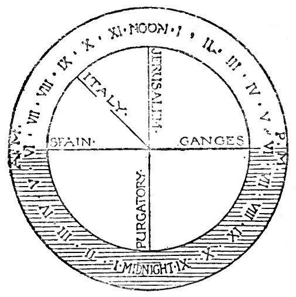
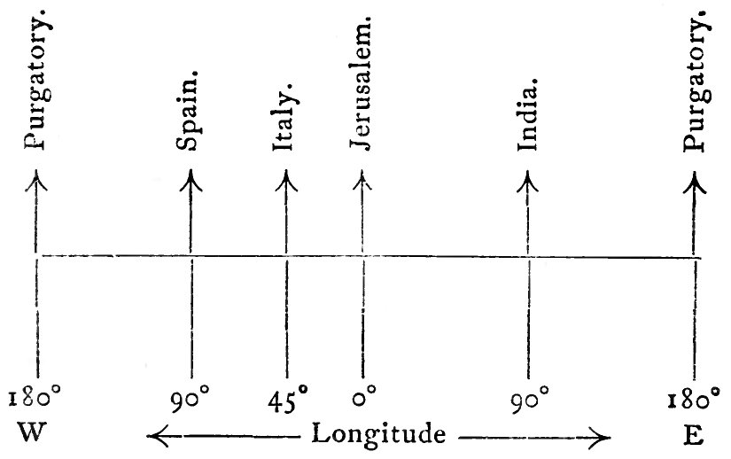

# Canto III

<!-- p. 24 (036) -->

## Argument

WHEN Dante has recovered from his confusion, and Virgil from the self-reproach caused by his momentary neglect of his charge, the poets look west toward the mountain. The sun shines behind them and throws Dante’s shadow right before him. Now for the first time he misses Virgil’s shadow, and thinks that he has lost his companionship; but Virgil reassures him. It is nine hours agone since the sun rose in the place where lies that part of him which once cast a shadow (1-30). The nature of the aerial bodies in the spirit world is unfathomable by human philosophy, which yearns in vain for solutions of the mysteries of faith (31-45). When they arrive at the foot of the mountain, the poets are at a loss how to scale its precipices; but at their left Dante perceives a group of souls slowly moving toward them from the south (46-60). With Virgil’s sanction they go to meet them, and by thus reversing the usual direction

<!-- p. 25 (037) -->

which the souls take, following the sun, they excite the amazement of the elect spirits from whom they inquire their way (61-78). These sheep without a shepherd—for they are the souls of such as died in contumacy against the Church, and they must dree their rebellion against the chief Shepherd by thirty times as long a space of shepherdless wandering—are yet more amazed than before when they see Dante’s shadow and hear from Virgil that he is still in the first life (79-99). They make sign to them to reverse their course; and one of them, King Manfred, when Dante has failed to recognise him, tells the story of his death at the battle of Benevento; of the pitiless persecution even of his lifeless body by the Bishop of Cosenza and Pope Clement. He declares that the Infinite Goodness hath so wide an embrace that it enfolds all who turn to it; explains the limitations of the power of the Church’s malediction, and implores the prayers of his daughter Constance (100-145).

<!-- p. 24 (036), text -->

Avvegna che la subitana fuga <!-- label: Anti-purgatorio -->\
&emsp;dispergesse color per la campagna,\
&emsp;rivolti al monte, ove ragion ne fruga,\
io mi ristrinsi alla fida compagna; 4\
&emsp;e come sare' io senza lui corso?\
&emsp;chi m'avria tratto su per la montagna?\
Ei mi parea da sè stesso rimorso: 7\
&emsp;o dignitosa coscienza e netta,\
&emsp;come t' è picciol fallo amaro morso!\
Quando li piedi suoi lasciâr la fretta, 10\
&emsp;che l' onestade ad ogni atto dismaga,\
&emsp;la mente mia, che prima era ristretta,\
lo intento rallargò, sì come vaga; 13\
&emsp;e diedi il viso mio incontro al poggio,\
&emsp;che inverso il ciel più alto si dislaga.

<!-- p. 25 (037), text -->

Although their sudden flight was scattering them o’er the plain, turned to the mount where justice probes us, <!-- label: The Poets go on their way -->

I drew me close to my faithful comrade; and how should I have sped without him? who would have brought me up the mountain?

Gnawed he seemed to me by self-reproach. O noble conscience and clear, how sharp a sting is a little fault to thee!

When his feet had lost that haste which mars the dignity of every act, my mind, that erewhile was centred within,

widened its scope as in eager search, and I set my face to the hillside which rises highest heavenward from the waters.

<!-- p. 26 (038) -->

Lo sol, che retro fiammeggiava roggio, 16 <!-- label: Anti-purgatorio -->\
&emsp;rotto m' era dinanzi, alla figura\
&emsp;ch' aveva in me de' suoi raggi l' appoggio.\
Io mi volsi dallato con paura 19\
&emsp;d' esser abbandonato, quando io vidi\
&emsp;solo dinanzi a me la terra oscura.\
E il mio conforto: “Perchè pur diffidi?” 22\
&emsp;a dir mi cominciò tutto rivolto;\
&emsp;“non credi tu me teco, e ch' io ti guidi?\
Vespero è già colà, dov' è sepolto 25\
&emsp;lo corpo, dentro al quale io facea ombra:\
&emsp;Napoli l' ha, e da Brandizio è tolto.\
Ora, se innanzi a me nulla s' adombra, 28\
&emsp;non ti maravigliar più che de' cieli,\
&emsp;che l' uno all' altro raggio non ingombra.\
A sofferir tormenti, caldi e gieli 31\
&emsp;simili corpi la virtù dispone,\
&emsp;che, come fa, non vuol che a noi si sveli.\
Matto è chi spera che nostra ragione 34\
&emsp;possa trascorrer la infinita via,\
&emsp;che tiene una sustanzia in tre persone.\
State contenti, umana gente, al *quia*: 37\
&emsp;chè, se potuto aveste veder tutto,\
&emsp;mestier non era partorir Maria;\
e disiar vedeste senza frutto 40\
&emsp;tai, che sarebbe lor disio quetato,\
&emsp;ch' eternalmente è dato lor per lutto.\
Io dico d' Aristotele e di Plato 43\
&emsp;e di molti altri.” E qui chinò la fronte;\
&emsp;e più non disse, e rimase turbato.\
Noi divenimmo intanto al piè del monte: 46\
&emsp;quivi trovammo la roccia sì erta,\
&emsp;che indarno vi sarien le gambe pronte.

<!-- p. 27 (039) -->

The sun, that behind us was flaming red, was broken in front of me in the figure in which it had its beams stayed by me. <!-- label: Dante’s fears -->

I turned me aside from fear of being forsaken, when I saw only before me the earth darkened.

And my Comfort began to say to me, turning full round: “Why dost thou again distrust? believest thou not me with thee and that I do guide thee? <!-- label: set at rest by Virgil -->

It is already evening there, where the body buried lies within which I made shadow: Naples possesses it, and from Brindisi ’tis taken.

Now, if before me no shadow falls, marvel not more than at the heavenly spheres, that one doth not obstruct the light from the other.

To suffer torments, heat and frost, bodies such as these that power disposes, which wills not that its workings be revealed to us.

Mad is he who hopes that our reason may compass that infinitude which one substance in three persons fills.

Be ye content, O human race, with the *quia*! For if ye had been able to see the whole, no need was there for Mary to give birth;

and ye have seen such sages desire fruitlessly, whose desire had else been satisfied, which is given them for eternal grief.

I speak of Aristotle and of Plato, and of many others.” And here he bent his brow, and said no more, and remained troubled.

We reached meanwhile the mountain’s foot: there found we the cliff so steep that vainly there would legs be nimble. <!-- label: The foot of the Mount -->

<!-- p. 28 (040) -->

Tra Lerici e Turbia, la più diserta, 49 <!-- label: Anti-purgatorio -->\
&emsp;la più romita via è una scala,\
&emsp;verso di quella, agevole ed aperta.\
“Or chi sa da qual man la costa cala,” 52\
&emsp;disse il maestro mio fermando il passo,\
&emsp;“sì che possa salir chi va senz' ala?”\
E mentre ch' ei teneva il viso basso 55\
&emsp;esaminando del cammin la mente,\
&emsp;ed io mirava suso intorno al sasso,\
da man sinistra m' apparì una gente 58\
&emsp;d' anime, che movieno i piè ver noi,\
&emsp;e non parevan, sì venivan lente.\
“Leva,” diss' io, “maestro, gli occhi tuoi: 61\
&emsp;ecco di qua chi ne darà consiglio,\
&emsp;se tu da te medesmo aver nol puoi.”\
Guardò a loro, e con libero piglio 64\
&emsp;rispose: “Andiamo in là, ch' ei vegnon piano;\
&emsp;e tu ferma la speme, dolce figlio.”\
Ancora era quel popol di lontano, 67\
&emsp;dico dopo li nostri mille passi,\
&emsp;quanto un buon gittator trarria con mano,\
quando si strinser tutti ai duri massi 70\
&emsp;dell' alta ripa, e stetter fermi e stretti,\
&emsp;come a guardar, chi va dubbiando, stassi.\
“O ben finiti, o già spiriti eletti,” 73\
&emsp;Virgilio incominciò, “per quella pace\
&emsp;ch' io credo che per voi tutti si aspetti,\
ditene dove la montagna giace, 76\
&emsp;sì che possibil sia l' andare in suso:\
&emsp;chè perder tempo a chi più sa più spiace.”\
Come le pecorelle escon del chiuso 79\
&emsp;ad una, a due, a tre, e l' altre stanno\
&emsp;timidette atterrando l' occhio e il muso;

<!-- p. 29 (041) -->

’Twixt Lerici and Turbia, the way most desolate, most solitary, is a stairway easy and free, compared with that. <!-- label: The nature of the ascent -->

“Now who knows on which hand the scarp doth slope,” said my Master, halting his steps, “so that he may climb who wingless goes?”

And while he held his visage low, searching in thought anent the way, and I was looking up about the rocks,

on the left hand appeared to me a throng of souls, who moved their feet towards us, and yet seemed not to advance, so slow they came. <!-- label: The excommunicate -->

“Master,” said I, “lift up thine eyes, behold there one who will give us counsel, if of thyself thou mayest have it not.”

He looked at them, and with gladsome mien answered: “Go we thither, for slowly they come, and do thou confirm thy hope, sweet son.”

As yet that people were so far off (I mean after a thousand paces of ours) as a good slinger would carry with his hand,

when they all pressed close to the hard rocks of the steep cliff, and stood motionless and close, as he halts to gaze around who goes in dread.

“O ye whose end was happy, O spirits already chosen,” Virgil began, “by that same peace which I believe by you all is awaited,

tell us where the mountain slopes, so that it may be possible to go upward; for time lost irks him most who knoweth most.”

As sheep come forth from the pen, in ones, in twos, in threes, and the others stand all timid, casting eye and nose to earth,

<!-- p. 30 (042) -->

e ciò che fa la prima, e l' altre fanno, 82 <!-- label: Anti-purgatorio -->\
&emsp;addossandosi a lei s' ella s' arresta,\
&emsp;semplici e quete, e lo 'mperchè non sanno:\
sì vid' io movere a venir la testa 85\
&emsp;di quella mandria fortunata allotta,\
&emsp;pudica in faccia, e nell' andare onesta.\
Come color dinanzi vider rotta 88\
&emsp;la luce in terra dal mio destro canto,\
&emsp;sì che l' ombra era da me alla grotta,\
restaro, e trasser sè indietro alquanto, 91\
&emsp;e tutti gli altri che venieno appresso,\
&emsp;non sapendo il perchè, fenno altrettanto.\
“Senza vostra domanda io vi confesso, 94\
&emsp;che questo è corpo uman che voi vedete,\
&emsp;per che il lume del sole in terra è fesso.\
Non vi maravigliate; ma credete 97\
&emsp;che, non senza virtù che dal ciel vegna,\
&emsp;cerchi di soperchiar questa parete.”\
Così il maestro; e quella gente degna: 100\
&emsp;“Tornate,” disse, “intrate innanzi dunque,”\
&emsp;coi dossi delle man facendo insegna.\
Ed un di loro incominciò: “Chiunque 103\
&emsp;tu se', così andando volgi il viso,\
&emsp;pon mente, se di là mi vedesti unque.”\
Io mi volsi ver lui, e guardail fiso: 106\
&emsp;biondo era e bello e di gentile aspetto;\
&emsp;ma l' un de' cigli un colpo avea diviso.\
Quando io mi fui umilmente disdetto 109\
&emsp;d' averlo visto mai, ei disse: “Or vedi”:\
&emsp;e mostrommi una piaga a sommo il petto.\
Poi sorridendo disse: “Io son Manfredi, 112\
&emsp;nepote di Costanza imperadrice;\
&emsp;ond' io ti prego che quando tu riedi,

<!-- p. 31 (043) -->

and what the first one doeth, the others do also, huddling up to her if she stand still, silly and quiet, and know not why, <!-- label: The excommunicate -->

so saw I then the head of that happy flock move to come on, modest in countenance, in movement dignified.

When those in front saw the light broken on the ground on my right side, so that the shadow was from me to the rock, <!-- label: Their doubts -->

they halted, and drew them back somewhat; and all the others that came after, knowing not why, did the like.

“Without your question I confess to you, that this is a human body ye see, by which the sun’s light on the ground is cleft. <!-- label: dispelled by Virgil -->

Marvel ye not, but believe that not without virtue which cometh from heaven, he seeks to surmount this wall.”

So my Master; and that worthy people said: “Turn ye, enter then before us,” with the backs of their hands making sign.

And one of them began: “Whoever thou art, thus while going turn thy face, give heed if e’er thou sawest me yonder.” <!-- label: Manfred -->

I turned me to him, and steadfastly did look: golden-haired was he, and fair, and of noble mien; but one of his eyebrows a cut had cleft.

When I humbly had disclaimed ever to have seen him, he said: “Now look”; and he showed me a wound above his breast.

Then smiling said: “I am Manfred, grandson of Empress Constance; wherefore I pray thee, that when thou returnest,

<!-- p. 32 (044) -->

vadi a mia bella figlia, genitrice 115 <!-- label: Anti-purgatorio -->\
&emsp;dell' onor di Cicilia e d' Aragona,\
&emsp;e dichi il vero a lei, s' altro si dice.\
Poscia ch' i' ebbi rotta la persona 118\
&emsp;di due punte mortali, io mi rendei\
&emsp;piangendo a quei che volentier perdona.\
Orribil furon li peccati miei; 121\
&emsp;ma la bontà infinita ha sì gran braccia\
&emsp;che prende ciò, che si rivolge a lei.\
Se il pastor di Cosenza, che alla caccia 124\
&emsp;di me fu messo per Clemente, allora\
&emsp;avesse in Dio ben letta questa faccia,\
l' ossa del corpo mio sarieno ancora 127\
&emsp;in co' del ponte presso a Benevento,\
&emsp;sotto la guardia della grave mora.\
Or le bagna la pioggia e move il vento 130\
&emsp;di fuor del regno, quasi lungo il Verde,\
&emsp;dov' ei le trasmutò a lume spento.\
Per lor maledizion sì non si perde, 133\
&emsp;che non possa tornar l' eterno amore,\
&emsp;mentre che la speranza ha fior del verde.\
Ver è che quale in contumacia muore 136\
&emsp;di santa Chiesa, ancor che al fin si penta,\
&emsp;stargli convien da questa ripa in fuore\
per ogni tempo, ch' egli è stato, trenta, 139\
&emsp;in sua presunzion, se tal decreto\
&emsp;più corto per buon preghi non diventa.\
Vedi oramai se tu mi puoi far lieto, 142\
&emsp;rivelando alla mia buona Costanza\
&emsp;come m' hai visto, ed anco esto divieto:\
chè qui per quei di là molto s' avanza.” 145

<!-- p. 33 (045) -->

thou go to my fair daughter, parent of the glory of Sicily and of Aragon, and tell her sooth, if other tale be told. <!-- label: The excommunicate -->

After I had my body pierced by two mortal stabs, I gave me up weeping to him who willingly doth pardon.

Horrible were my transgressions; but infinite goodness hath such wide arms that it accepteth all that turn to it.

If Cosenza’s Pastor, who to chase of me was set by Clement, then had well read that page in God,

the bones of my body would yet be at the bridge-head near Benevento, under the guard of the heavy cairn. <!-- label: Manfred’s burial -->

Now the rain washes them, and the wind stirs them, beyond the Realm, hard by the Verde, whither he translated them with tapers quenched.

By curse of theirs man is not so lost, that eternal love may not return, so long as hope retaineth aught of green.

True is it, that he who dies in contumacy of Holy Church, even though at the last he repent, needs must stay outside this bank <!-- label: The penalty of the excommunicate -->

thirtyfold for all the time that he hath lived in his presumption, if such decree be not shortened by holy prayers.

Look now, if thou canst make me glad, by revealing to my good Constance how thou hast seen me, and also this ban: for here, through those yonder, much advancement comes.”

## Notes

<!-- p. 32 (044), notes -->

25-27. *Vespero* is the last of the four divisions of the day, from 3 to 6 P.M. (*cf. Conv.* iii. 6: 20; iv. 23: 129). When it is 3 P.M. in Italy, it is 6 P.M. at Jerusalem and 6 A.M. in Purgatory (see diagrams on pp. 34 and 35).

<!-- p. 33 (045), notes -->

<!-- p. 34 (046) -->

27\. This tradition is recorded by Virgil’s biographers, Donatus and Suetonius. The body was transferred by order of Augustus (*cf. Purg.* vii. 6).

37\. Be satisfied *that it is*, without asking the reason *why*. “Demonstration is two-fold: the one demonstrates by means of the cause, and is called *propter quid* . . . the other by means of the effect, and is called the demonstration *quia*” (Thomas Aquinas).

38, 39. Had human reason been capable of penetrating these mysteries, there would have been no need for the revelation of the Word of God.

49\. Lerici and Turbia are at the E. and W. extremities of Liguria, respectively.

89, 90. The mountain was on their right, and the sun on their left.

103-145. This is Manfred (*ca.* 1231-1266), grandson of the Emperor Henry VI. and of his wife Constance (for whom see *Par.* iii. 109-120), and natural son of the Emperor Frederick II. Manfred’s wife, Beatrice of Savoy, bore him a daughter who (in 1262) married Peter III. of Aragon (for whom and for whose sons see below, Canto vii. 112-123; *cf.* also *Par.* xix. 130-138). Manfred became King of Sicily in 1258, usurping the rights of his nephew Conradin. The Popes naturally opposed him, as a Ghibelline, and excommunicated him; and in 1265 Charles of Anjou came to Italy with a large army, on the invitation of Clement IV., and was crowned as counter King of Sicily. On February 26, 1266, Manfred was defeated by Charles at Benevento (some thirty miles N.E. of Naples), and slain. He was buried near the battlefield, beneath a huge cairn (each soldier of the army contributing a stone); but his body was disinterred by order of the Pope, and deposited on the banks of the Verde (now the Garigliano, *cf. Par.* viii. 63), outside the boundaries of the Kingdom of Naples and of the Church States, and with the rites usual at the burial of those who died excommunicate (*v.* 132).

NOON\
I\
II\
III\
IV\
V\
VI\
P.M.\
VII\
VIII\
IX\
X\
XI\
MIDNIGHT\
I\
II\
III\
IV\
V\
VI\
A.M.\
VII\
VIII\
IX\
X\
XI\
JERUSALEM.\
GANGES\
PURGATORY.\
SPAIN.\
ITALY.

*Clock marking simultaneous hours at different regions of the earth. To indicate changes of hour, the reader may imagine the rim of the clock to revolve counterclockwise, while the five hands remain stationary, or the hands to revolve clockwise, while the rim remains stationary.*

<!-- p. 35 (047) -->

Purgatory.\
Spain.\
Italy.\
Jerusalem.\
India.\
Purgatory.\
180°\
90°\
45°\
0°\
90°\
180°\
W\
Longitude\
E
