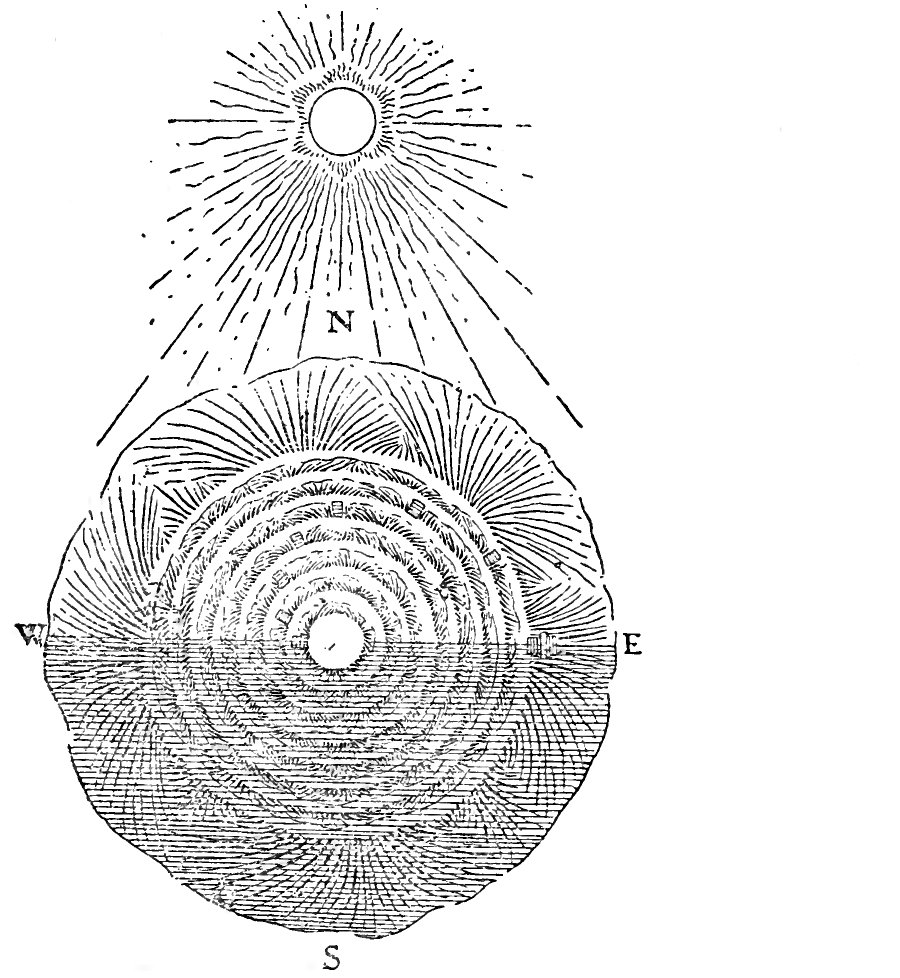

# Canto IV

<!-- p. 36 (048) -->

## Argument

IN the eagerness of his attention to Manfred’s tale, Dante takes no note of the passing time, and thereby furnishes a practical refutation of the Platonic doctrine of the plurality of souls; for if the soul that presides over hearing were one, and the soul that notes the passage of time another, then the completest absorption of the former could not so involve the latter as to prevent it from exercising its own special function. It is three and a half hours from sunrise when the souls point out the narrow cleft by which the pilgrims are to ascend the mountain; after which they take their leave of them (1-24). It is only the wings of longing and hope that enable Dante to overcome the impediments of the ascent, and bring him through the cleft to the open slope of the mountain, which he breasts at Virgil’s direction though it lies at an angle of more than forty-five degrees (25-42). In answer to his weary plea for a pause, Virgil urges him to gain a terrace that circles the mount a little above them (43-51). There they rest, and, looking east, survey their ascent, after the complacent fashion of mountain-climbers; but Dante is amazed to find that the sun is north of the equator and strikes on his left shoulder (52-60). Virgil explains that this is because they are in the southern hemisphere, at the antipodes of Jerusalem. Were the sun in Gemini instead of Aries, he would be further to the north yet (61-75). Dante rehearses and expands the lesson Virgil has taught him, and then (having meanwhile apparently turned west, facing the slope) makes inquiry as to the height of the mountain (76-87). Virgil, without making

<!-- p. 37 (049) -->

any direct answer, cheers his weary companion by assuring him that as they mount higher, the ascent becomes ever less arduous, till mounting up becomes as spontaneous as the movement of a ship dropping down stream; and then comes rest (89-96). Whereat a voice suddenly rising from behind a great stone lying south of them, intimates to Dante that he will probably experience a keen desire for rest *before* that consummation (97-102). Whereon the poets move to the shady or southern side of the rock where they see souls whose repentance had been deferred to the moment of death, stretched in attitudes of indolence. And in particular Belacqua, an old friend of Dante’s, sits hugging his knees like Sloth’s own brother. It is he who had given Dante his mocking warning, and who now in the same vein taunts him with his readiness to reproach others for their sloth the moment after he himself had implored Virgil to wait for him; and also with his slowness to understand the astronomical phenomena of the southern heavens (103-120). A smile of relief and amusement lightens Dante’s face as he finds his friend among the saved, and still his old self. Cannot even the spirit life check his nimble wit or stir his sluggish members? (121-126). But Belacqua answers sadly that unless aided by the prayer of some soul in grace, he must live as long excluded from purgation as he had lived in the self-exclusion of impenitence upon earth (127-135). It is now noonday in Purgatory; night reigns from Ganges to Morocco; and Virgil urges his charge to continue the ascent (136-139).

<!-- p. 36 (048), text -->

Quando per dilettanze ovver per doglie, <!-- label: Anti-purgatorio -->\
&emsp;che alcuna virtù nostra comprenda,\
&emsp;l' anima bene ad essa si raccoglie,

<!-- p. 37 (049), text -->

When through impression of pleasure, or of pain, which some one of our faculties receives, the soul is wholly centred on that faculty, <!-- label: The excommunicate -->

<!-- p. 38 (050) -->

par che a nulla potenza più intenda; 4 <!-- label: Anti-purgatorio -->\
&emsp;e questo è contra quello error, che crede\
&emsp;che un' anima sopr' altra in noi s' accenda.\
E però, quando s' ode cosa o vede 7\
&emsp;che tenga forte a sè l' anima volta,\
&emsp;vassene il tempo, e l' uom non se n' avvede:\
ch' altra potenza è quella che l' ascolta, 10\
&emsp;ed altra quella che ha l' anima intera;\
&emsp;questa è quasi legata, e quella è sciolta.\
Di ciò ebb' io esperienza vera, 13\
&emsp;udendo quello spirto ed ammirando:\
&emsp;chè ben cinquanta gradi salito era\
lo sole, ed io non m' era accorto, quando 16\
&emsp;venimmo dove quell' anime ad una\
&emsp;gridaro a noi: “Qui è vostro domando.”\
Maggiore aperta molte volte impruna, 19 <!-- label: Salita -->\
&emsp;con una forcatella di sue spine,\
&emsp;l' uom della villa, quando l' uva imbruna,\
che non era la calla, onde salìne 22\
&emsp;lo duca mio ed io appresso, soli,\
&emsp;come da noi la schiera si partìne.\
Vassi in Sanleo, e discendesi in Noli; 25\
&emsp;montasi su Bismantova in cacume\
&emsp;con esso i piè: ma qui convien ch' uom voli;\
dico con l' ali snelle e con le piume 28\
&emsp;del gran disio, di retro a quel condotto,\
&emsp;che speranza mi dava e facea lume.\
Noi salivam per entro il sasso rotto, 31\
&emsp;e d' ogni lato ne stringea lo stremo,\
&emsp;e piedi e man voleva il suol di sotto.\
Poi che noi fummo in su l' orlo supremo 34\
&emsp;dell' alta ripa, alla scoperta piaggia:\
&emsp;“Maestro mio,” diss' io, “che via faremo?”

<!-- p. 39 (051) -->

it seems that it gives heed to no other of its powers; and this is contrary to that error, which believes that one soul above another is kindled within us. <!-- label: The excommunicate --> <!-- label: Dante’s rapt wonder -->

And therefore, when aught is heard or seen which holds the soul strongly bent to it, the time passes away and we perceive it not;

for one faculty is that which notes it, and another that which possesses the undivided soul; the former is as ’twere bound, the latter free.

Of this I had true experience, while hearing that spirit and marvelling; for full fifty degrees had climbed

the sun, and I had not perceived it, when we came to where those souls with one voice cried out to us: “Here is what you ask.” <!-- label: The poets leave the excommunicate -->

A bigger opening many a time the peasant hedges up with a little forkful of his thorns, when the grape is darkening,

than was the gap by which my leader mounted, and I after him, we two alone, when the troop parted from us.

One can walk at Sanleo and get down to Noli; one can mount Bismantova to its summit, with feet alone; but here a man must fly, <!-- label: Difficulty of the ascent -->

I mean with the swift wings and with the plumes of great desire, behind that Leader, who gave me hope, and was a light to me.

We were climbing within the cleft rock, and on either side the surface pressed against us, and the ground beneath required both feet and hands.

After we were on the upper edge of the high cliff, out on the open hillside, “Master mine,” said I, “what way shall we take?”

<!-- p. 40 (052) -->

Ed egli a me: “Nessun tuo passo caggia; 37 <!-- label: Anti-purgatorio -->\
&emsp;pur su al monte retro a me acquista,\
&emsp;fin che n' appaia alcuna scorta saggia.” <!-- label: Salita -->\
Lo sommo er' alto che vincea la vista, 40\
&emsp;e la costa superba più assai\
&emsp;che da mezzo quadrante a centro lista.\
Io era lasso, quando cominciai: 43\
&emsp;“O dolce padre, volgiti e rimira\
&emsp;com' io rimango sol, se non ristai.”\
“Figliuol mio,” disse, “infin quivi ti tira,” 46\
&emsp;additandomi un balzo poco in sue,\
&emsp;che da quel lato il poggio tutto gira.\
Sì mi spronaron le parole sue 49\
&emsp;ch' io mi sforzai, carpando appresso lui,\
&emsp;tanto che il cinghio sotto i piè mi fue.\
A seder ci ponemmo ivi ambo e dui 52\
&emsp;volti a levante, ond' eravam saliti:\
&emsp;chè suole a riguardar giovare altrui.\
Gli occhi prima drizzai a' bassi liti; 55\
&emsp;poscia gli alzai al sole, ed ammirava\
&emsp;che da sinistra n' eravam feriti.\
Ben s' avvide il poeta, che io stava 58\
&emsp;stupido tutto al carro della luce,\
&emsp;dove tra noi ed Aquilone intrava.\
Ond' egli a me: “Se Castore e Polluce 61\
&emsp;fossero in compagnia di quello specchio,\
&emsp;che su e giù del suo lume conduce,\
tu vederesti il Zodiaco rubecchio 64\
&emsp;ancora all' Orse più stretto rotare,\
&emsp;se non uscisse fuor del cammin vecchio.\
Come ciò sia, se il vuoi poter pensare, 67\
&emsp;dentro raccolto, immagina Sion\
&emsp;con questo monte in su la terra stare,

<!-- p. 41 (053) -->

And he to me: “Let no step of thine descend, ever up the mount behind me win thy way, until some wise escort appear to us.” <!-- label: Dante’s weariness -->

So high was the top that it surpassed my sight, and the slope steeper far than a line from mid-quadrant to centre.

Weary was I when I began: “O sweet father, turn thee and look how I remain alone, if thou stay not.”

“My son,” said he, “so far as there drag thee,” pointing out to me a terrace a little higher up, which on that side circles the whole mountain.

So did his words spur me on, that I forced me, creeping after him, so far that the ledge was under my feet.

There we both did sit us down, turned towards the East, whence we had ascended; for to look back is wont to cheer men. <!-- label: The poets rest -->

First mine eyes I directed to the shores below; then did raise them to the sun, and marvelled that we were smitten by it on the left side. <!-- label: The position of the sun -->

Right well the Poet perceived that I was all astonished at the chariot of the light, where ’twas entering between us and the North.

Whereupon he to me: “If Castor and Pollux were in company of that mirror, which purveys of his light upward and downward, <!-- label: explained by Virgil -->

thou wouldst see the glowing Zodiac revolve yet closer to the Bears, unless it strayed from its ancient path.

If thou wouldst have power to conceive how that may be, rapt within thyself, imagine Zion and this mount to be placed on the earth

<!-- p. 42 (054) -->

sì che ambo e due hanno un solo orizzon 70 <!-- label: Anti-purgatorio -->\
&emsp;e diversi emisperi; onde la strada,\
&emsp;che mal non seppe carreggiar Feton,\
vedrai come a costui convien che vada 73\
&emsp;dall' un, quando a colui dall' altro fianco,\
&emsp;se l' intelletto tuo ben chiaro bada.”\
“Certo, maestro mio,” diss' io, “unquanco 76\
&emsp;non vidi chiaro sì com' io discerno,\
&emsp;là dove mio ingegno parea manco,\
che il mezzo cerchio del moto superno 79\
&emsp;che si chiama Equatore in alcun' arte,\
&emsp;e che sempre riman tra il sole e il verno,\
per la ragion che di', quinci si parte 82\
&emsp;verso settentrion, quanto gli Ebrei\
&emsp;vedevan lui verso la calda parte.\
Ma se a te piace, volentier saprei 85\
&emsp;quanto avemo ad andar, chè il poggio sale\
&emsp;più che salir non posson gli occhi miei.”\
Ed egli a me: “Questa montagna è tale, 88\
&emsp;che sempre al cominciar di sotto è grave,\
&emsp;e quanto uom più va su, e men fa male.\
Però quand' ella ti parrà soave 91\
&emsp;tanto, che il su andar ti fia leggiero,\
&emsp;come a seconda giuso andar per nave,\
allor sarai al fin d' esto sentiero: 94\
&emsp;quivi di riposar l' affanno aspetta.\
&emsp;Più non rispondo, e questo so per vero.”\
E, com' egli ebbe sua parola detta, 97\
&emsp;una voce di presso sonò: “Forse\
&emsp;che di sedere in prima avrai distretta.”\
Al suon di lei ciascun di noi si torse, 100\
&emsp;e vedemmo a mancina un gran petrone,\
&emsp;del qual nè io nè ei prima s' accorse.

<!-- p. 43 (055) -->

so that both have one sole horizon and different hemispheres; wherefore the way, which, to his hurt, Phaeton knew not how to drive, <!-- label: Virgil continues his discourse -->

thou shalt see must needs pass this on the one side when it passes Zion on the other, if thy mind right clearly apprehends.”

“Of a surety, Master mine,” said I, “never saw I so clearly as I discern, there where my wit seemed at fault,

that the median circle of the heavenly motion, which is called Equator in one of the sciences, and which ever remains ’twixt the sun and winter,

for the reason that thou tellest, departs here towards the North, as far as the Hebrews used to see it towards the hot climes.

But if it please thee, willingly would I know how far we have to go, for the hillside rises higher than mine eyes can reach.”

And he to me: “This mountain is such, that ever at the beginning below ’tis toilsome, and the more a man ascends the less it wearies. <!-- label: and tells how the ascent becomes more easy -->

Therefore when it shall seem to thee so pleasant that the ascending becomes to thee easy, even as in a boat to descend with the stream,

then shalt thou be at the end of this path: there hope to rest thy weariness. No more I answer, and this I know for truth.”

And when he had said his word, a voice hard by sounded: “Perchance ere that thou wilt have need to sit.” <!-- label: The Late-Repentant Belacqua -->

At sound of it each of us turned him round, and we saw on the left a great mass of stone, which neither I nor he perceived before.

<!-- p. 44 (056) -->

Là ci traemmo; ed ivi eran persone 103 <!-- label: Anti-purgatorio -->\
&emsp;che si stavano all' ombra dietro al sasso,\
&emsp;com' uom per negligenza a star si pone.\
Ed un di lor, che mi sembrava lasso, 106\
&emsp;sedeva ed abbracciava le ginocchia,\
&emsp;tenendo il viso giù tra esse basso.\
“O dolce signor mio,” diss' io, “adocchia 109\
&emsp;colui che mostra sè più negligente\
&emsp;che se pigrizia fosse sua sirocchia.”\
Allor si volse a noi, e pose mente, 112\
&emsp;movendo il viso pur su per la coscia,\
&emsp;e disse: “Or va su tu, che se' valente.”\
Conobbi allor chi era; e quell' angoscia, 115\
&emsp;che m' avacciava un poco ancor la lena,\
&emsp;non m' impedì l' andare a lui; e poscia\
che a lui fui giunto, alzò la testa appena, 118\
&emsp;dicendo: “Hai ben veduto come il sole\
&emsp;dall' omero sinistro il carro mena?”\
Gli atti suoi pigri e le corte parole 121\
&emsp;mosson le labbra mie un poco a riso;\
&emsp;poi cominciai: “Belacqua, a me non duole\
di te omai; ma dimmi, perchè assiso 124\
&emsp;quiritta sei? attendi tu iscorta,\
&emsp;o pur lo modo usato t' hai ripriso?”\
Ed ei: “Frate, l' andare in su che porta? 127\
&emsp;chè non mi lascerebbe ire ai martiri\
&emsp;l' uccel di Dio che siede in su la porta.\
Prima convien che tanto il ciel m' aggiri 130\
&emsp;di fuor da essa, quanto fece in vita,\
&emsp;perch' io indugiai al fine i buon sospiri;\
se orazione in prima non m' aita, 133\
&emsp;che surga su di cor che in grazia viva:\
&emsp;l' altra che val, che in ciel non è udita?”

<!-- p. 45 (057) -->

Thither drew we on; and there were persons, lounging in the shade behind the rock, even as a man settles him to rest for laziness. <!-- label: The Late-Repentant --> <!-- label: Dante and Belacqua -->

And one of them, who seemed to me weary, was sitting and clasping his knees, holding his face low down between them.

“O sweet my Lord,” said I, “set thine eye on that one who shows himself lazier than if Sloth were his very sister.”

Then turned he to us and gave heed, moving his face only over his thigh, and said: “Now go thou up who art valiant.”

Then knew I who he was; and that toil which still oppressed a little my breath, did not hinder my going to him; and after

I had got to him, his head he scarce did lift, saying: “Hast thou truly seen how the sun drives his chariot on thy left side?”

His lazy actions and the brief words moved my lips to smile a little; then I began: “Belacqua, it grieves me not

for thee now; but tell me, why art thou seated here? dost thou await escort, or hast thou but resumed thy wonted habit?”

And he: “Brother what avails it to ascend? For God’s winged angel that sits at the gate, would not let me pass to the torments. <!-- label: The penalty of the Late-Repentant -->

First must the heavens revolve around me outside it, so long as they did during my life, because I delayed my healing sighs to the end:

unless before, a prayer aids me, which may rise up from a heart that lives in grace: what profits another that in heaven is not heard?”

<!-- p. 46 (058) -->

E già il poeta innanzi mi saliva, 136 <!-- label: Anti-purgatorio -->\
&emsp;e dicea: “Vienne omai, vedi ch' è tocco\
&emsp;meridian dal sole, e dalla riva\
copre la notte già col piè Morrocco.” 139

<!-- p. 47 (059) -->

And already the poet was mounting before me, and saying: “Come on now, thou seest the meridian is touched by the sun, and Night already with her foot covers from Ganges’ banks to Morocco.” <!-- label: The Late-Repentant -->

## Notes

<!-- p. 46 (058), notes -->

5, 6. “Plato asserted that there were divers souls with distinct organs in one and the same body” (Thomas Aquinas). On the Aristotelian doctrine of the three kinds of soul—vegetative, animal, and rational, see below, Canto xxv. *vv.* 52 *sqq.*

12\. For this use of *questa* and *quella*, *cf. Purg.* xxv. 54.

15\. The sun traverses fifteen degrees every hour: it is therefore now 9.20 A.M.

25, 26. Sanleo: in the territory of Urbino; Noli: on the coast of Liguria, between Savona and Albenga; Bismantova: a hill in the Emilia, about twenty miles S. of Reggio.

40, 41. The angle of the quadrant (quarter of a circle) is 90°; that of a half quadrant is therefore 45°.

57\. They were looking east, and therefore had the north to their left and the south to their right. South of the equator the equinoctial sun is north of the zenith at midday, for the same reason that north of the equator he is south of it.

61-66. See *Argument*. Castor and Pollux = the Twins (*cf. Par.* xxvii. 98 and *note*), which sign is further north of the equator than Aries. The sun is called *specchio* (like Saturn in *Par.* xxi. 18), because, in common with the other planets [for the sun = a planet, *cf. Inf.* i. 17, *note*], he receives the divine light from above, the spheres intervening, and reflects it downwards (*cf. Par.* xxviii. 127); and this is probably the attribute of the sun referred to in *v.* 63, though some commentators take the line to mean that he illuminates the northern and southern hemisphere alternately. The *Zodiaco rubecchio* = that part of the Zodiac in which the sun is. The *Orse* indicate the North Pole.

68-72. Consider that Purgatory is at the exact antipodes of Jerusalem.—The *strada* = the path of the sun, the ecliptic. For Phaëton, see *Inf.* xvii. 106-108, *note*.

82-84. The equator is equi-distant from Jerusalem and from the Mount of Purgatory.

<!-- p. 47 (059), notes -->

98\. The Florentine Belacqua, a friend of Dante’s, was a maker of musical instruments, notorious for his sloth.

123\. Seeing that thou art on the road to salvation.

137-139. It is noon in Purgatory, sunrise on the Ganges (the *riva*), and sunset in Morocco=Spain (see the diagrams on pp. 34, 35, and below).

N\
W\
E\
S

*Showing the portions of the mountain under light and shade at noonday.* Cf. *Purg.* iv. 136-139, xii. 81 (*compare* xxii. 118-120 *with* xxv. 1-3), xxxiii. 103-105.
