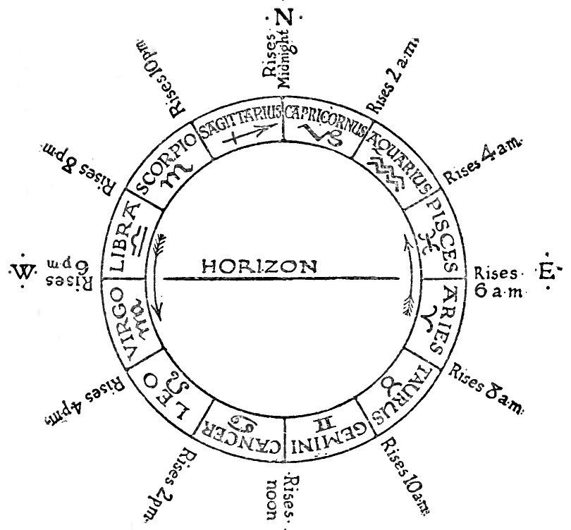

# Canto V

<!-- p. 48 (060) -->

## Argument

AS they pass up the mountain, Dante’s shadow still excites the amazement of the souls; but Virgil bids him pay no heed to their exclamations (1-12). A group of souls chanting the *Miserere* breaks into a cry of wonder, and when two of them, sent out as messengers, have received Virgil’s statement that Dante is still in the first life, the whole group crowd around him (22-42). They tell him that they are souls of the violently slain, who repented and made their peace with God at the last moment. Virgil bids Dante pursue his path, but suffers him to promise to bear

<!-- p. 49 (061) -->

news of these souls to their friends on earth and implore their prayers (43-63). Dante hears the tale of Jacopo del Cassero (64-84). Then Buonconte da Monte Feltro tells the story of his death at Campaldino, the struggle of the angel and the devil for his soul, and the fate of his deserted body (85-129). And lastly Pia rehearses, in brief pathetic words, the tragedy of her wedded life, and implores the poet when he is rested from his long journey to bethink him of her (130-136).

<!-- p. 48 (060), text -->

Io era già da quell' ombre partito, <!-- label: Anti-purgatorio -->\
&emsp;e seguitava l' orme del mio duca,\
&emsp;quando di retro a me drizzando il dito,\
una gridò: “Ve' che non par che luca 4\
&emsp;lo raggio da sinistra a quel di sotto,\
&emsp;e come vivo par che si conduca.”\
Gli occhi rivolsi al suon di questo motto, 7\
&emsp;e vidile guardar per maraviglia\
&emsp;pur me, pur me, e il lume ch' era rotto.\
“Perchè l' animo tuo tanto s' impiglia,” 10\
&emsp;disse il maestro, “che l' andare allenti?\
&emsp;che ti fa ciò che quivi si pispiglia?\
Vien retro a me, e lascia dir le genti; 13\
&emsp;sta come torre ferma, che non crolla\
&emsp;giammai la cima per soffiar de' venti:\
chè sempre l' uomo, in cui pensier rampolla 16\
&emsp;sopra pensier, da sè dilunga il segno,\
&emsp;perchè la foga l' un dell' altro insolla.”\
Che poteva io ridir, se non: “Io vegno?” 19\
&emsp;Dissilo, alquanto del color consperso\
&emsp;che fa l' uom di perdon tal volta degno.

<!-- p. 49 (061), text -->

I was already parted from those shades, and was following my leader’s footsteps, when behind me, pointing his finger, <!-- label: The Late-Repentant -->

one cried: “See, it seemeth not that the light shines on the left of him below, and he appears to demean himself like one alive.” <!-- label: Their amazement -->

Mine eyes I turned at sound of these words, and saw them gazing in astonishment at me alone, me alone, and at the light that was broken.

“Why is thy mind so entangled,” said the Master, “that thou slackenest thy pace? what matters it to thee what they whisper here? <!-- label: Virgil reproves Dante for tarrying -->

Follow me and let the people talk; stand thou as a firm tower which never shakes its summit for blast of winds:

for ever the man in whom thought wells up on thought, sets back his mark, because the one saps the force of the other.”

What could I answer, save: “I come”? This I said, suffused somewhat with that colour which ofttimes makes a man worthy of pardon.

<!-- p. 50 (062) -->

E intanto per la costa di traverso 22 <!-- label: Anti-purgatorio -->\
&emsp;venivan genti innanzi a noi un poco,\
&emsp;cantando *Miserere* a verso a verso.\
Quando s' accorser ch' io non dava loco, 25\
&emsp;per lo mio corpo, al trapassar de' raggi,\
&emsp;mutar lor canto in un ‘oh’ lungo e roco;\
e due di loro in forma di messaggi 28\
&emsp;corsero incontro a noi, e domandarne:\
&emsp;“Di vostra condizion fatene saggi.”\
E il mio maestro: “Voi potete andarne, 31\
&emsp;e ritrarre a color che vi mandaro,\
&emsp;che il corpo di costui è vera carne.\
Se per veder la sua ombra restaro, 34\
&emsp;com' io avviso, assai è lor risposto;\
&emsp;facciangli onore, ed esser può lor caro.”\
Vapori accesi non vid' io sì tosto 37\
&emsp;di prima notte mai fender sereno,\
&emsp;nè, sol calando, nuvole d' agosto,\
che color non tornasser suso in meno; 40\
&emsp;e, giunti là, con gli altri a noi dier volta,\
&emsp;come schiera che corre senza freno.\
“Questa gente che preme a noi è molta, 43\
&emsp;e vengonti a pregar,” disse il poeta;\
&emsp;“però pur va, ed in andando ascolta.”\
“O anima, che vai per esser lieta 46\
&emsp;con quelle membra, con le quai nascesti,”\
&emsp;venian gridando, “un poco il passo queta.\
Guarda se alcun di noi unque vedesti, 49\
&emsp;sì che di lui di là novelle porti:\
&emsp;deh, perchè vai? deh, perchè non t' arresti?\
Noi fummo già tutti per forza morti, 52\
&emsp;e peccatori infino all' ultim' ora:\
&emsp;quivi lume del ciel ne fece accorti

<!-- p. 51 (063) -->

And meanwhile across the mountain slope came people a little in front of us, chanting the *Miserere* verse by verse alterne. <!-- label: The Late-Repentant violently slain -->

When they perceived that I gave no place, because of my body, to the passage of the rays, they changed their chant to an Oh! long and hoarse;

and two of them in the guise of messengers ran to meet us, and asked of us: “Make us to know of your condition.” <!-- label: They parley with the poets -->

And my Master: “Ye may go hence and bear back to those who sent you that the body of this man is very flesh.

If they stayed for seeing his shadow, as I opine, enough is answered: let them do him honour and he may be precious to them.”

Ne’er saw I flaming vapours so swiftly cleave the bright sky at early night, or August clouds at setting sun,

but that they returned upward in less, and, arrived there, with the others wheeled round to us, like a troop that hastes with loosened rein.

“This people that presses on to us is many, and they come to entreat thee,” said the poet; “but go thou ever on and, while going, listen.”

“O soul, that goest to be glad with those members which thou wast born with,” they came crying, “arrest a while thy step.

Look if e’er thou sawest any one of us, so that thou mayst bear tidings of him yonder: ah, wherefore goest thou? ah, wherefore stayest thou not?

We were all slain by violence and sinners up to the last hour: then light from heaven made us ware

<!-- p. 52 (064) -->

sì che, pentendo e perdonando, fuora 55 <!-- label: Anti-purgatorio -->\
&emsp;di vita uscimmo a Dio pacificati,\
&emsp;che del disio di sè veder n' accora.”\
Ed io: “Perchè ne' vostri visi guati, 58\
&emsp;non riconosco alcun; ma, se a voi piace\
&emsp;cosa ch' io possa, spiriti ben nati,\
voi dite; ed io farò per quella pace, 61\
&emsp;che, retro ai piedi di sì fatta guida,\
&emsp;di mondo in mondo cercar mi si face.”\
Ed uno incominciò: “Ciascun si fida 64\
&emsp;del beneficio tuo senza giurarlo,\
&emsp;pur che il voler nonpossa non ricida.\
Ond' io, che solo innanzi agli altri parlo, 67\
&emsp;ti prego, se mai vedi quel paese\
&emsp;che siede tra Romagna e quel di Carlo,\
che tu mi sie de' tuoi preghi cortese 70\
&emsp;in Fano sì che ben per me s' adori,\
&emsp;perch' io possa purgar le gravi offese.\
Quindi fu' io; ma li profondi fori, 73\
&emsp;onde uscì il sangue in sul qual io sedea,\
&emsp;fatti mi furo in grembo agli Antenori,\
là dov' io più sicuro esser credea. 76\
&emsp;Quel da Esti il fe' far, che m' avea in ira\
&emsp;assai più là che dritto non volea.\
Ma s' io fossi fuggito in ver La Mira, 79\
&emsp;quando fui sopraggiunto ad Oriago,\
&emsp;ancor sarei di là dove si spira.\
Corsi al palude, e le cannucce e il brago 82\
&emsp;m' impigliar sì ch' io caddi, e lì vid' io\
&emsp;delle mie vene farsi in terra lago.”\
Poi disse un altro: “Deh, se quel disio 85\
&emsp;si compia che ti tragge all' alto monte,\
&emsp;con buona pietate aiuta il mio.

<!-- p. 53 (065) -->

so that, repenting and pardoning, we came forth from life reconciled with God, who penetrates us with desire to behold him.” <!-- label: The Late-Repentant violently slain -->

And I: “How much soever I gaze in your faces, I recognise none; but if aught I can do may please you, ye spirits born for bliss,

speak ye; and I will do it for the sake of that peace, which, following the steps of such a guide, makes me pursue it from world to world.”

And one began: “Each of us trusts in thy good offices without thine oath, if only want of power cut not off the will. <!-- label: Jacopo del Cassero -->

Wherefore I, who merely speak before the others, pray thee, if e’er thou see that country which lies between Romagna and that of Charles,

that thou be gracious to me of thy prayers in Fano, so that holy orison be made for me, that I may purge away my heavy offences,

Thence sprang I; but the deep wounds whence flowed the blood wherein my life was set, were dealt me in the bosom of the Antenori,

there where I thought to be most secure. He of Este had it done, who held me in wrath far beyond what justice would.

But if I had fled towards La Mira, when I was surprised at Oriaco, I should yet be yonder where men breathe.

I ran to the marshes, and the reeds and the mire entangled me so, that I fell; and there saw I a pool growing on the ground from my veins.”

Then said another: “Prithee,—and so be that desire satisfied which draws thee up the lofty mount—with kindly pity help my desire. <!-- label: Buonconte da Montefeltro -->

<!-- p. 54 (066) -->

Io fui di Montefeltro, io son Buonconte; 88 <!-- label: Anti-purgatorio -->\
&emsp;Giovanna o altri non ha di me cura:\
&emsp;per ch' io vo tra costor con bassa fronte.”\
Ed io a lui: “Qual forza o qual ventura 91\
&emsp;ti traviò sì fuor di Campaldino\
&emsp;che non si seppe mai tua sepoltura?”\
“Oh,” rispos' egli, “a piè del Casentino 94\
&emsp;traversa un' acqua che ha nome l' Archiano,\
&emsp;che sopra l' Ermo nasce in Apennino.\
Dove il vocabol suo diventa vano 97\
&emsp;arriva' io forato nella gola,\
&emsp;fuggendo a piede e sanguinando il piano.\
Quivi perdei la vista, e la parola 100\
&emsp;nel nome di Maria finii; e quivi\
&emsp;caddi, e rimase la mia carne sola.\
Io dirò il vero, e tu il ridi' tra i vivi; 103\
&emsp;l' angel di Dio mi prese, e quel d' inferno\
&emsp;gridava: ‘O tu del ciel, perchè mi privi?\
Tu te ne porti di costui l' eterno 106\
&emsp;per una lagrimetta che il mi toglie;\
&emsp;ma io farò dell' altro altro governo.’\
Ben sai come nell' aere si raccoglie 109\
&emsp;quell' umido vapor, che in acqua riede\
&emsp;tosto che sale dove il freddo il coglie.\
Giunse quel mal voler, che pur mal chiede, 112\
&emsp;con l' intelletto, e mosse il fummo e il vento\
&emsp;per la virtù, che sua natura diede.\
Indi la valle, come il dì fu spento, 115\
&emsp;da Pratomagno al gran giogo coperse\
&emsp;di nebbia, e il ciel di sopra fece intento\
sì che il pregno aere in acqua si converse: 118\
&emsp;la pioggia cadde, ed ai fossati venne\
&emsp;di lei ciò che la terra non sofferse;

<!-- p. 55 (067) -->

I was of Montefeltro, I am Buonconte; Giovanna, or any other hath no care for me; wherefore I go among these, with downcast brow.” <!-- label: The Late-Repentant violently slain -->

And I to him: “What violence or what chance made thee stray so far from Campaldino, that thy burial place ne’er was known?”

“Oh,” answered he, “at Casentino’s foot a stream crosses, which is named Archiano, and rises in the Apennines above the Hermitage. <!-- label: Buonconte’s death at Campaldino -->

There where its name is lost, did I arrive, pierced in the throat, flying on foot, and bloodying the plain.

There lost I vision, and ended my words upon the name of Mary; and there fell I, and my flesh alone was left.

I will speak sooth, and do thou respeak it among the living; the angel of God took me, and one from Hell cried: ‘O thou from Heaven, wherefore robbest thou me? <!-- label: The devil fights for his soul— -->

Thou bearest hence the eternal part of this man, for one little tear that snatches him from me; but with the other will I deal in other fashion.’ <!-- label: in vain -->

Thou knowest how in the air that damp vapour gathers, which turns again to water soon as it ascends where the cold condenses it. <!-- label: The rushing river -->

He united that evil will, which seeks ill only, with intellect, and stirred the mist and wind by the power which his nature gave.

Then when day was spent, he covered the valley from Pratomagno to the great mountain chain with mist, and the sky above made lowering

so that the saturated air was turned to water: the rain fell, and to the water-rills came what of it the earth endured not;

<!-- p. 56 (068) -->

e come a' rivi grandi si convenne, 121 <!-- label: Anti-Purgatorio -->\
&emsp;ver lo fiume real tanto veloce\
&emsp;si ruinò, che nulla la ritenne.\
Lo corpo mio gelato in su la foce 124\
&emsp;trovò l' Archian rubesto; e quel sospinse\
&emsp;nell' Arno, e sciolse al mio petto la croce,\
ch' io fei di me quando il dolor mi vinse; 127\
&emsp;voltommi per le ripe e per lo fondo,\
&emsp;poi di sua preda mi coperse e cinse.”\
“Deh, quando tu sarai tornato al mondo, 130\
&emsp;e riposato della lunga via,”\
&emsp;seguitò il terzo spirito al secondo,\
“ricorditi di me, che son la Pia; 133\
&emsp;Siena mi fe', disfecemi Maremma:\
&emsp;salsi colui che innanellata, pria\
disposando, m' avea con la sua gemma.” 136

<!-- p. 57 (069) -->

and as it united into great torrents, so swiftly it rushed towards the royal stream, that naught held it back. <!-- label: The Late-Repentant violently slain -->

My frozen body at its mouth the raging Archian found, and swept it into the Arno, and loosed the cross on my breast, <!-- label: The devil’s vengeance on Buonconte’s body -->

which I made of me when pain o’ercame me: it rolled me along its banks and over its bed, then covered and wrapped me with its spoils.”

“Pray, when thou shalt return to the world, and art rested from thy long journey,” followed the third spirit after the second, <!-- label: La Pia -->

“Remember me, who am La Pia: Siena made me, Maremma unmade me: ’tis known to him who, first plighting troth, had wedded me with his gem.”

## Notes

<!-- p. 56 (068), notes -->

24\. The *Miserere*—Psalm li.

37-39. Medieval science held falling stars and weather lightning to be due to “flaming vapours.”

63-84. Jacopo del Cassero (probably related to the Guido of *Inf.* xxviii. 77), a Guelf of Fano (situated in the mark of Ancona, between Romagna and the kingdom of Naples, which was ruled by Charles II. of Anjou) was Podestà of Bologna in 1296. Having incurred the wrath of Azzo VIII. of Este (for whom see *Inf.* xii. 110-112; *cf. also Purg.* xx. 80), whose designs on the city he had frustrated, he hoped to escape his vengeance by exchanging the office at Bologna for a similar one at Milan (1298). He was, however, murdered by Azzo’s orders [among the assassins being Riccardo da Cammino, for whom see *Par.* ix. 49-51] while on his way thither, at Oriaco, between Venice and Padua [the Paduans are called Antenori in *v.* 75, from their reputed founder Antenor, for whom see *Inf.* xxxii. 88, *note*; his escape to Italy after the fall of Troy, and his building of Padua are recorded by Virgil. *Æn.* i. 242 *sqq.*]. Oriaco is situated in a marshy country, while La Mira would have been easier of access to Jacopo in his flight (*vv.* 79-81).

<!-- p. 57 (069), notes -->

85-129. Buonconte of Montefeltro, son of the Guido whose death forms the subject of a very similar episode in *Inf.* xxvii., and, like his father, a Ghibelline leader. He was in command of the Aretines when they were defeated by the Florentine Guelfs at Campaldino, on June 11, 1289, and was himself among the slain. [According to Bruni’s testimony, Dante took part in this battle on the Guelf side; see *Inf.* xxi. 94-96, *note*]. Giovanna (*v.* 89) was Buonconte’s wife. Campaldino is in the Upper Val d’Arno, or district of Casentino (bounded by the mountains of Pratomagno on the west and by the principal chain of the Apennines on the east—*v.* 116; *cf. Inf.* xxx. 65, and *Purg.* xiv. 43), between Poppi and Bibbiena. At the latter place the Archiano, which rises in the Apennines at the monastery of Camaldoli (*v.* 96; *cf. Par.* xxii. 49, *note*), falls into the Arno (*vv.* 97, 124-126).—With *vv.* 109-111, *cf. Purg.* xxviii. 121-12

<!-- p. 58 (070) -->

130-136. Until recently the story of *la Pia*, as given by the various commentators, was as follows:—The unfortunate lady belonged to the Sienese family of the Tolomei, and married Nello d’Inghiramo dei Pannocchieschi (Podestà of Volterra in 1277, and of Lucca in 1314; captain of the Tuscan Guelfs in 1284; still living in 1322). She was put to death by her husband in 1295 at the Castello della Pietra, in the Sienese Maremma: some say that she was thrown out of a window, by Nello’s orders, others that she died in some mysterious way (which probably gave rise to the tradition that the unhealthy marshes of the district were intended to, and actually did, kill her). Nello’s motives are variously given: according to some accounts he was jealous (with or without cause); according to others he wished to get rid of his wife in order to be able to marry the Countess Margherita degli Aldobrandeschi, the widow of Guy of Montfort.—In the year 1886 this identification of *la Pia* was proved (by Banchi) to be impossible; and it is difficult to say how much truth there may be in the legends clustering round her name, till fresh documents concerning her are unearthed.

<!-- p. 59 (071) -->

N\
E\
S\
W\
Rises Midnight\
Rises 2 a.m.\
Rises 4 a.m.\
Rises 6 a.m.\
Rises 8 a.m.\
Rises 10 a.m.\
Rises noon\
Rises 2 p.m.\
Rises 4 p.m.\
Rises 6 p.m.\
Rises 8 p.m.\
Rises 10 p.m.\
CAPRICORNUS\
AQUARIUS\
PISCES\
ARIES\
TAURUS\
GEMINI\
CANCER\
LEO\
VIRGO\
LIBRA\
SCORPIO\
SAGITTARIUS\
HORIZON\
*Showing the hours at which the several signs of the Zodiac*\
*begin to rise at the spring equinox. Each sign begins to set*\
*twelve hours after it begins to rise. The spectator is looking*\
*North.*
