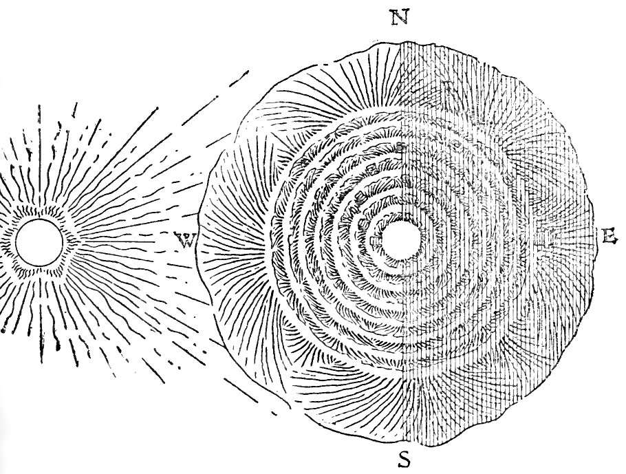

# Canto VIII

<!-- p. 92 (104) -->

## Argument

AT the pensive hour of sunset the souls devoutly join in their evening hymn, with eyes uplifted to heaven (1-18). As though to remind them that while outside the gate of the true Purgatory their wills are not intrinsically above the reach of temptation, but are guarded only by the express intervention and protection of divine grace, two angels descend and stand on either bank of the dell to guard them against the serpent who would enter this counterpart of Eden (19-39). At the mention of the serpent Dante shrinks close up to Virgil; but Sordello invites them to descend, as the twilight deepens, into the little vale, where Dante meets his friend Nino, Judge of Gallura, and in answer to his question tells him that he is still in the first life; whereon both he and Sordello start back in amazement. Nino summons Conrad Malaspina to witness this wonder of God’s grace, and then turning to Dante again, implores him to obtain the prayers of his daughter; for his wife, wedded to a Visconte, has surely forgotten him (40-84). Dante, looking to

<!-- p. 93 (105) -->

heaven, notes that in this season of repose the four stars that represent the moral virtues have vanished behind the mountain, and the three that represent the theological virtues shine in the sky. This is one of the many indications that the proper business of Purgatory is ethical, the recovery of the sound moral will. The season in which the souls may actually ascend is the one over which the four stars preside (85-93). Meanwhile the dreaded serpent approaches, but the angels swoop like celestial hawks upon it, and having put it to flight return to their posts (94-108). During the whole assault Conrad has not ceased to gaze on Dante; and he now asks him for news of his country of Valdemagra, and of his kinsfolk there; to which Dante replies that he has never visited those parts, but the noble character of the Malaspini rings through all Europe (109-132); whereon he receives the significant comment that ere six years are gone he shall know the worth of the Malaspini better than reportingly (133-139).

<!-- p. 92 (104), text -->

Era già l' ora che volge il disio <!-- label: Anti-purgatorio -->\
&emsp;ai naviganti, e intenerisce il core\
&emsp;lo dì ch' han detto ai dolci amici addio; <!-- label: Valle -->\
e che lo nuovo peregrin d' amore 4\
&emsp;punge, se ode squilla di lontano,\
&emsp;che paia il giorno pianger che si more:\
quand' io incominciai a render vano 7\
&emsp;l' udire, ed a mirare una dell' alme\
&emsp;surta, che l' ascoltar chiedea con mano.\
Ella giunse e levò ambo le palme, 10\
&emsp;ficcando gli occhi verso l' oriente,\
&emsp;come dicesse a Dio: “D' altro non calme.”

<!-- p. 93 (105), text -->

’Twas now the hour that turns back the desire of those who sail the seas and melts their heart, that day when they have said to their sweet friends adieu, <!-- label: The Negligent Rulers --> <!-- label: Sunset of the first day in Purgatory -->

and that pierces the new pilgrim with love, if from afar he hears the chimes which seem to mourn for the dying day;

when I began to annul my sense of hearing, and to gaze on one of the spirits, uprisen, that craved a listening with its hand.

It joined and lifted up both its palms, fixing its eyes towards the east, as though ’twere saying to God: “For aught else I care not.”

<!-- p. 94 (106) -->

“*Te lucis ante*” sì devotamente 13 <!-- label: Anti-purgatorio -->\
&emsp;le uscì di bocca, e con sì dolci note,\
&emsp;che fece me a me uscir di mente. <!-- label: Valle -->\
E l' altre poi dolcemente e devote 16\
&emsp;seguitar lei per tutto l' inno intero,\
&emsp;avendo gli occhi alle superne rote.\
Aguzza qui, lettor, ben gli occhi al vero, 19\
&emsp;chè il velo è ora ben tanto sottile,\
&emsp;certo, che il trapassar dentro è leggiero.\
Io vidi quello esercito gentile 22\
&emsp;tacito poscia riguardare in sue,\
&emsp;quasi aspettando pallido ed umile;\
e vidi uscir dell' alto, e scender giue 25\
&emsp;due angeli con due spade affocate,\
&emsp;tronche e private delle punte sue.\
Verdi, come fogliette pur mo nate, 28\
&emsp;erano in veste, che da verdi penne\
&emsp;percosse traean dietro e ventilate.\
L' un poco sopra noi a star si venne, 31\
&emsp;e l' altro scese in l' opposita sponda,\
&emsp;sì che la gente in mezzo si contenne.\
Ben discerneva in lor la testa bionda; 34\
&emsp;ma nelle faccie l' occhio si smarria,\
&emsp;come virtù che al troppo si confonda.\
“Ambo vegnon del grembo di Maria,” 37\
&emsp;disse Sordello, “a guardia della valle,\
&emsp;per lo serpente che verrà via via.”\
Ond' io, che non sapeva per qual calle, 40\
&emsp;mi volsi intorno, e stretto m' accostai\
&emsp;tutto gelato alle fidate spalle.\
E Sordello anco: “Ora avvalliamo omai 43\
&emsp;tra le grandi ombre, e parleremo ad esse;\
&emsp;grazioso fia lor vedervi assai.”

<!-- p. 95 (107) -->

“*Te lucis ante*” so devoutly proceeded from its mouth, and with such sweet music, that it rapt me from my very sense of self. <!-- label: The Negligent Rulers -->

And the others then sweetly and devoutly accompanied it through the entire hymn, having their eyes fixed on the supernal wheels. <!-- label: Evening Hymn -->

Reader, here sharpen well thine eyes to the truth, for the veil now is indeed so thin, that of a surety to pass within is easy.

I saw that noble army thereafter silently gaze upward, as if in expectancy, pale and lowly;

and I saw two angels come forth from on high and descend below with two flaming swords, broken short and deprived of their points. <!-- label: Two Angels descend from Heaven -->

Green, as tender leaves just born, was their raiment, which they trailed behind, fanned and smitten by green wings.

One came and alighted a little above us, and the other descended on the opposite bank, so that the people was contained in the middle.

Clearly I discerned the fair hair of them; but in their faces the eye was dazed, like a faculty which by excess is confounded.

“Both come from Mary’s bosom,” said Sordello, “as guard of the vale, because of the serpent that straightway will come.”

Whereat I, who knew not by what way, turned me around, and placed me all icy cold close to the trusty shoulders.

And Sordello again: “Now go we into the vale among the mighty shades, and we will speak to them; great joy will it be to them to see you.”

<!-- p. 96 (108) -->

Solo tre passi credo ch' io scendesse, 46 <!-- label: Anti-purgatorio -->\
&emsp;e fui di sotto, e vidi un che mirava <!-- label: Valle -->\
&emsp;pur me, come conoscer mi volesse.\
Tempo era già che l' aer s' annerava, 49\
&emsp;ma non sì che tra gli occhi suoi e i miei\
&emsp;non dichiarisse ciò che pria serrava.\
Ver me si fece, ed io ver lui mi fei: 52\
&emsp;Giudice Nin gentil, quanto mi piacque,\
&emsp;quando ti vidi non esser tra i rei!\
Nullo bel salutar tra noi si tacque; 55\
&emsp;poi domandò: “Quant' è che tu venisti\
&emsp;a piè del monte per le lontane acque?”\
“O,” diss' io lui, “per entro i lochi tristi 58\
&emsp;venni stamane, e sono in prima vita,\
&emsp;ancor che l' altra sì andando acquisti.”\
E come fu la mia risposta udita, 61\
&emsp;Sordello ed egli indietro si raccolse,\
&emsp;come gente di subito smarrita.\
L' uno a Virgilio, e l' altro ad un si volse 64\
&emsp;che sedea lì, gridando: “Su, Corrado,\
&emsp;vieni a veder che Dio per grazia volse.”\
Poi volto a me: “Per quel singular grado, 67\
&emsp;che tu dei a colui, che sì nasconde\
&emsp;lo suo primo perchè, che non gli è guado,\
quando sarai di là dalle larghe onde, 70\
&emsp;di' a Giovanna mia, che per me chiami\
&emsp;là dove agl' innocenti si risponde.\
Non credo che la sua madre più m' ami, 73\
&emsp;poscia che trasmutò le bianche bende,\
&emsp;le quai convien che misera ancor brami.\
Per lei assai di lieve si comprende, 76\
&emsp;quanto in femmina foco d' amor dura,\
&emsp;se l' occhio o il tatto spesso non l' accende.

<!-- p. 97 (109) -->

Only three steps methinks I descended, and was below, and saw one who was gazing only at me, as tho’ he would recognise me. <!-- label: The Negligent Rulers -->

’Twas now the time when the air was darkening, yet not so dark but that what between his eyes and mine before was hidden, now grew clear. <!-- label: Nino de’ Visconti -->

He advanced towards me, and I to him: Noble judge Nino how did I rejoice when I saw thee, and not among the damned!

No fair greeting was left unsaid between us; then he asked: “How long is it since thou camest to the foot of the mount over the far waters?” <!-- label: discourses with Dante -->

“Oh,” said I to him, “from within the places of woe came I this morn, and am in my first life, albeit by this my journeying I gain the other.”

And when my answer was heard, Sordello and he shrank back like folk suddenly bewildered.

The one turned to Virgil, and the other to one who was seated there, crying: “Up, Conrad, come and see what God by his grace hath willed.”

Then turning to me: “By that especial grace which thou owest to him who so hideth his first purpose that there is no ford to it,

when thou art beyond the wide waters, tell my Giovanna that she pray for me there where the innocent are heard.

I do not think her mother loves me more, since she hath changed her white wimples, which hapless she must long for once again.

By her right easily may be known, how long the fire of love doth last in woman, if eye and touch do not oft rekindle it.

<!-- p. 98 (110) -->

Non le farà sì bella sepoltura 79 <!-- label: Anti-purgatorio -->\
&emsp;la vipera che il Milanese accampa, <!-- label: Valle -->\
&emsp;com' avria fatto il gallo di Gallura.”\
Così dicea, segnato della stampa 82\
&emsp;nel suo aspetto di quel dritto zelo,\
&emsp;che misuratamente in core avvampa.\
Gli occhi miei ghiotti andavan pure al cielo, 85\
&emsp;pur là dove le stelle son più tarde,\
&emsp;sì come rota più presso allo stelo.\
E il duca mio: “Figliuol, che lassù guarde?” 88\
&emsp;Ed io a lui: “A quelle tre facelle,\
&emsp;di che il polo di qua tutto quanto arde.”\
Ed egli a me: “Le quattro chiare stelle, 91\
&emsp;che vedevi staman, son di là basse,\
&emsp;e queste son salite ov' eran quelle.”\
Com' ei parlava, e Sordello a sè il trasse 94\
&emsp;dicendo: “Vedi là il nostro avversaro”;\
&emsp;e drizzò il dito, perchè in là guardasse.\
Da quella parte, onde non ha riparo 97\
&emsp;la picciola vallea, era una biscia,\
&emsp;forse qual diede ad Eva il cibo amaro.\
Tra l' erba e i fior venia la mala striscia, 100\
&emsp;volgendo ad or ad or la testa al dosso,\
&emsp;leccando come bestia che si liscia.\
Io non vidi, e però dicer non posso, 103\
&emsp;come mosser gli astor celestiali,\
&emsp;ma vidi bene e l' uno e l' altro mosso.\
Sentendo fender l' aere alle verdi ali, 106\
&emsp;fuggì il serpente, e gli angeli dier volta\
&emsp;suso alle poste rivolando eguali.\
L' ombra, che s' era al giudice raccolta 109\
&emsp;quando chiamò, per tutto quell' assalto\
&emsp;punto non fu da me guardare sciolta.

<!-- p. 99 (111) -->

The viper that the Milanese blazons on his shield will not make her so fair a tomb as Gallura’s cock would have done.” <!-- label: The Negligent Rulers --> <!-- label: Nino -->

Thus spake he, his countenance stamped with the mark of that righteous zeal which in due measure glows in the breast.

My yearning eyes were again turned towards heaven, even there where the stars are slowest, like a wheel nearest the axle. <!-- label: The Three Stars -->

And my leader: “Son, what gazest thou at up there?” And I to him: “At those three torches, wherewith the whole pole here is flaming.”

And he to me: “The four bright stars which thou sawest this morn are low on the other side, and these are risen where they were.”

As he was speaking, lo Sordello drew him to himself, saying: “See there our adversary,” and pointed his finger so that he should look thither. <!-- label: The Serpent -->

On that side where the little vale hath no rampart, was a snake, perchance such as gave to Eve the bitter food.

Through the grass and the flowers came the evil reptile, turning round now and again its head to its back, licking like a beast that sleeks itself.

I saw not, and therefore cannot tell, how the celestial falcons moved; but full well I saw both in motion.

Hearing the green wings cleave through the air, the serpent fled, and the angels wheeled around, flying in equal measure back to their posts. <!-- label: put to flight by the Angels -->

The shade that had drawn close to the judge when he called, through all that assault was not loosed a moment from gazing at me. <!-- label: Conrad Malaspina -->

<!-- p. 100 (112) -->

“Se la lucerna che ti mena in alto 112 <!-- label: Anti-purgatorio -->\
&emsp;trovi nel tuo arbitrio tanta cera, <!-- label: Valle -->\
&emsp;quant' è mestiero infino al sommo smalto,”\
cominciò ella, “se novella vera 115\
&emsp;di Valdimacra o di parte vicina\
&emsp;sai, dilla a me, che già grande là era.\
Chiamato fui Corrado Malaspina: 118\
&emsp;non son l' antico, ma di lui discesi;\
&emsp;a' miei portai l' amor che qui raffina.”\
“O,” diss' io lui, “per li vostri paesi 121\
&emsp;giammai non fui; ma dove si dimora\
&emsp;per tutta Europa, ch' ei non sien palesi?\
La fama che la vostra casa onora 124\
&emsp;grida i signori e grida la contrada,\
&emsp;sì che ne sa chi non vi fu ancora.\
Ed io vi giuro, s' io di sopra vada, 127\
&emsp;che vostra gente onrata non si sfregia\
&emsp;del pregio della borsa e della spada.\
Uso e natura sì la privilegia, 130\
&emsp;che, perchè il capo reo lo mondo torca,\
&emsp;sola va dritta, e il mal cammin dispregia.”\
Ed egli: “Or va, chè il sol non si ricorca 133\
&emsp;sette volte nel letto che il Montone\
&emsp;con tutti e quattro i piè copra ed inforca,\
che cotesta cortese opinione 136\
&emsp;ti fia chiavata in mezzo della testa\
&emsp;con maggior chiovi che d' altrui sermone,\
se corso di giudizio non s' arresta.” 139

<!-- p. 101 (113) -->

“So may that light which guideth thee on high, find in thy will as much wax as is needful to reach the enamelled summit,” <!-- label: The Negligent Rulers --> <!-- label: Conrad Malaspina -->

it began, “if thou know true tidings of Valdimacra, or of neighbouring parts, tell it me who once was mighty there.

I was called Conrad Malaspina: not the elder am I, but descended from him: to mine own I bore that love which here is purified.”

“Oh,” said I to him, “through your lands I ne’er have been, but where do men dwell throughout Europe to whom they are not renowned? <!-- label: Dante praises the Malaspini -->

The fame which honours your house proclaims abroad its lords, and proclaims the country, so that he knows of it who there hath never been.

And I swear to you, so may I go on high, that your honoured race strips not itself of the glory of the purse and of the sword.

Custom and nature so do privilege it, that for all that the guilty head sets the world awry, it alone goeth straight and scorns the path of evil.”

And he: “Now depart, for the sun goeth not to rest seven times in the bed which the Ram covers and bestrides with all four feet, <!-- label: and is rewarded by Conrad’s cheering prophecy -->

ere this courteous opinion shall be nailed in the midst of thy head, with bigger nails than other men’s words, if course of judgment be not stayed.”

## Notes

<!-- p. 100 (112), notes -->

1-6, 49-51. See diagram on p. 103.

13\. The Ambrosian hymn, *Te lucis ante terminum*, sung at Compline (the last office of the day).

19-39. In addition to the general explanation given in the *Argument*, the following points should be noted. The green robes and wings of the angels speak of hope. The pointless swords are usually taken to indicate justice tempered with mercy (*cf.* below, Canto xxxi. 42, *note*); but perhaps they mean that the battle is in truth already decided, the deadly thrust no longer needed, and that the sword-edge alone is adequate (see below, Canto xxxi. 2, 3).

<!-- p. 101 (113), notes -->

<!-- p. 102 (114) -->

47-84. Nino de’ Visconti of Pisa (for whom see *Inf.* xxii. 83, *note*, and xxxiii. 1-90, *note*) was appointed by the Pisans to the judgeship of Gallura in Sardinia, in the last decade of the 13th century. He married Beatrice of Este (see, in the *Inferno* volume, the table on p. 237; and, above, those on pp. 90, 91), by whom he had a daughter, Giovanna [*v.* 71; it is interesting to note that in 1328 the Commune of Florence voted a pension of 100 *piccoli fiorini* to this Giovanna, on account of her father’s faith and devotion to Florence and the Guelf party, for the injuries and vexations he had suffered from the Ghibellines, and as compensation for the spoliation of all her goods by the Ghibellines]. After his death, Beatrice married Galeazzo Visconti, of Milan; the formalities were probably completed by Easter, 1300, but the ceremony did not actually take place till June of that year. Verse 74 refers to casting off the garb of widowhood (black robe and white veil), and *v.* 75 to the misfortunes of the Milanese Visconti, which date from 1302. The viper and the cock (*vv.* 80, 81) indicate the arms of the Milanese and Pisan Visconti, respectively. These two families appear to have been in no way connected with each other; the former were Ghibelline, the latter Guelf.

85-93. It must be steadily borne in mind that only half the heavens are visible to Dante at this point of the journey. The steep wall of Purgatory cuts off the whole portion of them west of the meridian. The four bright stars are near the south pole; but in the latitude of Purgatory the pole itself is only about 32° above the horizon, and the stars are now behind the mountain and beneath the pole.

65, 109-139. Currado I. of the Malaspina family (*l’antico* of *v.* 119) was grandfather of the three cousins, Currado II. (d. *ca.* 1294), the present speaker; Moroello III. (d. *ca.* 1315), to whom Dante’s third epistle, accompanied by Canzone xi., is probably addressed, and for whom see *Inf.* xxiv. 143-150, *note*; and Franceschino (d. between 1313 and 1321), who was Dante’s host at Sarzana, in Lunigiana, in the autumn of 1306 (*vv.* 133-139: less than seven years—the sun now being in Aries—from the moment at which Currado is speaking). The Malaspini were for the most part Ghibellines; but Moroello III. formed a notable exception. *Valdimacra* (*v.* 116): the Macra flows through Lunigiana (north-west of Tuscany), which formed part of the territory of the Malaspini (*cf. Inf.* xxiv. 145).—A table of the Malaspina family will be found on p. 241; see, too, the table on p. 89.

<!-- p. 103 (115) -->

*Cera* (*v.* 113). material to feed the flame (*lucerna*) of God’s grace; the *sommo smalto* being either the summit of the Mount of Purgatory or the Empyrean. With *v.* 131 compare xvi. 94-112; though some refer the words specifically to Boniface VIII.

N\
W\
E\
S

*Showing the portions of the Mountain under light and shade at 6 o’clock p.m.* Cf. “*Purgatorio*,” viii. 1-6, 49-51; xvii. 1-72; xxvii. 1-69.
