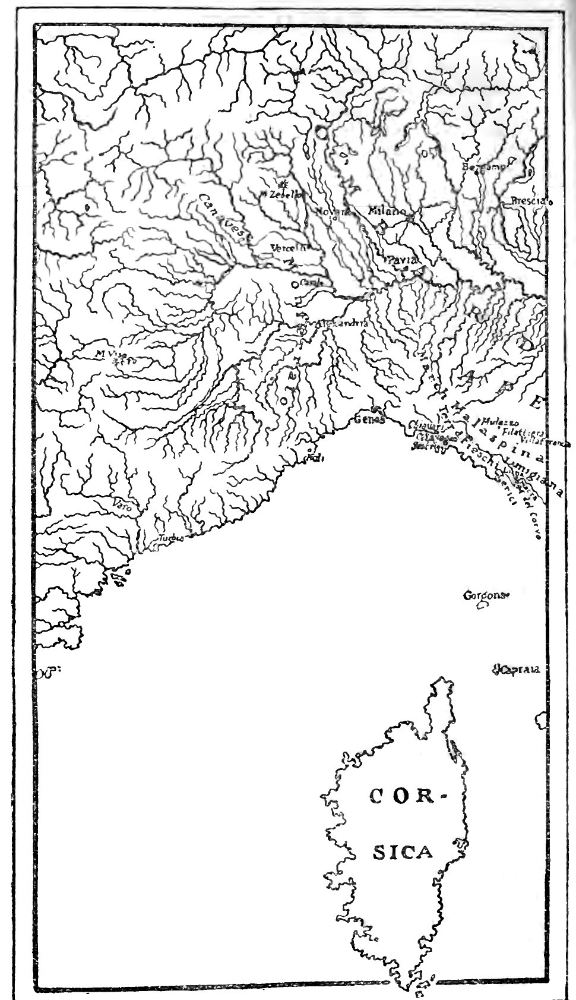
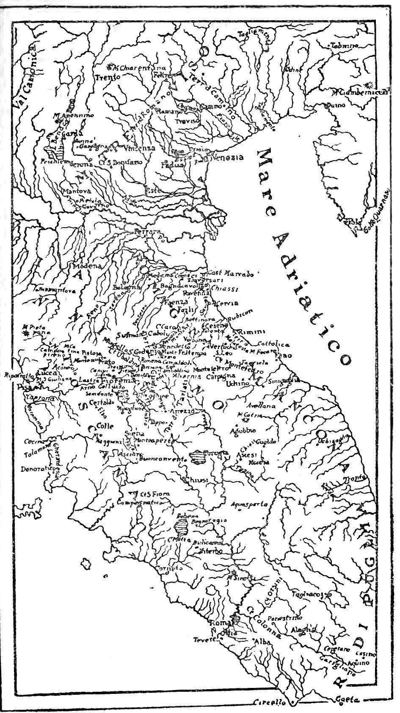

# Canto XXIX

<!-- p. 362 (374) -->

## Argument

AS she chants a blessing on those whose sins are forgiven, Matilda takes her way along one bank of the stream, while Dante keeps pace with her on the other; till the air, kindling with splendour and laden with sweet strains of song, fills Dante at once with the rapture of the Earthly Paradise and a sense of indignation against the act of sin which had bereft him and mankind of such delights —delights which all the waters of Helicon can scarce enable him to set in verse (1-42). Dante is pacing eastward, with the stream on his left hand flowing towards him, and on the other side of the stream a divine pageant approaches him; the details of which, together with words of song, are gradually disentangled by eye and ear. But when he turns to Virgil for enlightenment, his faithful teacher can no longer instruct him; these are things beyond the reach of his art (43-57). Seven lights leave the air painted with seven great rainbow streamers of colour stretching away as far as the eye can reach, throwing their

<!-- p. 363 (375) -->

glory over the heaven and glowing upon the stream. They represent the sevenfold gifts of the spirit, and beneath their glory tread four and twenty elders, crowned with lilies, representing the books of the Old Testament, chanting blessings on the Virgin (58-87). They are followed by the four Gospel beasts as described by Ezekiel and John, enclosing between them the triumphal chariot of the Church, resting on the two wheels of the contemplative and active life, drawn by a grifon whose twofold nature represents the two natures in one person of Christ (88-114). The sun itself has not so glorious a chariot. By the right wheel the three theological virtues dance, and by the left the four cardinal virtues (115-132). Then come two elders, then four, then one, crowned with roses, representing the remaining books of the New Testament (133-150). When Dante is just opposite the car, a peal of thunder arrests the whole procession (151-154).

<!-- p. 362 (374), text -->

Cantando come donna innamorata, <!-- label: Paradiso Terrestre -->\
&emsp;continuò col fin di sue parole:\
&emsp;“*Beati, quorum tecta sunt peccata.*”\
E come ninfe che si givan sole 4\
&emsp;per le salvatiche ombre, disiando\
&emsp;qual di veder, qual di fuggir lo sole,\
allor si mosse contra il fiume, andando 7\
&emsp;su per la riva, ed io pari di lei,\
&emsp;picciol passo con picciol seguitando.\
Non eran cento tra i suo' passi e i miei, 10\
&emsp;quando le ripe igualmente dier volta,\
&emsp;per modo ch' a levante mi rendei.

<!-- p. 363 (375), text -->

At the end of her words, singing like an enamoured lady, she continued: “*Beati, quorum tecta sunt peccata.*” <!-- label: Dante and Matilda -->

And, as nymphs who used to wend alone through the woodland shades, one desiring to see, another to flee the sun,

she then advanced against the stream, walking on the bank, and I abreast of her, little step answering with little step.

Not a hundred were her steps with mine, when both banks alike made a bend in such wise that I turned me to the east.

<!-- p. 364 (376) -->

Nè ancor fu così nostra via molta, 13 <!-- label: Paradiso Terrestre -->\
&emsp;quando la donna tutta a me si torse,\
&emsp;dicendo: “Frate mio, guarda, ed ascolta.”\
ed ecco un lustro subito trascorse 16\
&emsp;da tutte parti per la gran foresta,\
&emsp;tal che di balenar mi mise in forse.\
Ma perchè il balenar, come vien, resta, 19\
&emsp;e quel durando più e più splendeva,\
&emsp;nel mio pensar dicea: “Che cosa è questa?”\
Ed una melodia dolce correva 22\
&emsp;per l' aer luminoso; onde buon zelo\
&emsp;mi fe' riprender l' ardimento d' Eva,\
che, là dove ubbidia la terra e il cielo, 25\
&emsp;femmina sola, e pur testè formata,\
&emsp;non sofferse di star sotto alcun velo;\
sotto il qual, se devota fosse stata, 28\
&emsp;avrei quelle ineffabili delizie\
&emsp;sentite prima, e più lunga fiata.\
Mentr' io m' andava tra tante primizie 31\
&emsp;dell' eterno piacer, tutto sospeso,\
&emsp;e disioso ancora a più letizie,\
dinanzi a noi, tal quale un foco acceso, 34\
&emsp;ci si fe' l' aer sotto i verdi rami,\
&emsp;e il dolce suon per canto era già inteso.\
O sacrosante Vergini, se fami, 37\
&emsp;freddi o vigilie mai per voi soffersi,\
&emsp;cagion mi sprona, ch' io mercè ne chiami.\
Or convien ch' Elicona per me versi, 40\
&emsp;ed Urania m' aiuti col suo coro,\
&emsp;forti cose a pensar mettere in versi.\
Poco più oltre sette arbori d' oro 43\
&emsp;falsava nel parere il lungo tratto\
&emsp;del mezzo, ch' era ancor tra noi e loro;

<!-- p. 365 (377) -->

Nor yet was our way thus very far, when the lady turned her full round to me, saying, “Brother mine, look and hearken.” <!-- label: Approach of the Divine Pageant -->

And lo, a sudden brightness flooded on all sides the great forest, such that it set me in doubt if ’twere lightning.

But since lightning ceases even as it cometh, and that enduring, brighter and brighter shone, in my mind I said: “What thing is this?”

And a sweet melody ran through the luminous air; wherefore righteous zeal made me reprove Eve’s daring,

who, there where heaven and earth obeyed, a woman alone and but then formed, did not bear to remain under any veil,

under which, if she had been devout, I should have tasted those ineffable joys ere this, and for a longer time.

While I was going amid so many first-fruits of the eternal pleasance, all enrapt and still yearning for more joys,

the air in front of us under the green boughs, became even as a flaming fire to us, and the sweet sound was heard as a chant.

O holy, holy, Virgins, if e’er for you I have endured fastings, cold, or vigils, occasion spurs me to crave my reward. <!-- label: Invocation of the Muses -->

Now ’tis meet that Helicon for me stream forth and Urania aid me with her choir to set in verse things hard to conceive.

A little farther on, a delusive semblance of seven trees of gold was caused by the long space that was yet between us and them; <!-- label: The seven Candlesticks -->

<!-- p. 366 (378) -->

ma quando fui sì presso di lor fatto, 46 <!-- label: Paradiso Terrestre -->\
&emsp;che l' obbietto comun, che il senso inganna,\
&emsp;non perdea per distanza alcun suo atto,\
la virtù ch' a ragion discorso ammanna 49\
&emsp;sì com' elli eran candelabri apprese,\
&emsp;e nelle voci del cantare, “*Osanna*.”\
Di sopra fiammeggiava il bello arnese 52\
&emsp;più chiaro assai che luna per sereno\
&emsp;di mezza notte nel suo mezzo mese.\
Io mi rivolsi d' ammirazion pieno 55\
&emsp;al buon Virgilio, ed esso mi rispose\
&emsp;con vista carca di stupor non meno.\
Indi rendei l' aspetto all' alte cose, 58\
&emsp;che si moveano incontro a noi sì tardi,\
&emsp;che foran vinte da novelle spose.\
La donna mi sgridò: “Perchè pur ardi 61\
&emsp;sì nell' aspetto delle vive luci,\
&emsp;e ciò che vien di retro a lor non guardi?”\
Genti vid' io allor, com' a lor duci, 64\
&emsp;venire appresso, vestite di bianco:\
&emsp;e tal candor di qua giammai non fuci.\
L' acqua splendeva dal sinistro fianco, 67\
&emsp;e rendea a me la mia sinistra costa,\
&emsp;s' io riguardava in lei, come specchio anco.\
Quand' io dalla mia riva ebbi tal posta, 70\
&emsp;che solo il fiume mi facea distante,\
&emsp;per veder meglio ai passi diedi sosta,\
e vidi le fiammelle andar davante, 73\
&emsp;lasciando retro a sè l' aer dipinto,\
&emsp;e di tratti pennelli avean sembiante;\
sì che lì sopra rimanea distinto 76\
&emsp;di sette liste, tutte in quei colori,\
&emsp;onde fa l' arco il sole e Delia il cinto.

<!-- p. 367 (379) -->

but when I had drawn so nigh to them that the general similitude of things, which deceives the senses, lost not by distance any of its features, <!-- label: The Divine Pageant --> <!-- label: The seven Candlesticks -->

the faculty which prepares material for reason distinguished them as candlesticks, even as they were, and in the words of the chant, “Hosannah.”

Above, the fair pageant was flaming forth, brighter far than the moon in clear midnight sky in her mid month.

Full of wonderment I turned me to the good Virgil, and he answered me with a face not less charged with amazement.

Then I turned my countenance back to the sublime things, which moved towards us so slowly, that they would be vanquished by new-wedded brides.

The lady cried to me: “Wherefore art thou so ardent only for the vision of these bright lights, and heedest not that which comes after them?” <!-- label: The seven Pennants -->

Then I beheld people, clad in white, following as after their leaders; and whiteness so pure here never was with us.

Bright shone the water on my left flank, and reflected to me my left side, if I gazed therein, even as a mirror.

When I was so placed on my bank that the river alone kept me distant, to see better I gave halt to my steps,

and I saw the flames advance, leaving the air behind them painted, and of trailing pennants they had the semblance;

so that the air above remained streaked with seven bands, all in those colours whereof the sun makes his bow, and Delia her girdle.

<!-- p. 368 (380) -->

Questi ostendali retro eran maggiori 79 <!-- label: Paradiso Terrestre -->\
&emsp;che la mia vista; e, quanto al mio avviso,\
&emsp;dieci passi distavan quei di fuori.\
Sotto così bel ciel, com' io diviso, 82\
&emsp;ventiquattro seniori, a due a due,\
&emsp;coronati venian di fiordaliso.\
Tutti cantavan: “Benedetta tue 85\
&emsp;nelle figlie d' Adamo, e benedette\
&emsp;sieno in eterno le bellezze tue.”\
Poscia che i fiori e l' altre fresche erbette, 88\
&emsp;a rimpetto di me dall' altra sponda,\
&emsp;libere fur da quelle genti elette,\
sì come luce luce in ciel seconda, 91\
&emsp;vennero appresso lor quattro animali,\
&emsp;coronato ciascun di verde fronda.\
Ognuno era pennuto di sei ali, 94\
&emsp;le penne piene d' occhi; e gli occhi d' Argo,\
&emsp;se fosser vivi, sarebber cotali.\
A descriver lor forme più non spargo 97\
&emsp;rime, lettor; ch' altra spesa mi strigne\
&emsp;tanto, che a questa non posso esser largo.\
Ma leggi Ezechiel, che li dipigne 100\
&emsp;come li vide dalla fredda parte\
&emsp;venir con vento, con nube e con igne:\
e quali i troverai nelle sue carte, 103\
&emsp;tali eran quivi, salvo ch' alle penne\
&emsp;Giovanni è meco, e da lui si diparte.\
Lo spazio dentro a lor quattro contenne 106\
&emsp;un carro, in su due rote, trionfale,\
&emsp;ch' al collo d' un grifon tirato venne.\
Esso tendea in su l' una e l' altr' ale 109\
&emsp;tra la mezzana e le tre e tre liste,\
&emsp;sì ch' a nulla fendendo facea male.

<!-- p. 369 (381) -->

These banners streamed to the rearward far beyond my sight, and as I might judge, the outermost were ten paces apart. <!-- label: The Divine Pageant -->

Beneath so fair a sky, as I describe, came four and twenty elders, two by two, crowned with flower-de-luce. <!-- label: The four and twenty Elders -->

All were singing: “Blessed thou among the daughters of Adam, and blessed to all eternity be thy beauties.”

When the flowers and the other tender herbs opposite to me on the other bank, were free from those chosen people,

even as star follows star in the heavens, four creatures came after them, each one crowned with green leaves. <!-- label: The four Beasts -->

Everyone was plumed with six wings, the plumes full of eyes; and the eyes of Argus, were they living, would be such.

To describe their form, reader, I spill no more rhymes; for other charges bind me so, that herein I cannot be lavish.

But read Ezekiel who depicts them as he saw them coming from the cold region, with whirlwind, with cloud, and with fire;

and as thou shalt find them in his pages, such were they here, save that in the pinions John is with me, and differs from him.

The space within the four of them contained a car triumphal, upon two wheels, which came drawn at the neck of a grifon. <!-- label: The Chariot and the Grifon -->

And he stretched upwards one wing and the other, between the middle and the three and three bands, so that he did hurt to none by cleaving.

<!-- p. 370 (382) -->

Tanto salivan, che non eran viste; 112\
&emsp;le membra d' oro avea, quanto era uccello, <!-- label: Paradiso Terrestre -->\
&emsp;e bianche l' altre di vermiglio miste.\
Non che Roma di carro così bello 115\
&emsp;rallegrasse Affricano, o vero Augusto,\
&emsp;ma quel del sol saria pover con ello:\
quel del sol, che sviando fu combusto, 118\
&emsp;per l' orazion della Terra devota,\
&emsp;quando fu Giove arcanamente giusto.\
Tre donne in giro, dalla destra rota, 121\
&emsp;venian danzando: l' una tanto rossa\
&emsp;ch' a pena fora dentro al foco nota;\
l' altr' era come se le carni e l' ossa 124\
&emsp;fossero state di smeraldo fatte;\
&emsp;la terza parea neve testè mossa;\
ed or parevan dalla bianca tratte, 127\
&emsp;or dalla rossa, e dal canto di questa\
&emsp;l' altre togliean l' andare e tarde e ratte.\
Dalla sinistra quattro facean festa, 130\
&emsp;in porpora vestite, dietro al modo\
&emsp;d' una di lor, ch' avea tre occhi in testa.\
Appresso tutto il pertrattato nodo, 133\
&emsp;vidi due vecchi in abito dispari,\
&emsp;ma pari in atto, ed onesto e sodo:\
l' un si mostrava alcun de' famigliari 136\
&emsp;di quel sommo Ippocrate, che natura\
&emsp;agli animali fe' ch' ell' ha più cari;\
mostrava l' altro la contraria cura 139\
&emsp;con una spada lucida ed acuta,\
&emsp;tal che di qua dal rio mi fe' paura.\
Poi vidi quattro in umile paruta, 142\
&emsp;e di retro da tutti un veglio solo\
&emsp;venir, dormendo, con la faccia arguta.

<!-- p. 371 (383) -->

So high they rose that they were not seen; his members had he of gold, so far as he was a bird, and the others white mingled with vermilion. <!-- label: The Divine Pageant --> <!-- label: The Chariot and the Grifon -->

Not only Africanus, nor in sooth, Augustus, e’er rejoiced Rome with a car so fair, but that of the sun would be poor beside it,

that of the sun, which straying was consumed at the devout prayer of the earth, when Jove was mysteriously just.

Three ladies came dancing in a round by the right wheel; one so red that hardly would she be noted in the fire; <!-- label: The Theological Virtues -->

the next was as if her flesh and bone had been made of emerald; the third seemed new fallen snow;

and now seemed they led by the white, now by the red, and from the song of her the others took measure slow and quick.

By the left wheel, four clad in purple, made festival, following the lead of one of them, who had three eyes in her head. <!-- label: The Cardinal Virtues -->

After all the group described, I saw two aged men, unlike in raiment, but like in bearing, and venerable and grave: <!-- label: Luke and Paul -->

one showed him to be of the familiars of that highest Hippocrates whom nature made for the creatures she holds most dear;

the other showed the contrary care, with a sword glittering and sharp, such that on this side the stream it made me afeard.

Then saw I four of lowly semblance; and behind all, an old man solitary, coming in a trance, with visage keen. <!-- label: The rearguard -->

<!-- p. 372 (384) -->

E questi sette col primaio stuolo 145 <!-- label: Paradiso Terrestre -->\
&emsp;erano abituati; ma di gigli\
&emsp;dintorno al capo non facevan brolo,\
anzi di rose e d' altri fior vermigli: 148\
&emsp;giurato avria poco lontano aspetto,\
&emsp;che tutti ardesser di sopra dai cigli.\
E quando il carro a me fu a rimpetto, 151\
&emsp;un tuon s' udì; e quelle genti degne\
&emsp;parvero aver l' andar più interdetto,\
fermandos' ivi con le prime insegne. 154

<!-- p. 373 (385) -->

And these seven were arrayed as the first company; but of lilies around their heads no garland had they, <!-- label: The Divine Pageant halts -->

rather of roses and of other red flowers; one who viewed from short distance would have sworn that all were aflame above the eyes.

And when the car was opposite to me, a thunder clap was heard; and those worthy folk seemed to have their further march forbidden, and halted there with the first ensigns.

## Notes

<!-- p. 372 (384), notes -->

3\. “Blessed is he whose transgression is forgiven, whose sin is covered” (*Ps.* xxxii. 1).

27\. *Cf. Par.* xix. 48, *note*.

37-42. With this invocation to the Muses, *cf. Inf.* ii. 7-9, xxxii. 10, 11; *Purg.* i. 7-12; *Par.* i. 16, 17, ii. 9, xviii. 82-85.—Helicon was in reality a *mountain* in Boeotia, sacred to the Muses (from which *sprang* two fountains associated with them—Aganippe and Hippocrene). Urania—the Muse of astronomy and heavenly things.

43, 50. . . . “And being turned, I saw seven golden candlesticks . . . and the seven candlesticks . . are the seven churches” (*Rev.* i. 12, 20) . . . “and there were seven lamps burning before the throne, which are the seven Spirits of God” (*Rev.* iv. 5). Dante seems to have amalgamated these two passages for the purpose of his allegory. See, too, *Conv.* iv. 21: 100-112: “By the Theological way it is possible to say that, when the supreme Deity, that is God, sees his creature prepared to receive his good gift, so freely he imparts it to his creature in proportion as it is prepared to receive it. And because these gifts proceed from ineffable Love, and the Divine Love is appropriate to the Holy Spirit, therefore it is that they are called the gifts of the Holy Spirit, which, even as the Prophet Isaiah distinguishes them [*Vulgate*, xi. 2, 3], are seven, namely, Wisdom, Understanding, Counsel, Might, Knowledge, Pity and the Fear of the Lord.”

47\. The “proper” objects of the senses are those which are perceived by one sense only, as colour by the sight, sound by the hearing, savour by the taste; and in these, according to Aristotle, the senses cannot be deceived. “But the common objects are motion, rest, number, shape, size; for such things are not the proper objects of any sense, but are common to all,” and with respect to them the senses may err.

<!-- p. 373 (385), notes -->

49\. Probably the apprehensive faculty (see above, Canto xviii. 22, 23, *note*).—Mr Butler quotes *Hamlet*, i. 2: “A beast that wants discourse of reason.”

51\. “Hosanna,” the word with which the Jews hailed Jesus on his entry into Jerusalem (*Matt.* xxi. 9; *Mark* xi. 9; *John* xii. 13); here used by the twenty-four elders (*vv.* 64,83) preceding Christ’s chariot.

73-81. The seven bands or pennons trailing behind the candlesticks may be taken as the seven sacraments, or, perhaps better, as the working of the seven gifts. The colours of the rainbow and of the moon’s halo [Diana was born on the island of Delos] may have been suggested by *Rev.* iv. 3: “. . . and there was a rainbow about the throne in sight like unto an emerald.”—The paces of *v.* 81 probably indicate the ten commandments.

83, 84. These elders represent the twenty-four books of the Old Testament (the Pentateuch, the historical books and the three ascribed to Solomon counting as one each). Their voices and their white garments (emblematical of Faith; see *Hebrews* xi.) were referred to above in *vv.* 51, 64-66; and the whole conception of them was derived by Dante from *Rev.* iv. 4: “And round about the throne were four and twenty seats; and upon the seats I saw four and twenty elders sitting, clothed in white raiment; and they had on their heads crowns of gold.” The crowns of “flower-de-luce” suggest the purity of their faith and teaching.

<!-- p. 374 (386) -->

85, 86. “Blessed art thou among women”—the words of the angel and of Elizabeth to Mary (*Luke* i. 28, 42); here addressed either to Mary or to Beatrice.

92-105. See the description of these four beasts in *Ezek.* i. 4-14 and *Rev.* iv. 6-9. The faces of the man, lion, ox (or calf) and eagle represent Matthew, Mark, Luke, and John, respectively. The green leaves indicate Hope (“Lord Jesus Christ, which is our hope” 1 *Tim.* i. 1). According to Pietro di Dante the beast’s six wings are the six laws—natural, Mosaic, prophetic, evangelical, Apostolic and canonical; [in *Ezekiel* we read that “everyone had four wings;” while John says that “the four beasts had each of them six wings about him”]. The eyes indicate the knowledge of things past and future; [for Argus, with the hundred eyes, see below, Canto xxxii. 64-66, *note*].

107\. The two wheels have been explained in many different ways, the interpretation adopted in the *Argument* being one of the most satisfactory. According to others, they indicate the Old and the New Testament; the orders of the Dominicans and Franciscans, etc., etc.

109-111. “Looking to *Pss.* xxxvi. and lvii. and comparing verses 5 and 7 of the former with 1 and 11 of the latter, it seems that we must understand them [the wings] as denoting—the one mercy, the other truth or justice. Then their position with regard to the bands will be made intelligible by a reference to *Ps.* xxxvi. 10: ‘O stretch forth thy mercy over those that know thee [*scientia*], and thy justice over them that are of a right heart [*consilium*]’” (Butler).

113, 114. “My beloved is white and ruddy, the chiefest among ten thousand. His head is as the most fine gold . . .” (*Song of Solomon*, v. 10, 11).

<!-- p. 375 (387) -->

115, 116. The cars used by these and all victorious Roman generals in their “triumphs.”

117-120. For Phaëton see *Inf.* xvii. 106-108, *note*.

121-129. Faith (white), Hope (green) and Charity (red); *cf.* above, Canto viii. 89-93. The song of Charity leads the measure because, according to 1 *Cor.* xiii. 13: “. . . now abideth faith, hope, charity, these three; but the greatest of these is charity.”

130-132. For the moral or cardinal virtues, see above, Canto i. *vv.* 23-27, *note*.—Even in the *Convito* (iv. 17: 77-84), where Dante follows Aristotle (in whose system Prudence is an intellectual virtue), he feels constrained to say: “By many, Prudence, that is Wisdom, is well asserted to be a moral virtue; but Aristotle numbers that amongst the intellectual virtues, although it is the guide of the moral, and points out the way by which they are formed, and without which they cannot be.” The three eyes of Prudence have reference to the past, present and future, and the purple garb of the four virtues to the Empire (*cf.* below, Canto xxxii. *vv.* 58, 59, *note*).

134-141. These two are Luke (considered as author of the *Acts*) and Paul. Paul describes Luke (in *Col.* iv. 14) as “the beloved physician”; he is therefore regarded as a spiritual Hippocrates (this being the name of a famous Greek physician). The *animali* of *v.* 138 of course = mankind. The explanation of Paul’s sword is to be found either in his own words (*Eph.* vi. 17): “. . . the sword of the Spirit, which is the word of God”; or in the circumstance that he was always represented with one (in reference to his martyrdom by sword).

142\. James, Peter, John and Jude—the authors of the four canonical epistles.

143, 144. John, considered as author of *Revelation*—a series of visions, concerning things that must shortly come to pass: hence he is represented as *dormendo* and *con la faccia arguta*.

145-150. We saw that the *fiordaliso* (*v.* 84) was emblematical of the purity of the Old Testament; now the charity of the New Testament is indicated by the *rose* and *altri fior vermigli*.

<!-- p. 376 (388) -->

Canavese\
M. Zebello\
Bergamo\
Novara\
Milano\
Brescia\
Vercelli\
Pavia\
Casale\
Alexandria\
M. Viso\
Po\
Orba\
Varo\
Turbia\
Noli\
Genoa\
Chiavari\
Lavagna\
Sestri\
March. Malaspina\
Mulazzo\
Filattiera\
Villafranca\
Lunigiana\
Terr. d. Fieschi\
Luni\
Macra\
Lerici\
M. del Corvo\
Gorgona\
Capraia\
COR-\
SICA\
MAP OF UPPER AND

<!-- p. 377 (389) -->

Val Camonica\
Tagliamento\
Tolmino\
M. Charentana\
Trento\
Feltre\
Udine\
M. Ciambernice\
Duino\
Terr. d. Camino\
M. Apennino\
L. Benaco\
Garda\
Benno'\
Cassagna\
E. ter. d. Romano\
Romano\
Cagnano\
Camino\
Treviso\
Piave\
Sile\
Tagliamento\
Peschiera\
Verona\
Ct. S. Bonifacio\
Vicenza\
Oriago\
Brenta\
Padua\
Venezia\
Mantova\
Mincio\
Pietola\
Governolo\
Adige\
Este\
Ferrara\
Po\
Mare Adriatico\
Pola\
Golfo Quarnaro\
Modena\
Bismantova\
Medicina\
Cunio\
Cast. Marrado\
Traversari\
Bologna\
Bagnacavallo\
Ravenna\
Chiassi\
Reno\
Savena\
Santerno\
Faenza\
Forli\
Savio\
Cervia\
Rubicon\
Bettinora\
Cesena\
Polenta\
Rimini\
Clara\
Aquacheta\
Montone\
Valbona\
Terr. d. Malatesta\
Cattolica\
Susinana\
Caboli\
Vertuchio\
M. Focara\
Fano\
M. Pieta\
pana\
S. Benedetto\
Monte Falterona\
S. Leo\
Ct. Montefeltro\
Saggiola\
Mugello\
S. Godenzo\
Romena\
Camaldoli\
Montefeltro\
Carpigna\
Sinigaglia\
M. Ca\
Campo\
piceno\
Pistoja\
Ct. Ubaldini\
Porciano\
Campaldino\
Alvernia\
Uchino\
Aconeo\
Montemurlo\
Prato\
Trespiano\
Fiesole\
Lucca\
Ripafratta\
Campi\
Signa\
M. S. Giuliano\
Lastra\
Firenze\
Pisa\
Arno\
Galluzzo\
Caprona\
Semifonte\
Certaldo\
Agoglione\
Pratomagno\
Figghine\
Maremma\
Elsa\
Ambra\
Terr. di Tarlati\
Arezzo\
Tevere\
Avellana\
M. Catria\
Agubbio\
Urbisaglia\
Colle\
Toppo\
Cecina\
Tolamone\
Mo\
Raggioni\
Siena\
Montaperto\
Arbia\
Chiasi\
Gualdo\
Donoratico\
C. Gherardesca\
Asciano\
Buonconvento\
Perugia\
Ascesi\
Nocera\
Tupino\
Chiusi\
Tronto\
Ct. S. Fiora\
Campagnatico\
Aquasparta\
Bolsena\
Bagnoregio\
C. Malta\
Bulicame\
Viterbo\
Corneto\
M. Siratti\
Ct. Orsini\
Tagliacozzo\
Roma\
Ct. Colonna\
Penestrino\
Ostia\
Tevere\
Alba\
Alagna\
Ceperano\
Casino\
Garigliano\
Aquino\
Circello\
Gaeta\
R. DI PUGLIA\
CENTRAL ITALY IN DANTE’S TIME
